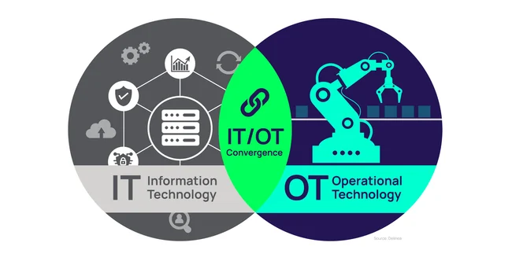
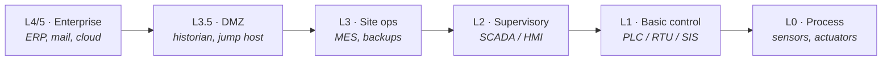
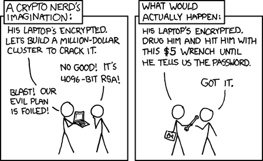
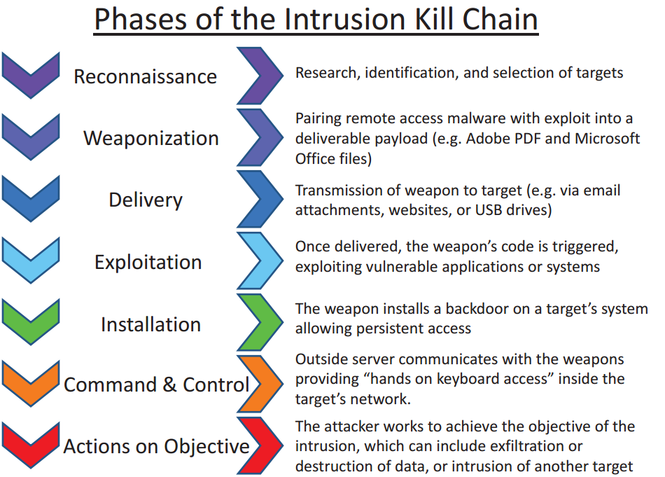
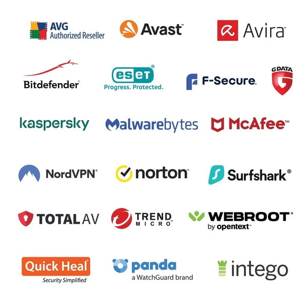
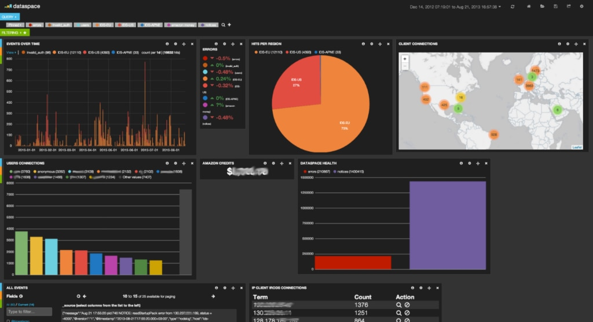
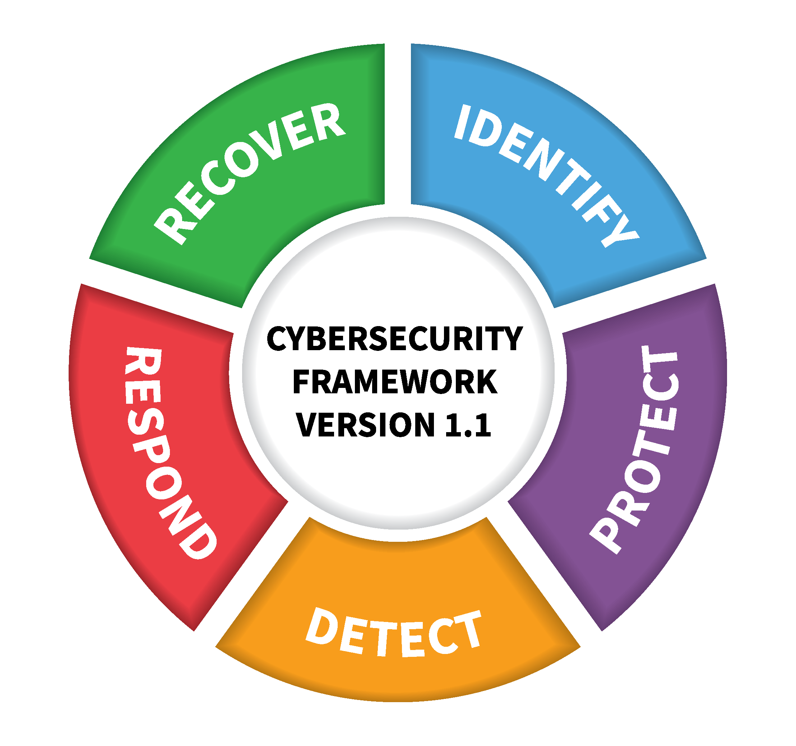

---
layout: cover
title: "Cyber-Physical Security"
subtitle: "ICS/OT security — when bits move the physical world"
---

::default::

<!--
Welcome. Extra lecture: what changes when the "hacked computer" is a centrifuge,
a pipeline, a pump station or a pager. Every concept gets a real incident.
-->

---
layout: section
---

# Context

---

# This lecture

<v-clicks>

1. Context: **IT vs OT** (Operational Technology)
2. Security principles
3. Threats & attacks
4. **Attacking the process** — ICS specifics
5. **Impact**: safety and availability
6. Defense

</v-clicks>

---
layout: two-cols
---

# IT vs OT

- **IT** — Information Technology: servers, cloud, business data
- **OT** — Operational Technology: PLCs, RTUs, sensors, actuators
- Two different worlds, historically **air-gapped**
- Latest trend: connecting CPS to the ☠️ **Internet** ☠️
  - **IIoT** — Industrial Internet of Things
- **IT/OT convergence** — one network, two sets of priorities

::right::

<em>IT/OT convergence</em>

---

# Security priorities: IT vs OT

|            | **IT security**                 | **OT / CPS security**                                 |
| ---------- | ------------------------------- | ----------------------------------------------------- |
| Priority   | **CIA** — confidentiality first | **Safety · Reliability · Resilience**                 |
| Control    | cryptography                    | **physical fail-safe** mechanisms                     |
| Worst case | data loss, downtime, fines      | **harm, environmental damage, disruption**            |
| Threat     | malware, phishing, insiders     | all of the above **+ the physical world as actuator** |

> In OT, availability is not a number in a SLA — it is a pump that must keep running.

---

# Cyber-physical systems (CPS)

- Software + network + **physical process**
- Examples: power grid, autonomous vehicles, **ICS/SCADA**, smart buildings, medical devices, manufacturing lines
- Security concerns are **CIA + safety, reliability, resilience**
- An attack is no longer only "data leaked" — it can **cause harm / disruption**

 

**"Cyber" is not the target — the physical process is.**

<!--
CPS: safety, reliability, and resilience in addition to CIA.
-->

---

# Anatomy of an ICS — the Purdue model

- **L2/L1/L0** are the OT world; **L4/L5** are ordinary IT
- **L3.5 DMZ** is an industry convention, **not** part of the original PERA model
- Every level is a target: steal credentials (IT), rewrite logic (PLC), lie to the operator (HMI)

---

# Why OT cannot simply be patched

- The plant runs **24/7** — a reboot is a production stop, sometimes a safety event
- Equipment lives **20–40 years**; firmware is frozen and **vendor-certified**
- Any change may require **re-certification / re-validation** of the process
- Old OS on HMIs (XP / 7); **no AV agent on a PLC** (real-time, no resources)
- One maintenance window per year, negotiated with production

<v-click>

**⇒ You cannot "just patch". You compensate:**

- Segmentation (**IEC 62443 zones & conduits**), allow-listing
- Passive monitoring, virtual patching (IPS), offline backups of logic
- A **tested** manual-operation mode

</v-click>

---

# Motivation — 25 years of ICS incidents

<v-clicks>

- **2000** — Maroochy Shire: 800,000 L of sewage into parks (insider)
- **2007** — Łódź: 14-year-old derails **4 trams, 12 injured** (TV remote)
- **2010** — **Stuxnet** ☢️: ≈1,000 centrifuges, ~1–2 years delay
- **2015** — Ukraine: **~225,000** customers dark, 3 utilities
- **2017** — **Triton**: malware that attacks the *safety* system
- **2021** — **Colonial Pipeline**: OT untouched, fuel shortages anyway
- **2023** — Unitronics PLCs: factory password `1111` on the Internet
- **2024** — Lebanon: exploding pagers, **≈37 dead, 3,000+ injured**
- **2025** — Jaguar Land Rover: **5 weeks** of production lost to IT ransomware

</v-clicks>

---
layout: section
---

# Security principles

---

# Security principles (recap)

- **Cyberattack** — unauthorized use of a digital system
- **CIA triad**
  - **C + I** → cryptography-based solutions
  - **A** → redundancy, fail-overs, good architectures
- **AAA model** — Authentication, Authorization, Accounting
- Data in **use / transit / at rest**
- Threats & attacks: network, malware, social engineering
- Security frameworks: **NIST CSF**, **IEC 62443**, ISO 27001/27019

---
layout: two-cols
---

# Attacker model & economics

- Don't protect **$1B** with encryption broken for **$1M**
- Don't spend **$10M** to protect **$1M**
- In CPS the attacker may simply **walk up to the device**
  - Default passwords, exposed debug ports, unlocked cabinets

::right::

<em>https://xkcd.com/538/</em>

---
layout: section
---

# Threats & attacks

---

# Threat classification

- **Source:** external / internal
- **Motivation:** hacktivism / economic / espionage / warfare …
- **Attack vectors**
  - Network access
  - Software/hardware vulnerabilities
  - Physical access
  - Supply chain
  - Social engineering
- **Impact**, lifecycle stages, target components (cyber-physical layers)
- **Advanced Persistent Threats (APT)**

---
layout: two-cols
---

# Types of attackers

From pranksters to professionals:

<v-clicks>

- Script kiddies
- Vulnerability brokers
- Cybercriminals
- Hacktivists / security researchers
- **National state adversaries**

</v-clicks>

::right::

<em>"Hackers", 1995 — the professional look</em>

---

# Vulnerabilities

- **Complexity ⇒ bugs** (software / hardware)!
- **Vulnerability** — a bug that introduces a security risk
  - Design/implementation flaws (buffer overflows, broken crypto …)
  - Configuration errors (weak ACLs, hardcoded passwords)
  - Supply chain (vulnerabilities in third-party components)
  - Human stupidity (social engineering)
- **Discovery ⇒ exploitation ⇒ patching**
- **Zero-days!**

---

# Common Weakness Enumeration

- MITRE's **CWE** (similar: OWASP Top 10)
- **CWE Top 25 — 2025** [1]:
  - CWE-79: Cross-site Scripting
  - CWE-89: SQL Injection
  - CWE-352: Cross-Site Request Forgery (CSRF)
  - CWE-862: Missing Authorization
  - CWE-787: Out-of-bounds Write
  - CWE-22: Path Traversal
- In ICS the interesting weaknesses are usually **misconfiguration**, not code

[cwe.mitre.org/top25](https://cwe.mitre.org/top25/)

---

# Common Vulnerabilities & Exposures

- Vulnerabilities in public / commercial software
- The **CVE Program** is sponsored by **CISA** (US DHS); **MITRE** operates it as the primary CNA / CNA-of-Last-Resort (~400+ CNAs worldwide)
  - Since 2025 governance is moving to the non-profit **CVE Foundation**
- Examples
  - **CVE-2010-2772** — Siemens Simatic WinCC / PCS 7 SCADA uses a **hard-coded password** — used by Stuxnet to move laterally
  - **CVE-2023-36028** — Microsoft PEAP Remote Code Execution (CVSS 9.8)
  - **CVE-2023-21608** — Adobe Acrobat use-after-free RCE
- CVEs often come with **Proofs of Concept** (exploit code)!

---

# Malware

<v-clicks>

- **Virus** — infects files, spreads when opening them
- **Worm** — automatically infects other systems!
- **Trojan horse** — user must explicitly open the file
- **Logic bomb** — e.g. from insiders / supply chain
- **Rootkits**
- **Remote Access Trojan / backdoors**
- **Ransomware** ₿💸🤑💰
- **Spyware** ;)
- **Adware** — the entire WWW :(

</v-clicks>

<v-click>

*Details in Lecture 6 — Malicious Software.*

</v-click>

---

# The intrusion kill chain

<em>Lockheed Martin, 2011 — https://en.wikipedia.org/wiki/File:Intrusion_Kill_Chain_-_v2.png</em>

---

# MITRE ATT&CK for ICS

- Adversary tactics for ICS — **12**, not the enterprise 14
- The familiar ones: *Initial Access · Execution · Persistence · Privilege Escalation · Evasion · Discovery · Lateral Movement · Collection · Command & Control*
- **The three that exist for process safety:**
  - **Inhibit Response Function** — blind or disable safety, protection, alarms, operator response
  - **Impair Process Control** — manipulate or damage the control loop
  - **Impact** — interrupt, manipulate or destroy the process
- Every incident in this lecture maps to one of them

[attack.mitre.org/matrices/ics](https://attack.mitre.org/matrices/ics/)

---

# Intrusion workflow — examples

| Phase                | In practice                                                       |
| -------------------- | ----------------------------------------------------------------- |
| Reconnaissance       | `nmap` (**never** on a live plant), distributed IP scanning, **Shodan** |
| Weaponization        | buy an exploit kit (worm + RAT + rootkit), or a plant-specific tool |
| Delivery             | phishing / social engineering, crafted packet or document, USB      |
| Exploitation         | **RCE** and/or privilege escalation                                |
| Installation         | rootkit + remote access trojan                                     |
| Command & Control    | covert + encrypted channel, on stolen servers / IoT equipment      |
| Actions on objective | ??? ⇒ **profit!**                                                  |

---
layout: section
---

# Attacking the process

---

# OT protocols were not built for security

- **Modbus/TCP** (TCP 502) — no authentication, no integrity, no encryption
- **DNP3** (IEEE 1815) — base protocol unauthenticated; **SAv2** added in IEEE 1815-2012, **SAv5** later
- **PROFINET** (RT/IRT, DCP), **EtherNet/IP + CIP** — unauthenticated by default
- Security came as **add-ons**: Modbus/TCP Security over TLS (2018), **CIP Security**, **DNP3 SA**, **IEC 62351** for power protocols
- **OPC UA** (IEC 62541) is the exception — X.509, Sign / SignAndEncrypt by design

These protocols were designed for determinism and field-bus efficiency on isolated networks. "No auth" is a feature, not a bug — until someone reaches the network.

---

# Attack surface in OT

- **Internet-exposed** HMIs / PLCs (Shodan says hello), UPnP port forwards
- **Default / shared credentials** (`1111`, `admin/admin`, one TeamViewer password)
- **Remote vendor access** — VPN, cellular modems, TeamViewer/AnyDesk
- **USB and removable media** (Stuxnet's delivery vehicle)
- **The IT→OT pivot** — office mail → engineering workstation → process
- **Supply chain** — vendor laptops, firmware updates, the devices themselves
- **No logging** — most field devices keep no audit trail at all

---

# Example: Maroochy Shire (2000)

- **Where:** sewage system, Queensland, Australia
- **Who:** Vitek Boden — ex-contractor, rejected for a job
- **How:** laptop + radio from his car → **unauthenticated** wireless pump controllers
- **Impact:** ~**800,000 L** of raw sewage into parks, canals, hotel grounds; dead fish, 46 spills, **300+ alarms ignored**
- **Caught:** by matching his car's movements with the alarm times → jailed (2001)

 

**Lesson:** no authentication on field comms + insider knowledge + nobody watching the alarms.
The first famous ICS attack had no zero-day — just command packets anyone could send.

<!--
The first famous ICS attack was an insider with a radio. No zero-day, no exploit,
just unauthenticated commands and no monitoring.
-->

---

# Example: Oldsmar water plant (2021)

- **Where:** water treatment plant, Oldsmar, Florida
- **How:** remote access via **TeamViewer** — one shared password for all users, unsupported version, **no firewall**
- **What:** intruder took the HMI twice, moved the **sodium hydroxide (lye)** setpoint from **100 ppm → 11,100 ppm**
- **Saved by:** an operator watching the screen saw the cursor move and set it back; no water reached the public
- **Never charged** — the suspect was never publicly identified

 

**Lesson:** remote access **is** an OT control. Shared passwords and unsupported remote tools are not "IT details".

---

# Example: Unitronics PLCs (2023)

- **Who:** *CyberAv3ngers* — IRGC-affiliated, anti-Israel hacktivism
- **How:** internet-exposed **Unitronics Vision** PLC/HMI, factory password **`1111`**, TCP 20256, no authentication
- **Impact:** pumps and booster stations at small US utilities (Aliquippa, PA) disabled, HMIs defaced → manual operation; **no loss of water service**
- **Also:** water utilities in Ireland
- **Response:** CISA advisory AA23-335A, exposure scans, password resets

 

**Lesson:** the default password **is** the vulnerability. Know what your field devices expose.

---

# Example: Industroyer (2016)

- **Where:** Pivnichna 330 kV substation, Ukraine, 17 Dec 2016
- **How:** malware modules that **speak the grid's own protocols** — IEC 60870-5-101/104, IEC 61850, OPC DA — straight to the RTUs
- **Impact:** ~⅕ of Kyiv without power (~200 MW) for about an hour; wiper alongside
- **2022 — Industroyer2:** IEC-104 with hard-coded breaker commands against a Ukrainian transmission operator; **blocked** by CERT-UA / ESET before it ran

 

<v-click>

**Lesson:** no memory-corruption exploit needed. **The protocol is the weapon** — and the payload is plant-specific, so it can be rebuilt for yours.

</v-click>

---

# Example: Stuxnet (2010)

- **Target:** Iranian uranium enrichment facility (Natanz)
- **Motivation:** sabotage by a national state adversary (*ahem*)
- **How**
  - **Infection** — Windows networks and USB devices
  - **Escalation** — **4 Windows zero-days** + hard-coded WinCC password (CVE-2010-2772)
  - **PLC compromise** — rewrote the centrifuge speed-control logic (S7-315)
  - **Deception** — recorded **21 s of normal telemetry** and replayed it to the HMI, while blocking alarms
- **Impact:** ≈**1,000 of ~8,700 IR-1** centrifuges replaced (ISIS estimate, range 1–2k); delay ≈**1–2 years** (contested)

---

# Example: Aurora (2007)

- **What:** a controlled test at **Idaho National Laboratory**, not an incident
- **How:** spoofed control traffic opened and closed a breaker **out of phase**
- **Result:** a 2.25 MW / 27-ton diesel generator fought itself, jumped off its mounts and threw debris — **destroyed**
- **No malware, no exploit** — just the right packets at the right moment

 

<v-click>

**Lesson:** the worst case in CPS is not data loss, it is **physical destruction**. And it needs no vulnerability at all.

</v-click>

---

# Example: Volt Typhoon (2023 →)

- **Who:** PRC state-sponsored, "living off the land"
- **How:** valid accounts + built-in tools, staged through compromised **SOHO routers**; no bespoke ICS malware
- **Where:** US critical infrastructure — energy, water, transport, communications
- **Impact so far: none publicly observed** — this is **pre-positioning**

 

<v-click>

**Lesson:** *capability ≠ effect*. Hunting for malware finds nothing here; you hunt **behaviour** and **identity**. Assume the network is already compromised.

</v-click>

---

# Example: Lebanon pagers (2024)

- **When:** 17–18 Sep 2024 — pagers, then walkie-talkies
- **How:** a front company (BAC Consulting, Budapest) supplied Gold Apollo-branded **AR-924** pagers with explosive and a detonator built into the battery compartment — **implanted during production**, not "intercepted in transit"
- **Impact:** ≈**37 killed, 3,000+ injured** across the two days

 

<v-click>

**Lesson:** the **supply chain is an attack surface** for every connected device. And physical access to a device is a cyber capability.

</v-click>

---
layout: section
---

# Impact

---

# Safety vs security

- A **Safety Instrumented System (SIS)** is an independent layer that drives the plant to a **safe state** (IEC 61511, SIL levels)
  - Safety PLCs, trips, interlocks, relief systems
- It was designed for **safety**, not for security
  - No authentication, no crypto, frozen firmware, almost never patched
  - Excluded from IT scanning and IT change management — "do not touch"
  - Engineering workstations are often **dual-homed** (IT + SIS network)
- **Fail-safe vs fail-secure**: safety wants to *stop* the process, security wants to *keep it available* — the goals can conflict
- Security controls must **never break the safety case** (no AV on the SIS, no aggressive scanning)

---

# Example: Triton (2017)

- **Where:** petrochemical plant, Saudi Arabia — **Triconex SIS**
- **How:** IT → **engineering workstation** → **TriStation** protocol (proprietary, unauthenticated, TCP 1502) → attempted to reprogram the safety controllers
- **Impact:** a safety trip shut the plant down; the apparent intent was to **disable the safety layer** — the risk was a catastrophic release
- **Note:** the attackers built custom tooling for one specific SIS model

 

<v-click>

**Lesson:** the safety layer is a target. An SIS that nobody monitors, patches or audits is the softest spot in the plant — and the most valuable one.

</v-click>

---

# Example: Ukraine grid (2015)

- **When:** 23 Dec 2015, ~15:35 — three distribution utilities, **~225,000** customers, outages 1–6 h
- **How:** BlackEnergy spear-phishing → IT → SCADA; attackers **drove the HMIs by hand** to open breakers
- **Also:** KillDisk wiper on the SCADA hosts, and a **telephony DoS** so customers could not report the outage
- **Recovery:** manual switching at substations, hours to days

 

<v-click>

**Lesson:** you do not need automation — an operator console is enough. And **blinding the response** (phones, logs, backups) is part of the attack.

</v-click>

---

# Example: Colonial Pipeline (2021)

- **When:** 7 May 2021 — DarkSide ransomware
- **How:** **legacy VPN account**, password reused and leaked, **no MFA**; ~100 GB exfiltrated
- **What was hit:** **IT / billing systems only — OT was never compromised**
- **Impact:** pipeline **shut down for ~6 days by decision** (unknown blast radius) → fuel shortages, panic buying; 75 BTC ≈ **$4.4M** paid; FBI recovered ≈**$2.3M**
- **Lesson:** in cyber-physical systems, **IT downtime becomes a physical supply-chain event**. MFA and account hygiene are OT controls.

 

**And:** the shutdown, not the malware, caused the shortage.

---

# Example: Norsk Hydro (2019)

- **When:** 19 Mar 2019 — LockerGoga ransomware
- **How:** Windows IT / Active Directory; no OT compromise reported
- **Impact:** ~22,000 machines affected; extrusion plants switched to **pen and paper** within hours; output partly maintained
- **Cost:** tens of millions USD (quarterly report), plus reputation
- **Lesson:** a **tested manual-operation mode** is a security control — and "IT-only" can still stop physical production.

---

# Example: Jaguar Land Rover (2025)

- **When:** 31 Aug 2025 — Qilin ransomware
- **How:** corporate IT; plants depend on ERP/MES for scheduling and parts
- **Impact:** production **halted ~5 weeks** (resumed 8 Oct 2025), supplier cash crisis, thousands of workers idled
- **Cost:** UK-wide economic impact modelled at ≈**£1.9bn** — reported as the costliest cyber incident in UK history (estimate, not audited)

 

<v-click>

**Lesson:** a modern factory **is** a cyber-physical system. If the planning systems die, the robots stop.

</v-click>

---
layout: section
---

# Defense

---
layout: two-cols
---

# Attack vs. defense

- Anti-viruses + firewalls?
- In general, it's **easier to destroy than to create** 😿
- Malware's toolbox (case study [1]):
  - **Persistence** — surviving reboots
  - **Stealth** — conceal in user / kernel space
  - **Communication** with Command & Control (C2) services
  - **Firewall evasion** — traffic concealment, data exfiltration

::right::

<em>≈ the whole AV industry</em>

---

# Defender's tasks

- **Penetration testing** — black box / white box / gray box
  - In OT: a testbed or digital twin first, **never** a production scan
- **TTPs** — Tactics, Techniques and Procedures
  - Campaign strategy (**tactics**), attack vectors (**techniques**), tools (**procedures**)
- **IoC / IoA** — indicator of compromise / of attack
  - Reactive: evidence of intrusion
  - Logs, **SIEM** alerts, correlation of system and threat data
- **ATT&CK for ICS** — the map you detect against

---

# Detection in OT

- **No agents** on controllers; no EDR on a PLC
- **No active scanning** — brittle devices, and a scan can trip a protection
- **Passive monitoring** via SPAN / TAP: protocol-aware baselining of Modbus, DNP3, S7, EtherNet/IP
- Sources: engineering workstations, HMIs, switches, firewalls, **physical access control**
- Correlate in a SIEM; map detections to **ATT&CK for ICS**
- Exercises: tabletop incident response where **safety comes before containment**

<em>telemetry, not an agent</em>

---

# Best practices — IT vs OT

| Area         | **IT**                        | **OT / ICS**                                              |
| ------------ | ----------------------------- | --------------------------------------------------------- |
| Patching     | weekly, automated             | maintenance window, vendor-certified, **compensate**       |
| Endpoint     | EDR / AV on every host        | **no agents on controllers** → allow-listing, app control  |
| Remote access| VPN + MFA                     | jump host + MFA, **no direct vendor access**               |
| Monitoring   | agents + SIEM                 | **passive taps**, protocol baselines, no active scans      |
| Backup       | images, tested restores       | PLC logic / HMI configs **+ tested manual mode**           |
| IR & testing | isolate, reimage, pentest     | **safety first**, then isolate; testbed, not production    |

---
layout: two-cols
class: cols-60-40
---

# NIST Cybersecurity Framework 2.0

- **Govern** — strategy, roles, policy, supply-chain risk *(new in CSF 2.0, 2024)*
- **Identify** — know your assets and risks
- **Protect** — pro-active protection
- **Detect** — detect attacks (IoC)
- **Respond** — incident response plan ready, analyze & mitigate
- **Recover** — you have backups, right?
  - Wipe clean anything the attacker touched — **but not on the PLC**

::right::

<em>CSF v1.1 graphic — v2.0 adds GOVERN</em>

---

# Assurance: Common Criteria & IEC 62443

- **Common Criteria** — certifies IT products
  - **Protection Profile (PP)**, **Security Target (ST)**, **EAL1–EAL7** (EAL1 = basic … EAL7 = formal)
  - Measures the *assurance process*, not "safe for a plant"
- **IEC 62443** — the ICS standard
  - **Zones & conduits**: group assets by security requirement, control every path between them
  - **Security Levels SL1–SL4**, component requirements (62443-4-2), certification schemes
- For energy utilities: **ISO/IEC 27019**; for OT programmes: **NIST SP 800-82 Rev.3 (2023)** — *Guide to OT Security*

---

# Human & organizational factors

- **Operator training & awareness**
  - The human is both the weakest link and the first line of defense
  - The Oldsmar attack was caught by an operator watching the screen
- **Policies and governance**
  - **NIST SP 800-82**, **IEC 62443**, plant change management
- **Supply chain security**
  - Hardware trust, firmware signing, **vendor access** management
- **Cross-disciplinary collaboration**
  - Process engineers, OT staff, IT staff and management coordinate
  - Security asks "who can reach it?"; safety asks "what happens if it stops?"

---

# Key takeaways

<v-clicks>

1. In CPS you protect **CIA + safety, reliability, resilience** — and availability usually wins.
2. The **air gap is gone**: IT is the road into OT. MFA, segmentation and monitoring are OT controls.
3. You **cannot patch a running plant** — you compensate: zones, allow-listing, passive detection, tested manual mode.
4. Attackers target **the process, and sometimes the safety layer** (Triton). The worst case is physical.
5. Assume compromise: hunt **behaviour** (ATT&CK for ICS), not just malware — and keep an offline, tested recovery path.

</v-clicks>

---

# References — incidents

<small>

- Łódź trams: [The Register, 11 Jan 2008](https://www.theregister.com/off-prem/2008/01/11/polish-teen-derails-tram-after-hacking-train-network/759671) · [The Telegraph](https://www.telegraph.co.uk/news/worldnews/1575293/Schoolboy-hacks-into-citys-tram-system.html)
- Maroochy Shire: [MITRE case study (2008)](https://www.mitre.org/sites/default/files/pdf/08_1145.pdf)
- Aurora: Idaho National Laboratory generator test, 2007
- Stuxnet: [ISIS, "Did Stuxnet Take Out 1,000 Centrifuges?" (2010)](https://isis-online.org/isis-reports/detail/did-stuxnet-take-out-1000-centrifuges-at-the-natanz-enrichment-plant/) · [Langner, "To Kill a Centrifuge" (2013)](https://www.langner.com/wp-content/uploads/2017/03/to-kill-a-centrifuge.pdf)
- Ukraine 2015: [CISA IR-ALERT-H-16-056-01](https://www.cisa.gov/news-events/ics-alerts/ir-alert-h-16-056-01) · SANS/E-ISAC analysis
- Industroyer: [ESET, 2017](https://www.welivesecurity.com/2017/06/12/industroyer-biggest-threat-industrial-control-systems-since-stuxnet/)
- Triton: [Mandiant, "TRITON — new ICS attack framework" (2017)](https://cloud.google.com/blog/topics/threat-intelligence/attackers-deploy-new-ics-attack-framework-triton)
- Oldsmar: [Dragos analysis](https://www.dragos.com/blog/recommendations-following-the-oldsmar-water-treatment-facility-cyber-attack/) · CISA/INL CyOTE case study
- Unitronics: [CISA AA23-335A](https://www.cisa.gov/news-events/cybersecurity-advisories/aa23-335a)
- Colonial Pipeline: [CISA AA21-131A](https://www.cisa.gov/news-events/cybersecurity-advisories/aa21-131a) · DOJ ransom seizure, 2021
- Volt Typhoon: [CISA AA24-038A](https://www.cisa.gov/news-events/cybersecurity-advisories/aa24-038a)
- Lebanon pagers: [Reuters, Sep 2024](https://www.reuters.com/world/middle-east/hezbollah-handed-out-pagers-hours-before-blasts-even-after-checks-2024-09-20/)
- JLR 2025: [Wikipedia — Jaguar Land Rover cyberattack](https://en.wikipedia.org/wiki/Jaguar_Land_Rover_cyberattack) (estimates are modelled)

</small>

---

# References — standards & further reading

<small>

- [MITRE ATT&CK for ICS](https://attack.mitre.org/matrices/ics/) · [CWE Top 25](https://cwe.mitre.org/top25/) · [CVE Program](https://www.cve.org/)
- [NIST Cybersecurity Framework 2.0](https://www.nist.gov/cyberframework) (CSWP 29, Feb 2024)
- [NIST SP 800-82 Rev.3 — Guide to OT Security](https://csrc.nist.gov/pubs/sp/800/82/r3/final) (2023)
- [ISA/IEC 62443 series](https://www.isa.org/standards-and-publications/isa-standards/isa-iec-62443-series-of-standards) · ISO/IEC 27019 (energy utilities)
- [Common Criteria](https://www.commoncriteriaportal.org/)
- [CISA ICS advisories](https://www.cisa.gov/news-events/ics-advisories)
- **Further reading:** *Industrial Network Security* — Eric D. Knapp & Joel Thomas Langill (Syngress)
- *Computer Security and the Internet: Tools and Jewels* — Paul C. van Oorschot (Springer, 2021)

</small>

---
layout: end
class: text-center
---

# Thank you

**Questions?**

*Next: bring one real ICS incident and map it to ATT&CK for ICS.*
