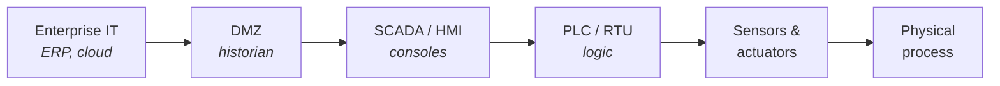
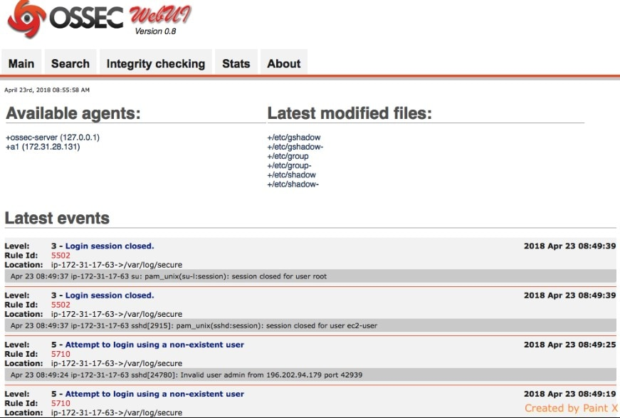

---
layout: cover
title: "Cyber-Physical Security"
subtitle: "IT vs OT — when bits move the physical world"
---

::default::

<!--
Welcome. Extra lecture: what changes when a "hacked computer" is a
centrifuge, a pipeline, a pacemaker or a pager.
-->

---
layout: section
---

# Context

---

# This lecture

<v-clicks>

1. Context: **IT vs OT** (Operational Technology)
2. Security principles
3. Threats & attacks
4. Security architectures
5. Human & organizational factors

</v-clicks>

---
layout: two-cols
---

# IT vs OT

- **IT** — Information Technology: servers, cloud, business data
- **OT** — Operational Technology: PLCs, RTUs, sensors, actuators
- Two different worlds, historically **air-gapped**
- Latest trend: connecting CPS to the ☠️ **Internet** ☠️
  - **IIoT** — Industrial Internet of Things
- **IT/OT convergence** — one network, two sets of priorities

::right::

<em>IT/OT convergence</em>

---

# Security priorities: IT vs OT

|             | **IT security**                 | **OT / CPS security**                                  |
| ----------- | ------------------------------- | ------------------------------------------------------ |
| Priority    | **CIA** — confidentiality first | **Safety · Reliability · Resilience**                  |
| Control     | cryptography                    | **physical fail-safe** mechanisms                      |
| Worst case  | data loss, downtime, fines      | **harm, environmental damage, disruption**             |
| Threat      | malware, phishing, insiders     | all of the above **+ the physical world as actuator**  |

> In OT, availability is not a number in a SLA — it is a pump that must keep running.

---

# Cyber-physical systems (CPS)

- Software + network + **physical process**
- Examples: power grid, autonomous vehicles, **ICS/SCADA**, smart buildings, medical devices
- Security concerns are **CIA + safety, reliability, resilience**
- An attack is no longer only "data leaked" — it can **cause harm / disruption**

 

**"Cyber" is not the target — the physical process is.**

<!--
CPS: safety, reliability, and resilience in addition to CIA.
Examples: power grid, autonomous vehicles, industrial control systems (ICS/SCADA),
smart buildings, medical devices.
-->

---

# Anatomy of an ICS / CPS

Each layer is a target: steal the credentials (IT), rewrite the logic (PLC), or lie to the operator (HMI).

---
layout: section
---

# Motivation

---

# Motivation — real incidents

<v-clicks>

- **2008** — Polish teen derails four city trams using a TV remote [1]
- **2010** — **Stuxnet** ☢️ — centrifuges destroyed from a USB stick [2]
- **2015** — Ukrainian power grid attack — 230k customers without power [3]
- **2021** — **Colonial Pipeline** ransomware — fuel shortages in the US [4]
- **2024** — Lebanon's exploding pagers ☠️ — supply chain as a weapon

</v-clicks>

---
layout: section
---

# Security principles

---

# Security principles (recap)

- **Cyberattack** — unauthorized use of a digital system
- **CIA triad**
  - **C + I** → cryptography-based solutions
  - **A** → redundancy, fail-overs, good architectures
- **AAA model** — Authentication, Authorization, Accounting
- Data in **use / transit / at rest**
- Threats & attacks: network, malware, social engineering
- Security frameworks (NIST, ISO 27001, IEC 62443)

---
layout: two-cols
---

# Attacker model & economics

- Don't protect **$1B** with encryption broken for **$1M**
- Don't spend **$10M** to protect **$1M**
- In CPS the attacker may simply **walk up to the device**
  - Default passwords, exposed debug ports, unlocked cabinets

::right::

<em>https://xkcd.com/538/</em>

---
layout: section
---

# Threats & attacks

---

# Threat classification

- **Source:** external / internal
- **Motivation:** hacktivism / economic / espionage / warfare …
- **Attack vectors**
  - Network access
  - Software/hardware vulnerabilities
  - Physical access
  - Supply chain
  - Social engineering
- **Impact**, lifecycle stages, target components (cyber-physical layers)
- **Advanced Persistent Threats (APT)**

---
layout: two-cols
---

# Types of attackers

From pranksters to professionals:

<v-clicks>

- Script kiddies
- Vulnerability brokers
- Cybercriminals
- Hacktivists / security researchers
- **National state adversaries**

</v-clicks>

::right::

<em>"Hackers", 1995 — the professional look</em>

---

# Vulnerabilities

- **Complexity ⇒ bugs** (software / hardware)!
- **Vulnerability** — a bug that introduces a security risk
  - Design/implementation flaws (buffer overflows, broken crypto …)
  - Configuration errors (weak ACLs, hardcoded passwords)
  - Supply chain (vulnerabilities in third-party components)
  - Human stupidity (social engineering)
- **Discovery ⇒ exploitation ⇒ patching**
- **Zero-days!**

---

# Common Weakness Enumeration

- MITRE's **CWE** (similar: OWASP Top 10)
- Top 2024 [1]:
  - CWE-79: Cross-site Scripting
  - CWE-787: Out-of-bounds Write
  - CWE-89: SQL Injection
  - CWE-352: Cross-Site Request Forgery (CSRF)
  - CWE-22: Path Traversal

[cwe.mitre.org/top25](https://cwe.mitre.org/top25/)

---

# Common Vulnerabilities & Exposures

- Vulnerabilities in public / commercial software
- CVEs are assigned by **Numbering Authorities (CNAs)**
  - MITRE: editor & primary CNA, funded by NSA
- Examples
  - **CVE-2010-2772** — Siemens Simatic WinCC / PCS 7 SCADA uses a **hard-coded password** (Stuxnet)
  - **CVE-2023-36028** — Microsoft PEAP Remote Code Execution
  - **CVE-2023-21608** — Adobe Acrobat use-after-free RCE
- CVEs often come with **Proofs of Concept** (exploit code)! [1]

---

# Malware

<v-clicks>

- **Virus** — infects files, spreads when opening them
- **Worm** — automatically infects other systems!
- **Trojan horse** — user must explicitly open the file
- **Logic bomb** — e.g. from insiders / supply chain
- **Rootkits**
- **Remote Access Trojan / backdoors**
- **Ransomware** ₿💸🤑💰
- **Spyware** ;)
- **Adware** — the entire WWW :(

</v-clicks>

<v-click>

*Details in Lecture 6 — Malicious Software.*

</v-click>

---

# The intrusion kill chain

<em>Source: https://en.wikipedia.org/wiki/File:Intrusion_Kill_Chain_-_v2.png</em>

---

# Intrusion workflow — examples

| Phase                | In practice                                                            |
| -------------------- | ---------------------------------------------------------------------- |
| Reconnaissance       | `nmap`, distributed IP scanning, **Shodan**                            |
| Weaponization        | buy an exploit kit (worm + RAT + rootkit)                              |
| Delivery             | phishing / social engineering, crafted network packet or document      |
| Exploitation         | **RCE** and/or privilege escalation                                    |
| Installation         | rootkit + remote access trojan                                         |
| Command & Control    | covert + encrypted channel, on stolen servers / IoT equipment          |
| Actions on objective | ??? ⇒ **profit!**                                                      |

---
layout: section
---

# Case studies

---

# Case study 1: Stuxnet (2010)

- **Target:** Iranian uranium enrichment facility
- **Motivation:** sabotage by a national state adversary (*ahem*)
- **Attack chain**
  - **Infection** — propagated through Windows networks and USB devices
  - **Privilege escalation** — used multiple zero-day exploits
  - **PLC compromise** — reprogrammed the centrifuge speed control logic
  - **Deception** — fake sensor feedback to the operators (HMI), hiding the damage
- Destroyed ~**1000 centrifuges**; set Iran's nuclear program back by years

---

# Case study 2: Colonial Pipeline (2021)

- **Target:** Colonial Pipeline, major U.S. fuel distributor
- **Motivation:** 💰 (cybercriminals / DarkSide group)
- **Attack chain**
  - **Initial access** — stolen VPN credentials (**no MFA**)
  - **Malware** — ransomware encrypted business systems
  - **Operational response** — pipeline shut down to prevent the spread
  - **Restoration** — decryption key after a ransom payment (~$4.4M)
- **Impact:** fuel shortages & price spikes across the U.S. 🦅🦅🦅

<!--
Lessons learned: IT/OT interdependence can cause physical disruption even without
compromising the OT network. Segmentation, incident response planning and MFA.
-->

---
layout: section
---

# Security architectures

---
layout: two-cols
---

# Attack vs. defense

- Anti-viruses + firewalls?
- In general, it's **easier to destroy than to create** 😿
- Malware's toolbox (case study [1]):
  - **Persistence** — surviving reboots
  - **Stealth** — conceal in user / kernel space
  - **Communication** with Command & Control (C2) services
  - **Firewall evasion** — traffic concealment, data exfiltration

::right::

<em>Is that all?</em>

---

# Defender's tasks

- **Penetration testing** — black box / white box / gray box
- **TTPs** — Tactics, Techniques and Procedures
  - Generalized statement of adversary behavior
  - Campaign strategy and approach (**tactics**)
  - Generalized attack vectors (**techniques**)
  - Specific intrusion tools and methods (**procedures**)
- **IoC / IoA** — indicator of compromise / of attack
  - Reactive: evidence of intrusion
  - Logs, **SIEM** (Security Information and Event Management) alerts
  - Correlation of system and threat data

---
layout: two-cols
class: cols-60-40
---

# Best security practices

- Use trustworthy vendors
- Keep software up to date, **apply patches**
- Design with **least privilege / zero trust**
- Layered architecture: **redundancy** and compartmentalization
- Log & analyze everything — SIEM: OSSIM, Splunk, ELK stack
- Perform regular **penetration tests**
- **Backups** (online/offline + remote + tested!)
- Enforce the authentication policy — strong passwords + **2FA**

::right::

---
layout: two-cols
---

# NIST Cybersecurity Framework

- **Identify** — plan, know your risks
- **Protect** — pro-active protection
- **Detect** — detect attacks (IoC)
- **Respond** — have an incident response plan ready, analyze & mitigate
- **Recover** — you have backups, right?
  - Wipe clean anything the attacker touched!

::right::

---

# Common Criteria

- International standard for **certifying security of IT products**
- Common framework for specifying, implementing and assessing security features
- **Protection Profile (PP)** — reusable set of security requirements for a class of products
- **Security Target (ST)** — the target product's own security requirements / claims
- **Evaluation Assurance Levels (EAL1–EAL7)**
  - EAL1 = basic · EAL7 = formal verification

[commoncriteriaportal.org](https://www.commoncriteriaportal.org/)

---

# Human & organizational factors

- **Operator training & awareness**
  - The human is both the weakest link and the first line of defense!
- **Policies and governance**
  - Standards: **NIST 800-82**, **IEC 62443**
- **Supply chain security**
  - Hardware trust, firmware signing, vendor management
- **Cross-disciplinary collaboration**
  - Engineers, IT staff and management coordination

---

# References

- [1] Tram hack: [theregister.com/2008/01/11/tram_hack](https://www.theregister.com/2008/01/11/tram_hack/)
- [2] Stuxnet: [spectrum.ieee.org/the-real-story-of-stuxnet](https://spectrum.ieee.org/the-real-story-of-stuxnet)
- [3] Ukraine grid: [CISA IR-ALERT-H-16-056-01](https://www.cisa.gov/news-events/ics-alerts/ir-alert-h-16-056-01)
- [4] Colonial Pipeline: [cisa.gov — attack on Colonial Pipeline](https://www.cisa.gov/news-events/news/attack-colonial-pipeline-what-weve-learned-what-weve-done-over-past-two-years)
- CWE Top 25: [cwe.mitre.org/top25](https://cwe.mitre.org/top25/)
- Kaspersky ICS CERT: [ics-cert.kaspersky.com](https://ics-cert.kaspersky.com/)

---
layout: end
class: text-center
---

# Thank you

**Further reading:**
*Industrial Network Security* — Eric D. Knapp & Joel Thomas Langill (Syngress)
*Computer Security and the Internet: Tools and Jewels* — Paul C. van Oorschot (Springer, 2021)
