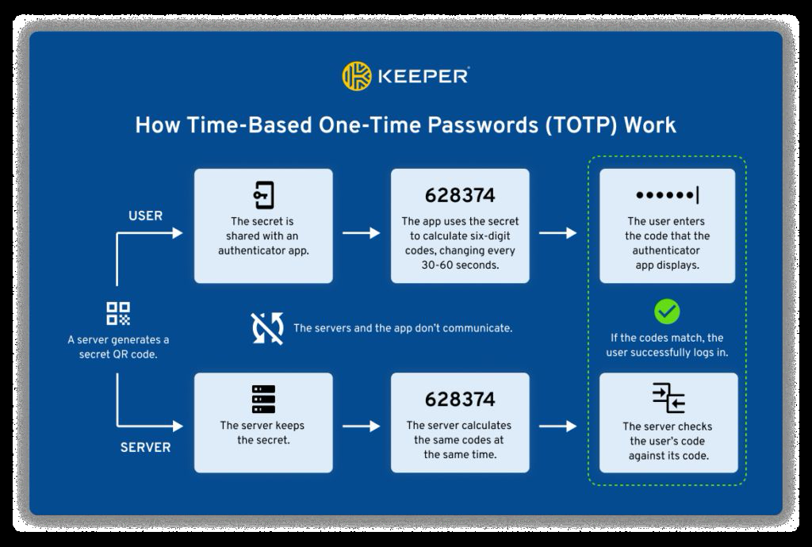

---
layout: cover
title: "Lecture 3: Authentication and Key Establishment"
subtitle: "Identification, authentication, factors, and key establishment protocols"
---

::default::

---

# This lecture

<v-clicks>

- **Authentication** — who we authenticate, factors, passwords, biometrics
- **Storing factors** — passwords, keys, password managers, FIDO2
- **One-time passwords** — OATH, HOTP & TOTP
- **Key establishment protocols** — symmetric, Diffie–Hellman, Kerberos
- **Digital identity & federation** — eID, NIST, SSO, SAML

</v-clicks>

---
layout: two-cols
---

# Who do we authenticate?

**Users** — the human operator

- Authentication is typically **slow**
- Local or over-the-wire
- **Authentication** only
  - the human brain cannot do proper cryptography just yet :((

::right::

<br>
<br>

**Principals** — the user's digital identity

- Authentication should be **fast and scalable**
- Mostly over-the-wire
- Goal: **Authentication & key establishment**

---

# AAA framework

<v-clicks>

1. **Identify** — map a real person/subject to a virtual account
2. **Authenticate** — request a proof from the account
3. **Authorize** — verify if the account can access a resource
4. **Accounting** — log/monitor what the account is doing

</v-clicks>

---
layout: two-cols
---

# ID vs authentication

- **Identification** — *one-from-many*
  - find your fingerprints in a police database
- **Authentication** — *one-to-one* relation
  - compare your (username-based) input to a previously saved one

::right::

# Enrollment vs. recognition

- **Enrollment** — can be slow, must be precise
- **Recognition** — must be quick

**Cooperation:**

- Identification: the user does **not** cooperate
- Authentication: the user **is** cooperative

---

# Just authentication?

- Is authentication alone enough?
  - **Yes** for local systems (e.g., console/GUI login)
  - Not very good for remote systems (e.g., telnet) → **session hijack**

- Key establishment only?
  - For **anonymity** purposes
  - Not very practical (e.g., plain D–H over a MitM channel)

<br>

> Usually: we do **both**!

---

# Attacks?

| Attack         | Short description                                                     |
| -------------- | --------------------------------------------------------------------- |
| replay         | reusing a previously captured message in a later protocol run         |
| reflection     | replaying a captured message to the originating party                 |
| relay          | forwarding a message in real time from a distinct protocol run        |
| interleaving   | weaving together messages from distinct concurrent protocols          |
| middle-person  | eavesdropping on communication                                        |
| bruteforce     | usable for short credentials (e.g., PIN codes without rate limiting)  |
| dictionary     | using a heuristically prioritized list in a guessing attack           |
| forward search | feeding guesses into a one-way function, seeking output matches       |
| pre-capture    | extracting client OTPs by social engineering, for later use           |

<style>
table { font-size: 0.8em; }
</style>

---
layout: section
---

# Authentication

---

# The concept

- The **authenticator** (e.g., server, website) asks you to prove that you are who you pretend to be, based on one or more pieces of evidence called **factors**.
- May also be **mutual**: the server also authenticates to the client!
- Evidence can be presented:
  - **directly** (e.g., password authentication)
  - **indirectly**, by using it in a cryptographic calculation (e.g., challenge-response protocol)
- Indirect proof uses cryptographic algorithms — also known as **implicit authentication**

---

# Types of factors

<v-clicks>

- Something you **know** (Knowledge Factor)
- Something you **have** (Possession Factor)
- Something you **are** (Inherence Factor)

</v-clicks>

<v-click>

Other authentication attributes that can be used:

- Somewhere you are
- Someone you know

</v-click>

---
layout: two-cols
---

# Chaining factors

- **N-factor authentication**
  - factors should be **different**
- **N-step verification**
  - can be the **same** factor

::right::

<div class="flex justify-center items-center gap-2">


</div>

<div style="text-align: center">

[rublon.com — 2FA vs 2SV](https://rublon.com/blog/2fa-2sv-difference/)

</div>

<style>
.slidev-layout.two-columns { grid-template-columns: 45% 55%; }
</style>

---

# Something you know — Passwords

- Require people to remember them
  - used on multiple occasions
- Shoulder surfing / key logging
- Can be enhanced through policies
  - e.g., minimum **20 characters**

<div class="flex flex-col items-center" style="text-align: center; margin-top: 1em;">


</div>

---

# Most common passwords

- Top lists change very little year to year

<div class="flex flex-col items-center" style="text-align: center;">


</div>

---
layout: two-cols
---

# Password strength

> THROUGH 20 YEARS OF EFFORT, WE'VE SUCCESSFULLY TRAINED EVERYONE TO USE PASSWORDS THAT ARE HARD FOR HUMANS TO REMEMBER, BUT EASY FOR COMPUTERS TO GUESS.
>
> — [xkcd.com/936](https://xkcd.com/936/)

::right::

<div class="flex flex-col items-center" style="text-align: center;">


<a style="font-style: italic; font-size: 9pt;" href="https://xkcd.com/936/">xkcd.com/936</a>
</div>
<style>
.slidev-layout.two-columns {
	grid-template-columns: 45% 55%;
	.col-right img { display: inline; max-width: 90%; }
}
</style>

---

# Something you have

- Phone number / email 🪦
- Public / private key
- Symmetric key

<div class="mt-8 p-4 rounded border-l-4 border-green-600 bg-green-50 text-black">

**Best:** on a **hardware token** (write+execute-only private keys)

</div>

---
layout: two-cols
---

# Something you are

- Fingerprint
- Facial recognition
- Speech recognition
- Odour recognition
- Gait

::right::

# Biometric properties

- **Not 100% accurate**
  - because of sensors
  - because of changes in biometrics
- **Not 100% applicable**
  - e.g., fingerprints w/o hands
- Typically **hard to profile, easy to collect/verify**
  - e.g., scanning a face multiple times to enable FaceID on Apple

---
layout: section
---

# Storing factors

---

# Storing passwords

- **Plain text** 💀 - just don't
- `Hash(Password)`
- `Hash(Salt + Password)`
- `Hash(Salt + Password + Pepper)`
- `Repeat(Hash(Salt + Password + Pepper))`

---

# Password hashing & salting

- Standard hashes (SHA-256, SHA-3) are designed to be **fast**.
- If a hash is fast, attackers can guess billions of passwords per second using GPUs (brute force / rainbow tables).
- **Passwords need SLOW hashes** (Key Derivation Functions):
  - **Argon2** (modern standard), **bcrypt**, **PBKDF2**.
- **The salt:**
  - a random string added to the password *before* hashing: `Hash(Salt + Password)`
  - stored in plaintext next to the username
  - defeats rainbow tables and ensures two users with the same password have completely different hashes

---
layout: two-cols
---

# Attacks on stored passwords

**Offline**

- Brute force
- Dictionary (better: crunch wordlists)
- Rainbow tables

**Offline defences**

- Multiple round hashing
- RAM explosion

::right::

<br> <br>

**Online**

- Brute force
- Dictionary (better: crunch wordlists)

**Online defences**

- Rate-limit
- Lock out after N failed attempts
- Some cryptographic hardware devices are _online_ (stateful) in this regard!

---

# Storing keys

- Which factor is a random key?
- **Software-protected** memory / files
  - `chmod 600`
  - e.g., SSH keys, WebAuthn 'passkeys'
  - → weakest "something you have" factor!
- **Hardware** security tokens / **TPM**
  - key becomes a stronger "something you have"
  - requires online attacks → rate limiting, auto-wipe after 10 failures etc.

---
layout: two-cols
---

# Password managers

- *One ring to rule them all*
- Master key can be derived from a password
- Use multiple factors (e.g., tokens)!
- Database storage: local or cloud
- Encourage a **different password per service**: password generators, browser integration
- **Back it up** / don't forget or lose the keys!

::right::

<div class="flex flex-col items-center" style="text-align: center; margin-top: 5em;">


</div>
<style>
.slidev-layout.two-columns {
	grid-template-columns: 50% 50%;
	.col-right img { display: inline; max-width: 100%; }
}
</style>

---

# FIDO2 / passkeys / passwordless

- Previously: **U2F** — Universal Second Factor
- **FIDO2 WebAuthn** → asymmetric crypto!
- Give a **unique public key** to the web server (no reuse!)
- Use the private key **instead of a password**
- Private key must be stored on **secure hardware**!
- FIDO-certified security keys: Yubikey, SoloKey, NitroKey ;)
- Hardware validates the 2nd factor:
  - something you **know** (PIN — rate limited!)
  - something you **are** (fingerprint, FaceID etc.)
- **Must always enroll backup keys!**

---
layout: section
---

# One-time passwords

---
layout: two-cols
---

# OATH one-time pass standards

- **OATH**: **HOTP** & **TOTP**
- **TOTP**: [RFC 6238](https://datatracker.ietf.org/doc/html/rfc6238)

```
TOTP = HOTP(K, T)
T = floor(unix_timestamp / X)
```

- `X` — the time step (e.g., 60 s)
- **Private key shared** between user and auth server

::right::

<div class="flex flex-col items-center" style="text-align: center;">



</div>
<style>
.slidev-layout.two-columns {
	grid-template-columns: 48% 52%;
	.col-right img { display: inline; max-width: 100%; }
}
</style>

---

# Password-based key derivation

- Problem: passwords have **arbitrary lengths**
- Cryptographic algorithms require keys of **specific lengths**
  - e.g., AES-256 requires a 256-bit key → 32 bytes
- Solution: **Key Derivation Functions (KDF)**:

```
DerivedKey = KDF(password, salt, iterations)
```

- Algorithms: **PBKDF2**, **Argon2**
- e.g., per-domain derived passwords: [spectre.app](http://spectre.app)

---
layout: section
---

# Key establishment protocols

---

# Authentication protocols

- **Symmetric** (shared secret)
  - how to ask for a known secret over insecure channels?
  - hash the password? → **challenge-response**
- **Asymmetric** protocols
  - **Diffie–Hellman**!
  - **forward secrecy**

---

# Burrows–Abadi–Needham notation

- $ID_A$, $ID_B$, $ID_S$ — a unique identifier for A, B and S (Trusted Server)
- $k_{A,B}$ — a key shared between A and B
- $\{ID_A\}_{K_A}$ — encryption/signature of $ID_A$ under the key of A
- $A \to B : \{ID_A\}_{k_{A,B}}$ — A sends to B the message $ID_A$ encrypted by the shared key of A and B

---

# Symmetric authentication

- Given A and B who trust **S**, A and B should be able to create a shared key $k_{A,B}$ for secret communication
- $k_{A,B}$ should be known only to A and B (and possibly to S)
- A and B should know that $k_{A,B}$ is **newly generated**
- A and B should **authenticate** each other

<br>

> Why? **Enterprise authentication!**

---

# Symmetric protocol (1) — naive

```
1. A -> S : ID_A, ID_B                (I am A, give me key for B)
2. S -> A : k_A,B                     (key transferred in unencrypted form)
3. A -> B : ID_A, k_A,B               (key transferred in unencrypted form)
```

**Possible attacks:**

- An attacker with MitM capabilities gets $k_{A,B}$

---

# Symmetric protocol (2) — encrypted at the server

```
1. A -> S : ID_A, ID_B
2. S -> A : {k_A,B} k_A,S , {k_A,B} k_B,S    (encrypted with A,S shared secret)
3. A -> B : ID_A, {k_A,B} k_B,S              (encrypted with B,S shared secret)
```

**Possible attack — reflection:**

```
3'. A -> T : ID_A, {k_A,B} k_B,S
4'. T -> B : ID_T, {k_A,B} k_B,S
```

(Trudy replaces the identity A presented to B!)

---

# Symmetric protocol (2') — Trudy in the middle

```
1. A -> T : ID_A, ID_B
2. T -> S : ID_A, ID_T
3. S -> T : {k_A,T} k_A,S , {k_A,T} k_T,S
4. T -> A : {k_A,T} k_A,S , {k_A,T} k_T,S
5. A -> T : ID_A, {k_A,T} k_T,S
```

Trudy in the middle …

<!--
Every message looks legitimate because each one is sealed by S.
-->

---

# Symmetric protocol (3) — include IDs

```
1. A -> S : ID_A, ID_B
2. S -> A : {k_A,B, ID_B} k_A,S , {k_A,B, ID_A} k_B,S
3. A -> B : ID_A, {k_A,B, ID_A} k_B,S
```

**Possible attack — replay of an old (broken) key:**

```
1. A -> T : ID_A, ID_B
2. T -> A : {k'_A,B, ID_B} k_A,S , {k'_A,B, ID_A} k_B,S
3. A -> B : ID_A, {k_A,B, ID_A} k_B,S
```

---

# Symmetric protocol (4) — Needham–Schroeder (1978)

```
1. A -> S : ID_A, ID_B, N_A
2. S -> A : {k_A,B, ID_B, N_A, {k_A,B, ID_A} k_B,S} k_A,S
3. A -> B : {k_A,B, ID_A} k_B,S
4. B -> A : {N_B} k_A,B
5. A -> B : {N_B - 1} k_A,B
```

**Possible attack — Denning–Sacco replay of an old broken key:**

```
1. T -> B : {k'_A,B, ID_A} k_B,S
2. B -> T : {N_B} k'_A,B
3. T -> B : {N_B - 1} k'_A,B
```

---

# Symmetric protocol (5) — final form

```
1. B -> A : ID_B, N_B
2. A -> S : ID_A, ID_B, N_A, N_B
3. S -> A : {k_A,B, ID_B, N_A} k_A,S ,
            {k_A,B, ID_A, N_B} k_B,S
4. A -> B : {k_A,B, ID_A, N_B} k_B,S
```

**Possible attacks:**

- **None of the above** (from our list)

---

# Notes on protocols — Abadi & Needham [2]

- If the identity of a principal is essential to the meaning of a message, mention the principal's name **explicitly** in the message
- Be **clear about why** encryption is being done
- When a principal signs material that has already been encrypted, it should **not** be inferred that the principal knows the content of the message
- Be clear about what **properties** you are assuming about **nonces**
- If **timestamps** are used as freshness guarantees, the difference between local clocks at various machines must be **much less** than the allowable age of a message

---
layout: two-cols
---

# Plain Diffie–Hellman

```
A and B (think they) talk:
1. A -> B : DH_A                     (g^a mod p)
2. B -> A : DH_B, {ID_B} k_A,B       (both obtain the same k_A,B)
3. A -> B : {ID_A} k_A,B
```

::right::

# Classic MitM attack

```
Attacker Trudy:
1. A -> T : DH_A
2. T -> B : DH_T
3. B -> T : DH_B, {ID_B} k_T,B
4. T -> B : {ID_A} k_T,B
5. T -> A : DH_T, {ID_B} k_A,T
... etc.
```

<!--
Trudy terminates two separate DH exchanges and relays identities.
-->

---

# Protocol for asymmetric encryption (STS simplified)

```
1. A -> B : DH_A
2. B -> A : DH_B, {{DH_A, DH_B} pubA} k_A,B
3. A -> B : {{DH_A, DH_B} pubB} k_A,B
```

- We assume each party has private/public keys
- Public keys are known to all entities
- The problem is **how to distribute public keys**
  - **Public Key Infrastructure**
  - **Pretty Good Privacy**

---
layout: section
---

# Federated / SSO

---
layout: two-cols
---

# European Digital Identity

- Digital identity for **all Europeans**
- Every EU citizen and resident will be able to use a **personal digital wallet**
- Usable for **online and offline** public and private services across the EU
- Key principles: user control of what data is shared, and how

> "One that we trust and that any citizen can use anywhere in Europe to do anything from paying your taxes to renting a bicycle."
>
> — Ursula von der Leyen, State of the Union, 16 September 2020

::right::

<div class="flex flex-col items-center" style="text-align: center;">


<a style="font-style: italic; font-size: 9pt;"
	href="https://commission.europa.eu/strategy-and-policy/priorities-2019-2024/europe-fit-digital-age/european-digital-identity_en">commission.europa.eu</a>
</div>
<style>
.slidev-layout.two-columns { grid-template-columns: 58% 42%; }
.slidev-layout.two-columns .col-right img { display: inline; max-width: 100%; }
</style>

---
layout: two-cols
---

# NIST SP 800-63 digital identity guidelines

| Document     | Title |
| ------------ | ----- |
| SP 800-63-3  | [Digital Identity Guidelines](https://doi.org/10.6028/NIST.SP.800-63-3) |
| SP 800-63A   | [Enrollment and Identity Proofing](https://doi.org/10.6028/NIST.SP.800-63a) |
| SP 800-63B   | [Authentication and Lifecycle Management](https://doi.org/10.6028/NIST.SP.800-63b) |
| SP 800-63C   | [Federation and Assertions](https://doi.org/10.6028/NIST.SP.800-63c) |

::right::

<div class="flex flex-col items-center" style="text-align: center;">


<a style="font-style: italic; font-size: 9pt;"
	href="https://pages.nist.gov/800-63-3/">pages.nist.gov/800-63-3/</a>
</div>
<style>
.slidev-layout.two-columns { grid-template-columns: 55% 45%; }
.slidev-layout.two-columns .col-right img { display: inline; max-width: 100%; }
</style>

---

# Single Sign-On (SSO)

- **Password managers**
- **Enterprise-level SSO**
  - same-domain authentication
  - Kerberos, RADIUS with LDAP / Active Directory databases
- **Federated identity**
  - cross-domain authentication
  - based on **assertions** containing the result of authentication
  - factors **cannot** be shared between domains
  - RADIUS, **OpenID Connect**, **SAML** etc.

---

# Kerberos

- Developed by **MIT in 1983**
- Was **banned for export** till 2000 by the US
- Used for key establishment between multiple entities
- The Kerberos server is **trusted** by all entities
- Assumes existing pre-shared keys between entities and the Kerberos server
- Can be adapted to multiple symmetric encryption algorithms
- **Kerberos v5 uses AES**

---

# Kerberos — assumptions

- The adversary can **compromise the network**, not the host (e.g., secrets, keys)
- Based on the fixed **Needham–Schroeder** protocol
- Uses **tickets** to create a legitimate session key

---

# Kerberos (v1) protocol

```
1. A -> KAS : ID_A, ID_B, N_A
2. KAS -> A : {k_A,B, ID_B, T_KAS, N_A} k_A,KAS,
              {k_A,B, ID_A, T_S} k_B,KAS
3. A -> B : {k_A,B, ID_A, T_KAS} k_B,KAS, {ID_A, T_A} k_A,B
```

- $k_{A,B}$: session key between A and B
- $\{k_{A,B}, ID_A, T_{KAS}\}_{k_{B,KAS}}$: **ticket** for A to use when contacting B
- $T_A > T_{KAS}$: B validates the time window by comparing $T_A$ and $T_{KAS}$

<!--
KAS = Kerberos Authentication Server; T_S = Timestamp server.
-->

---

# Kerberos (v2)

- Usually the shared key between A and KAS is **derived from a user input/password**
- The previous version requires **credentials input every connection** to a new application server (B)
- **Ticket granting separate from user authentication:**
  - user authenticates using passwords with KAS and receives a session key for the **Ticket Granting Service**
  - entities use that session key to request tickets for multiple applications

---
layout: two-cols
---

# SAML

- **Security Assertion Markup Language** — XML-based federation format
- Carries authentication results as **assertions** between domains

::right::
<div class="flex flex-col items-center" style="text-align: center;">


</div>
<style>
.slidev-layout.two-columns {
	grid-template-columns: 32% 68%;
	.col-right img { display: inline; max-width: 100%; }
}
</style>

---

# RADIUS / EAP

- **RADIUS** — central authentication, authorization and accounting protocol
- **EAP** — Extensible Authentication Protocol
  - wraps authentication methods (e.g., EAP-TLS, EAP-PEAP)
  - common in Wi-Fi (802.1X) and remote access

---

# References

- [1] *Protocols for Authentication and Key Establishment* — Colin Boyd, Anish Mathuria, Douglas Stebila (2020)
- [2] Abadi, M., Needham, R.: *Prudent engineering practice for cryptographic protocols*, IEEE Symposium on Research in Security and Privacy (1994)
- [3] *Computer Security and the Internet: Tools and Jewels* — Paul C. van Oorschot (Springer, 2021) · [people.scs.carleton.ca/~paulv/toolsjewels.html](https://people.scs.carleton.ca/~paulv/toolsjewels.html)
- [rublon.com — 2FA vs 2SV](https://rublon.com/blog/2fa-2sv-difference/)
- [nordpass.com — most common passwords](https://nordpass.com/most-common-passwords-list/)
- [xkcd.com/936](https://xkcd.com/936/)
- [NIST SP 800-63 Digital Identity Guidelines](https://pages.nist.gov/800-63-3/)

---
class: text-center
---

# Thank you

**Further reading:**
*Computer Security and the Internet: Tools and Jewels* — Paul C. van Oorschot (Springer, 2021)

[people.scs.carleton.ca/~paulv/toolsjewels.html](https://people.scs.carleton.ca/~paulv/toolsjewels.html)
