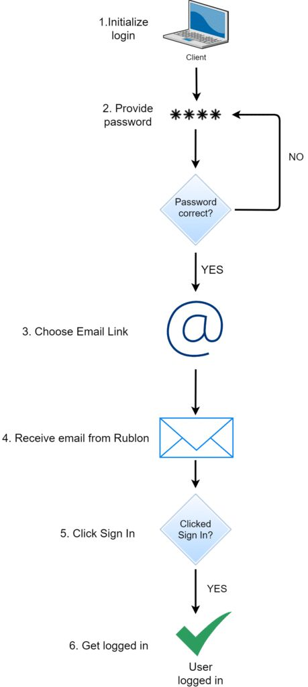
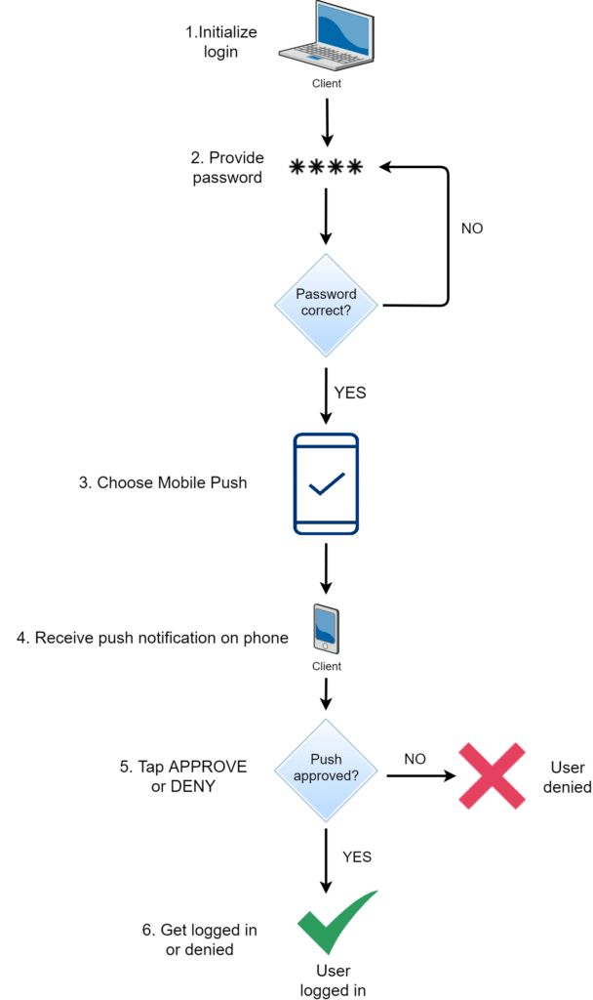
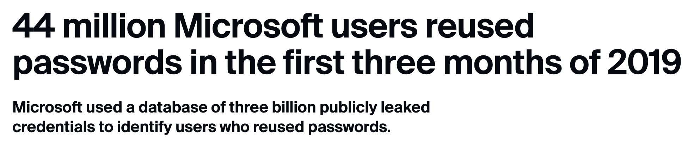
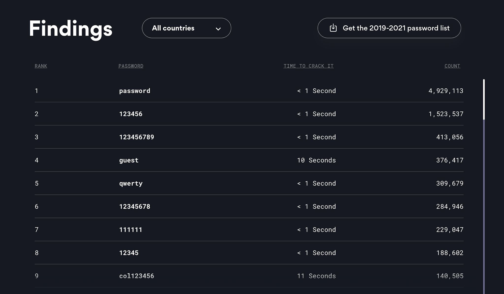
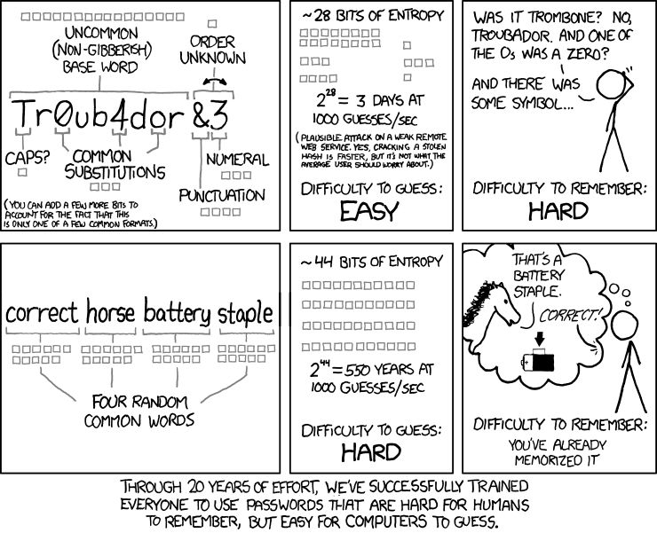
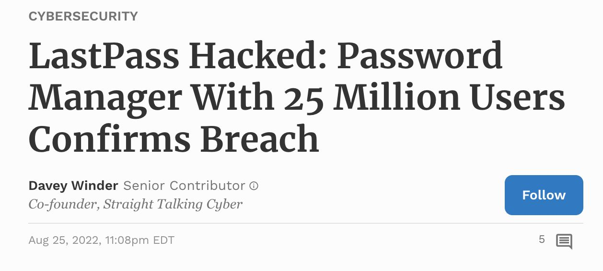
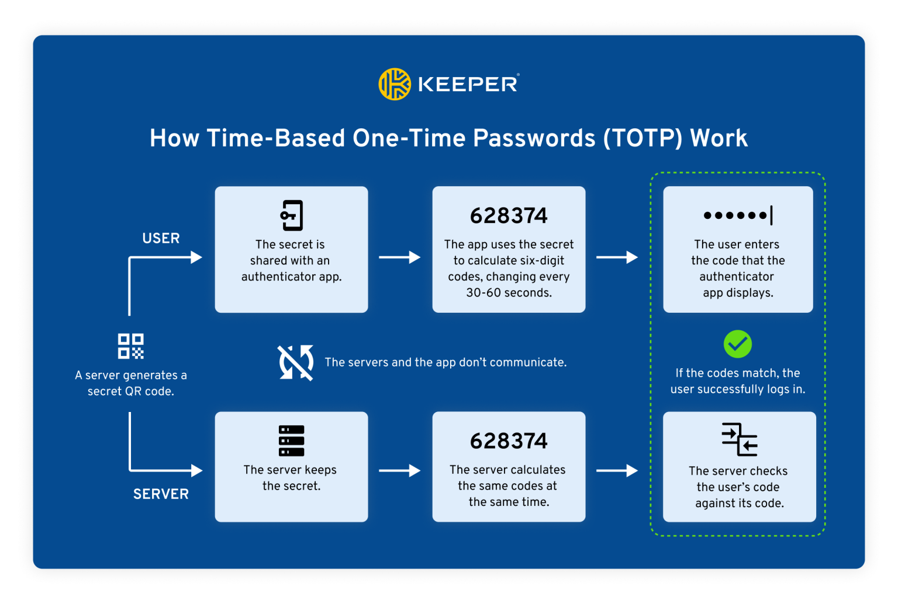
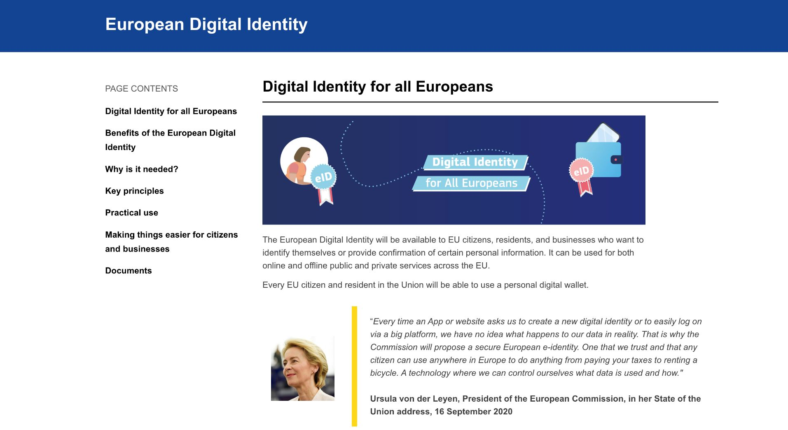
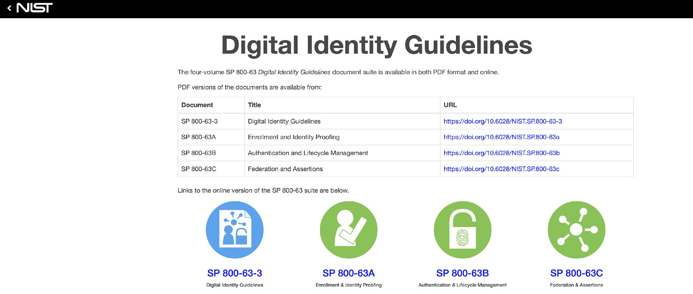
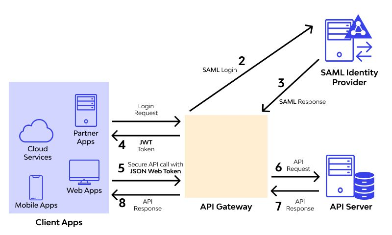

---
layout: cover
title: "Lecture 3: Authentication and Key Establishment"
subtitle: "Identification, authentication, factors, and key establishment protocols"
---

::default::

---

# This lecture

<v-clicks>

- **Authentication** — who we authenticate, factors, passwords, biometrics
- **Storing factors** — passwords, keys, password managers, FIDO2
- **One-time passwords** — OATH, HOTP & TOTP
- **Key establishment protocols** — symmetric, Diffie–Hellman, Kerberos
- **Digital identity & federation** — eID, NIST, SSO, SAML

</v-clicks>

---
layout: section
---

# Definitions

---
layout: two-cols
---

# Who do we authenticate?

**Users** — the human operator

<v-click>

- Authentication is typically **slow**
- Local or over-the-wire
- **Authentication** only
  - the human brain cannot do proper cryptography just yet :((

</v-click>

::right::

<br>
<br>
<v-click>

**Principals** — the user's digital identity

- Authentication should be **fast and scalable**
- Mostly over-the-wire
- Goal: **Authentication & key establishment**

</v-click>

---

# AAA framework

<v-clicks>

1. **Identify** — map a real person/subject to a virtual account
2. **Authenticate** — request a proof from the account
3. **Authorize** — verify if the account can access a resource
4. **Accounting** — log/monitor what the account is doing

</v-clicks>

---
layout: two-cols
---

<v-click>

# ID vs authentication

- **Identification** — *one-from-many*
  - find your fingerprints in a police database
- **Authentication** — *one-to-one* relation
  - compare your (username-based) input to a previously saved one

</v-click>

::right::

<v-click>

# Enrollment vs. recognition

- **Enrollment** — can be slow, must be precise
- **Recognition** — must be quick

**Cooperation:**

- Identification: the user does **not** cooperate
- Authentication: the user **is** cooperative

</v-click>

---

# Just authentication?

<v-click>

- Is authentication alone enough?
  - **Yes** for local systems (e.g., console/GUI login)
  - Not very good for remote systems (e.g., telnet) → **session hijack**

</v-click><v-click>

- Key establishment only?
  - For **anonymity** purposes
  - Not very practical (e.g., plain D–H over a MitM channel)

<br>
</v-click><v-click>

> Usually: we do **both**!

</v-click>

---

# Attacks?

<v-clicks>

| Attack         | Short description                                                     |
| -------------- | --------------------------------------------------------------------- |
| replay         | reusing a previously captured message in a later protocol run         |
| reflection     | replaying a captured message to the originating party                 |
| relay          | forwarding a message in real time from a distinct protocol run        |
| interleaving   | weaving together messages from distinct concurrent protocols          |
| middle-person  | eavesdropping on communication                                        |
| bruteforce     | usable for short credentials (e.g., PIN codes without rate limiting)  |
| dictionary     | using a heuristically prioritized list in a guessing attack           |
| forward search | feeding guesses into a one-way function, seeking output matches       |
| pre-capture    | extracting client OTPs by social engineering, for later use           |

</v-clicks>

<style>
table { font-size: 0.8em; }
</style>

---
layout: section
---

# Authentication

---

# The concept

<v-clicks>

- The **authenticator** (e.g., server, website) asks you to prove that you are who you pretend to be, based on one or more pieces of evidence called **factors**.
- May also be **mutual**: the server also authenticates to the client!
- Evidence can be presented:
  - **directly** (e.g., password authentication)
  - **indirectly**, by using it in a cryptographic calculation (e.g., challenge-response protocol)
- Indirect proof uses cryptographic algorithms — also known as **implicit authentication**

</v-clicks>

---

# Types of factors

<v-clicks>

- Something you **know** (Knowledge Factor)
- Something you **have** (Possession Factor)
- Something you **are** (Inherence Factor)

</v-clicks>

<v-click>

Other authentication attributes that can be used:

- Somewhere you are
- Someone you know

</v-click>

---
layout: two-cols
class: cols-45-55
---

# Chaining factors

<v-clicks>

- **N-factor authentication**
  - factors should be **different**
- **N-step verification**
  - can be the **same** factor

</v-clicks>

::right::

<div class="flex justify-center items-center gap-2">



</div>

<div style="text-align: center">

[rublon.com — 2FA vs 2SV](https://rublon.com/blog/2fa-2sv-difference/)

</div>

---

# Something you know — Passwords

<v-clicks>

- Require people to remember them
  - [re]used on multiple occasions
- Shoulder surfing / key logging
- Can be enhanced through policies
  - e.g., minimum **20 characters**

</v-clicks>

<div v-click="1" class="flex flex-col items-center" style="text-align: center; margin-top: 1em;">

</div>

---

# Most common passwords

- Top lists change very little year to year

<div class="img-col">

</div>

---
layout: two-cols
class: cols-45-55
---

# Password strength

> THROUGH 20 YEARS OF EFFORT, WE'VE SUCCESSFULLY TRAINED EVERYONE TO USE PASSWORDS THAT ARE HARD FOR HUMANS TO REMEMBER, BUT EASY FOR COMPUTERS TO GUESS.
>
> — [xkcd.com/936](https://xkcd.com/936/)

::right::

<div class="img-col">



</div>

---

# Something you have

<v-click>

- Phone number / email 🪦
- Public / private key
- Symmetric key

</v-click>

<div v-click class="mt-8 p-4 rounded border-l-4 border-green-600 bg-green-50 text-black">

**Best:** on a **hardware token** (write+execute-only private keys)

</div>

---
layout: two-cols
---

# Something you are

<v-click>

- Fingerprint
- Facial recognition
- Speech recognition
- Odour recognition
- Gait

</v-click>

::right::

<v-click>
<br>

## Biometric properties

- **Not 100% accurate**
  - because of sensors
  - because of changes in biometrics
- **Not 100% applicable**
  - e.g., fingerprints w/o hands
- Typically **hard to profile, easy to collect/verify**
  - e.g., scanning a face multiple times to enable FaceID on Apple

</v-click>

---
layout: section
---

# Storing factors

---

# Storing passwords

<v-clicks>

- **Plain text** 💀 - just don't
- `Hash(Password)`
- `Hash(Salt + Password)`
- `Hash(Salt + Password + Pepper)`
- `Repeat(Hash(Salt + Password + Pepper))`

</v-clicks>
---

# Password hashing & salting

<v-clicks>

- Standard hashes (SHA-256, SHA-3) are designed to be **fast**.
- If a hash is fast, attackers can guess billions of passwords per second using GPUs (brute force / rainbow tables).
- **Passwords need SLOW hashes** (Key Derivation Functions):
  - **Argon2** (modern standard), **bcrypt**, **PBKDF2**.
- **The salt:**
  - a random string added to the password *before* hashing: `Hash(Salt + Password)`
  - stored in plaintext next to the username
  - defeats rainbow tables and ensures two users with the same password have completely different hashes

</v-clicks>

---
layout: two-cols
---

# Attacks on stored passwords

<v-clicks>

**Offline**

- Brute force
- Dictionary (better: crunch wordlists)
- Rainbow tables

**Offline defences**

- Multiple round hashing
- RAM explosion

</v-clicks>

::right::

<br><br>

<v-clicks>

**Online**

- Brute force
- Dictionary (better: crunch wordlists)

**Online defences**

- Rate-limit
- Lock out after N failed attempts
- Some cryptographic hardware devices are _online_ (stateful) in this regard!

</v-clicks>

---

# Storing keys

<v-clicks>

- Which factor is a random key?
- **Software-protected** memory / files
  - `chmod 600`
  - e.g., SSH keys, WebAuthn 'passkeys'
  - → weakest "something you have" factor!
- **Hardware** security tokens / **TPM**
  - key becomes a stronger "something you have"
  - requires online attacks → rate limiting, auto-wipe after 10 failures etc.

</v-clicks>

---
layout: two-cols
---

# Password managers

<v-clicks>

- *One ring to rule them all*
- Master key can be derived from a password
- Use multiple factors (e.g., tokens)!
- Database storage: local or cloud
- Encourage a **different password per service**: password generators, browser integration
- **Back it up** / don't forget or lose the keys!

</v-clicks>

::right::

<div v-click class="flex flex-col items-center" style="text-align: center; margin-top: 5em;">



</div>

---

# FIDO2 / passkeys / passwordless

<v-clicks>

- Previously: **U2F** — Universal Second Factor
- **FIDO2 WebAuthn** → asymmetric crypto!
- Give a **unique public key** to the web server (no reuse!)
- Use the private key **instead of a password**
- Private key must be stored on **secure hardware**!
- FIDO-certified security keys: Yubikey, SoloKey, NitroKey ;)
- Hardware validates the 2nd factor:
  - something you **know** (PIN — rate limited!)
  - something you **are** (fingerprint, FaceID etc.)
- **Must always enroll backup keys!**

</v-clicks>

---
layout: two-cols
---

# OATH one-time pass standards

<v-clicks>

- **OATH**: **HOTP** & **TOTP**
- **TOTP**: [RFC 6238](https://datatracker.ietf.org/doc/html/rfc6238)

```
TOTP = HOTP(K, T)
T = floor(unix_timestamp / X)
```

- `X` — the time step (e.g., 60 s)
- **Private key shared** between user and auth server

</v-clicks>

::right::

<div class="img-col">



</div>

---

# Password-based key derivation

<v-clicks>

- Problem: passwords have **arbitrary lengths**
- Cryptographic algorithms require keys of **specific lengths**
  - e.g., AES-256 requires a 256-bit key → 32 bytes
- Solution: **Key Derivation Functions (KDF)**:

	`DerivedKey = KDF(password, salt, iterations)`

- Algorithms: **PBKDF2**, **Argon2**
- e.g., per-domain derived passwords: [spectre.app](http://spectre.app)

</v-clicks>

---
layout: section
---

# Key establishment protocols

---

# Authentication protocols

<v-clicks>

- **Symmetric** (shared secret)
  - how to ask for a known secret over insecure channels?
  - hash the password? → **challenge-response**
- **Asymmetric** protocols
  - **Diffie–Hellman**!
  - **forward secrecy**

</v-clicks>

---

# Burrows–Abadi–Needham notation

<v-clicks>

- $ID_A$, $ID_B$, $ID_S$ — a unique identifier for A, B and S (Trusted Server)
- $k_{A,B}$ — a key shared between A and B
- $\{ID_A\}_{k_A}$ — encryption/signature of $ID_A$ under the key of A
- $A \to B : \{ID_A\}_{k_{A,B}}$ — A sends to B the message $ID_A$ encrypted by the shared key of A and B

</v-clicks>

---

# Symmetric authentication

<v-clicks>

- Given A and B who trust **S**, A and B should be able to create a shared key $k_{A,B}$ for secret communication
- $k_{A,B}$ should be known only to A and B (and possibly to S)
- A and B should know that $k_{A,B}$ is **newly generated**
- A and B should **authenticate** each other

</v-clicks>

<v-click>
<br>

> Why? **Enterprise authentication!**

</v-click>

---

# Symmetric protocol (1) — naive

<v-clicks>

1. $A \to S : ID_A, ID_B$ *(I am A, give me the key for B)*
2. $S \to A : k_{A,B}$ *(key transferred in unencrypted form)*
3. $A \to B : ID_A, k_{A,B}$ *(key transferred in unencrypted form)*

</v-clicks>

<v-click>

**Possible attacks:**

- An attacker with MitM capabilities gets $k_{A,B}$

</v-click>

---

# Symmetric protocol (2) — encrypted at the server

<v-click>

Requirements: $k_{A,S}$, $k_{B,S}$ with a trusted **S**erver

</v-click>

<v-clicks>

1. $A \to S : ID_A, ID_B$
2. $S \to A : \{k_{A,B}\}_{k_{A,S}}, \{k_{A,B}\}_{k_{B,S}}$ *(encrypted with the A–S shared secret)*
3. $A \to B : ID_A, \{k_{A,B}\}_{k_{B,S}}$ *(encrypted with the B–S shared secret)*

</v-clicks>
<v-click>

**Possible attack — reflection:**

3'. $A \to T : ID_A, \{k_{A,B}\}_{k_{B,S}}$<br>
4'. $T \to B : ID_T, \{k_{A,B}\}_{k_{B,S}}$

(Trudy replaces the identity A presented to B!)

</v-click>

---

# Symmetric protocol (2') — Trudy in the middle

**Classic Man-in-the-Middle (MitM) attack:**

<v-clicks>

1. $A \to T : ID_A, ID_B$
2. $T \to S : ID_A, ID_T$
3. $S \to T : \{k_{A,T}\}_{k_{A,S}}, \{k_{A,T}\}_{k_{T,S}}$
4. $T \to A : \{k_{A,T}\}_{k_{A,S}}, \{k_{A,T}\}_{k_{T,S}}$
5. $A \to T : ID_A, \{k_{A,T}\}_{k_{T,S}}$

</v-clicks>
<v-click>

Trudy in the middle …

</v-click>

<!--
Every message looks legitimate because each one is sealed by S.
-->

---

# Symmetric protocol (3) — include IDs

<v-clicks>

1. $A \to S : ID_A, ID_B$
2. $S \to A : \{k_{A,B}, ID_B\}_{k_{A,S}}, \{k_{A,B}, ID_A\}_{k_{B,S}}$
3. $A \to B : ID_A, \{k_{A,B}, ID_A\}_{k_{B,S}}$

</v-clicks>
<v-click>

**Possible attack — replay of an old (broken) key:**

1. $A \to T : ID_A, ID_B$
2. $T \to A : \{k'_{A,B}, ID_B\}_{k_{A,S}}, \{k'_{A,B}, ID_A\}_{k_{B,S}}$
3. $A \to B : ID_A, \{k_{A,B}, ID_A\}_{k_{B,S}}$

</v-click>

---

# Symmetric protocol (4) — Needham–Schroeder (1978)

<v-clicks>

1. $A \to S : ID_A, ID_B, N_A$
2. $S \to A : \{k_{A,B}, ID_B, N_A, \{k_{A,B}, ID_A\}_{k_{B,S}}\}_{k_{A,S}}$
3. $A \to B : \{k_{A,B}, ID_A\}_{k_{B,S}}$
4. $B \to A : \{N_B\}_{k_{A,B}}$
5. $A \to B : \{N_B - 1\}_{k_{A,B}}$

</v-clicks>
<v-click>

**Possible attack — Denning–Sacco replay of an old broken key:**

1. $T \to B : \{k'_{A,B}, ID_A\}_{k_{B,S}}$
2. $B \to T : \{N_B\}_{k'_{A,B}}$
3. $T \to B : \{N_B - 1\}_{k'_{A,B}}$

</v-click>

---

# Symmetric protocol (5) — final form

<v-clicks>

1. $B \to A : ID_B, N_B$
2. $A \to S : ID_A, ID_B, N_A, N_B$
3. $S \to A : \{k_{A,B}, ID_B, N_A\}_{k_{A,S}}, \{k_{A,B}, ID_A, N_B\}_{k_{B,S}}$
4. $A \to B : \{k_{A,B}, ID_A, N_B\}_{k_{B,S}}$

</v-clicks>
<v-click>

**Possible attacks:**

- **None of the above** (from our list)

</v-click>

---

# Notes on protocols — Abadi & Needham [2]

<v-clicks>

- If the identity of a principal is essential to the meaning of a message, mention the principal's name **explicitly** in the message
- Be **clear about why** encryption is being done
- When a principal signs material that has already been encrypted, it should **not** be inferred that the principal knows the content of the message
- Be clear about what **properties** you are assuming about **nonces**
- If **timestamps** are used as freshness guarantees, the difference between local clocks at various machines must be **much less** than the allowable age of a message

</v-clicks>

---
layout: two-cols
---

# Plain Diffie–Hellman

<v-click>

A and B (think they) talk:

1. $A \to B : DH_A$ *(with $g^a \bmod p$)*
2. $B \to A : DH_B, \{ID_B\}_{k_{A,B}}$ 

	*(both obtain the same $k_{A,B}$)*

3. $A \to B : \{ID_A\}_{k_{A,B}}$

</v-click>

::right::

<v-click>

# Classic MitM attack

Attacker Trudy:

</v-click>
<v-clicks>

1. $A \to T : DH_A$
2. $T \to B : DH_T$
3. $B \to T : DH_B, \{ID_B\}_{k_{T,B}}$
4. $T \to B : \{ID_A\}_{k_{T,B}}$
5. $T \to A : DH_T, \{ID_B\}_{k_{A,T}}$

</v-clicks>

<v-click>

… etc.

<!--
Trudy terminates two separate DH exchanges and relays identities.
-->

</v-click>

---

# Protocol for asymmetric encryption (STS simplified)

<v-clicks>

1. $A \to B : DH_A$
2. $B \to A : DH_B, \{\{DH_A, DH_B\}_{pubA}\}_{k_{A,B}}$
3. $A \to B : \{\{DH_A, DH_B\}_{pubB}\}_{k_{A,B}}$

</v-clicks>
<br>
<v-click>

- We assume each party has private/public keys!
- Public keys are known to all entities
- The problem is **how to distribute public keys**
  - **Public Key Infrastructure**
  - **Pretty Good Privacy**

</v-click>

---
layout: section
---

# Federated / SSO

---

# European Digital Identity



- Digital identity for **all Europeans**
- Every EU citizen and resident will be able to use a **personal digital wallet**
- Usable for **online and offline** public and private services across the EU
- Key principles: user control of what data is shared, and how

<br>

> "One that we trust and that any citizen can use anywhere in Europe to do anything from paying your taxes to renting a bicycle."
>
> — Ursula von der Leyen, State of the Union, 16 September 2020

---
layout: two-cols
class: cols-55-45
---

# NIST SP 800-63 digital identity guidelines

| Document     | Title |
| ------------ | ----- |
| SP 800-63-3  | [Digital Identity Guidelines](https://doi.org/10.6028/NIST.SP.800-63-3) |
| SP 800-63A   | [Enrollment and Identity Proofing](https://doi.org/10.6028/NIST.SP.800-63a) |
| SP 800-63B   | [Authentication and Lifecycle Management](https://doi.org/10.6028/NIST.SP.800-63b) |
| SP 800-63C   | [Federation and Assertions](https://doi.org/10.6028/NIST.SP.800-63c) |

::right::

<div class="img-col" style="padding: 1em; margin-top: 3em;">


*[pages.nist.gov/800-63-3/](https://pages.nist.gov/800-63-3/)*

</div>

<style>
table { font-size: 0.9em; }
</style>

---

# Single Sign-On (SSO)

<v-clicks>

- **Password managers**
- **Enterprise-level SSO**
  - same-domain authentication
  - Kerberos, RADIUS with LDAP / Active Directory databases
- **Federated identity**
  - cross-domain authentication
  - based on **assertions** containing the result of authentication
  - factors **cannot** be shared between domains
  - RADIUS, **OpenID Connect**, **SAML** etc.

</v-clicks>

---

# Kerberos

<v-clicks>

- Developed by **MIT in 1983**
- Was **banned for export** till 2000 by the US
- Used for key establishment between multiple entities
- The Kerberos server is **trusted** by all entities
- Assumes existing pre-shared keys between entities and the Kerberos server
- Can be adapted to multiple symmetric encryption algorithms
- **Kerberos v5 uses AES**

</v-clicks>

---

# Kerberos — assumptions

<v-clicks>

- The adversary can **compromise the network**, not the host (e.g., secrets, keys)
- Based on the fixed **Needham–Schroeder** protocol
- Uses **tickets** to create a legitimate session key

</v-clicks>

---

# Kerberos (v1) protocol

<v-clicks>

1. $A \to KAS : ID_A, ID_B, N_A$
2. $KAS \to A : \{k_{A,B}, ID_B, T_{KAS}, N_A\}_{k_{A,KAS}}, \{k_{A,B}, ID_A, T_S\}_{k_{B,KAS}}$
3. $A \to B : \{k_{A,B}, ID_A, T_{KAS}\}_{k_{B,KAS}}, \{ID_A, T_A\}_{k_{A,B}}$

</v-clicks>
<br>
<v-click>

- $k_{A,B}$: session key between A and B
- $\{k_{A,B}, ID_A, T_{KAS}\}_{k_{B,KAS}}$: **ticket** for A to use when contacting B
- $T_A > T_{KAS}$: B validates the time window by comparing $T_A$ and $T_{KAS}$

</v-click>

<!--
KAS = Kerberos Authentication Server; T_S = Timestamp server.
-->

---

# Kerberos (v2)

<v-clicks>

- Usually the shared key between A and KAS is **derived from a user input/password**
- The previous version requires **credentials input every connection** to a new application server (B)
- **Ticket granting separate from user authentication:**
  - user authenticates using passwords with KAS and receives a session key for the **Ticket Granting Service**
  - entities use that session key to request tickets for multiple applications

</v-clicks>

---
layout: two-cols
class: cols-40-60
---

# SAML

<v-clicks>

- **Security Assertion Markup Language** — XML-based federation format
- Carries authentication results as **assertions** between domains

</v-clicks>

::right::

<div v-click class="img-col" style="padding:2em;">



</div>

---

# RADIUS / EAP

<v-clicks>

- **RADIUS** — central authentication, authorization and accounting protocol
- **EAP** — Extensible Authentication Protocol
  - wraps authentication methods (e.g., EAP-TLS, EAP-PEAP)
  - common in Wi-Fi (802.1X) and remote access

</v-clicks>

---

# References

- [1] *Protocols for Authentication and Key Establishment* — Colin Boyd, Anish Mathuria, Douglas Stebila (2020)
- [2] Abadi, M., Needham, R.: *Prudent engineering practice for cryptographic protocols*, IEEE Symposium on Research in Security and Privacy (1994)
- [3] *Computer Security and the Internet: Tools and Jewels* — Paul C. van Oorschot (Springer, 2021) · [people.scs.carleton.ca/~paulv/toolsjewels.html](https://people.scs.carleton.ca/~paulv/toolsjewels.html)
- [rublon.com — 2FA vs 2SV](https://rublon.com/blog/2fa-2sv-difference/)
- [nordpass.com — most common passwords](https://nordpass.com/most-common-passwords-list/)
- [xkcd.com/936](https://xkcd.com/936/)
- [NIST SP 800-63 Digital Identity Guidelines](https://pages.nist.gov/800-63-3/)

---
class: text-center
---

# Thank you

**Further reading:**
*Computer Security and the Internet: Tools and Jewels* — Paul C. van Oorschot (Springer, 2021)

[people.scs.carleton.ca/~paulv/toolsjewels.html](https://people.scs.carleton.ca/~paulv/toolsjewels.html)
