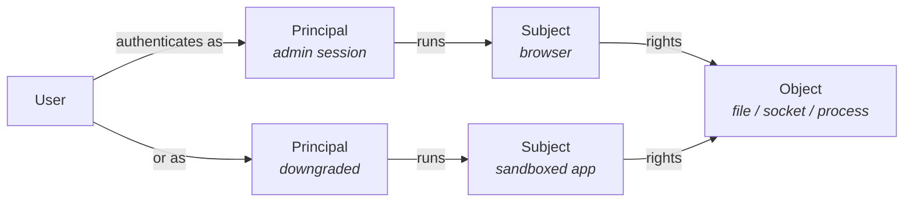
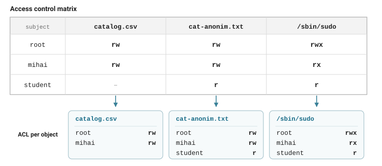
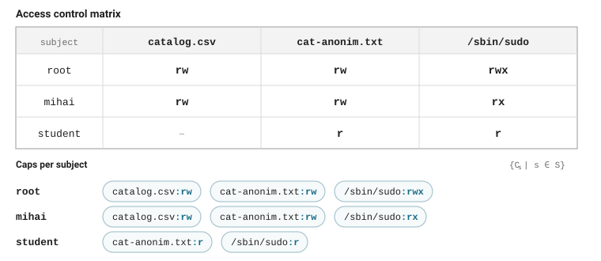
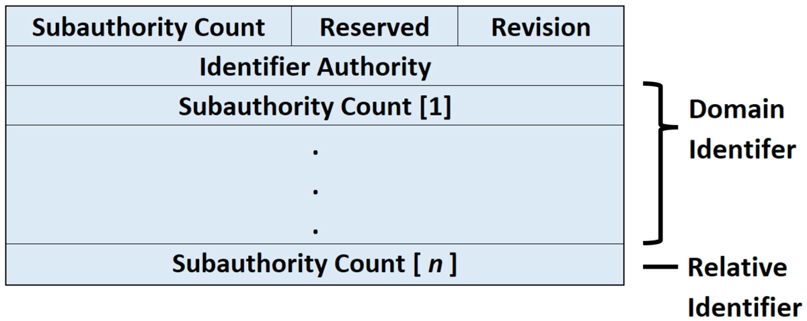
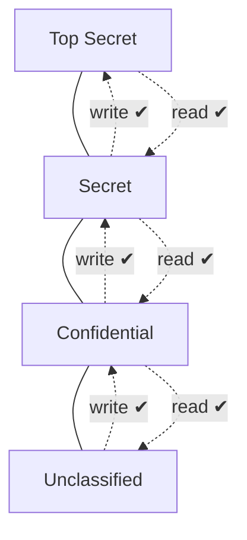
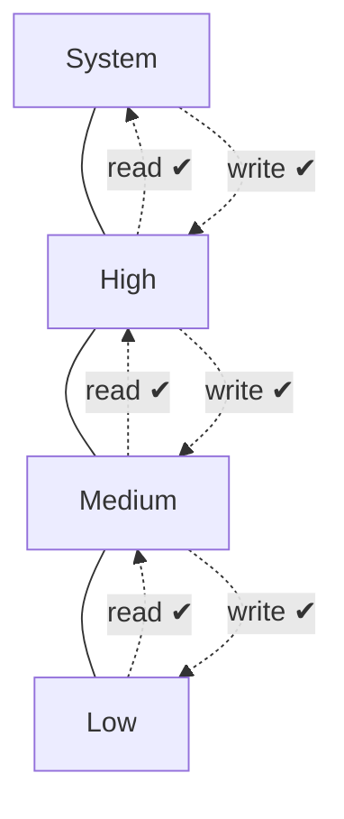
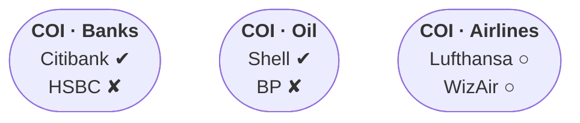
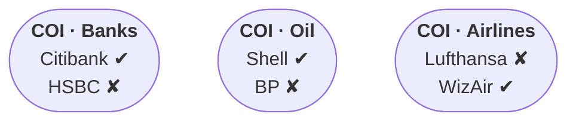
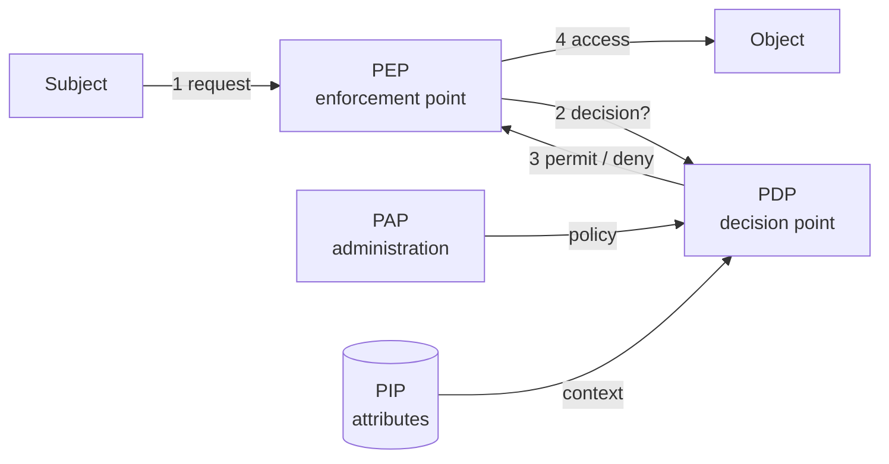

---
layout: cover
title: "Lecture 4: Authorization & Access Control"
subtitle: "Access control models, DAC vs MAC, RBAC, implementations and the human factor"
---

::default::

<!--
Welcome students. This lecture covers who is allowed to do what on a system:
access control models from theory (PEI, BLP, Biba) to practice (POSIX, OAuth).
-->

---
layout: section
---

# Access control

---
layout: two-cols
class: cols-55-45
---

# Examples of Access Control

<v-clicks>

- **Social Networks** — access to personal information
- **Web Browsers** — access restricted between web domains (same origin policy)
- **Operating Systems** — one user cannot arbitrarily access/kill another user's files/processes
- **CPU Memory Protection** — code in one region (e.g., Ring 3) cannot access data in a more privileged region (e.g., Ring 0)
- **Firewalls** — if a packet matches certain conditions, it is dropped

</v-clicks>

::right::

<div class="img-col" style="padding: 3em;">

</div>

---

# PEI Model [1]

Access control = **P**olicy – **E**nforcement – **I**mplementation:

- **Policy** — intent / goals, rules;
- **Enforcement** — access mediation layer;
- **Implementation** — technologies, protocols etc.

---

# Vocabulary

Basic abstractions:

- **Subject** — the entity requesting access; usually a **process** acting for a user
- **Object** — the resource being accessed: file, directory, socket, memory segment
- **Right** / **permission** — a permitted operation: read, write, execute, `kill`

The same entity can be both:

- Objects are usually **passive**, but processes are objects too: `kill`, `suspend`
- A process is a *subject* when it reads a file, an *object* when you attach to it

<!--
Subject = active, object = resource, rights = how subject can use object.
The last point matters later: processes holding capabilities are objects too.
-->

---

# Users, principals and subjects

- **User** — a human identity
- **Principal** — an identity authenticated in a context; the **unit of authorization**
- **Subject** — a program executing **on behalf of** a principal

<div style="width: 95%; margin: 0.2em auto;">



</div>

- **1** user → **N** principals → **N** subjects: **accountability** and least privilege
- **Service accounts / API keys** — principals that authenticate without a password
- In practice **principal ≈ subject**; the split matters when one principal runs many processes

<!--
Ask: where would you draw the principal/subject line inside a container?
-->

---
layout: section
---

# Access control models, DAC

---

# Access control enforcement — overview

- **DAC** (Discretionary Access Control) — access rights can be **propagated** from one subject to another; possession of a right is sufficient to allow access
- **MAC** (Mandatory Access Control) — access based on **system-wide policies** (security labels), changeable only by the administrator
- **RBAC** (Role-Based Access Control) — more flexible, access based on **roles**
- **ReBAC** (Relationship-Based Access Control) — Google's model for collaboration on shared resources (e.g., GDocs)

---

# Access control enforcement — more

- **ABAC** (Attribute-Based Access Control) — **properties of a subject/object/action** are used when access decisions are made
- **UCON** (Usage Control) — generalization of access control to include:
  - authorization, **obligations**, **conditions** (e.g., quotas)
  - continuity and mutability of attributes

---

# Discretionary Access Control (DAC)

- **No precise definition**
- Basically, DAC allows access rights to be propagated **at the subject's discretion**
- Often has the notion of **owner** of an object
- Used in **UNIX, Windows**, etc.

<!--
Ask: is "discretion" a feature or a bug? We'll see both sides.
-->

---

# Formal rule representation

Let $S$ be the set of all subjects, $O$ the set of all objects, $P$ the set of all permissions:

- Access control = a set $A \subseteq S \times O \times P$
- Adding a permission → add a triplet to $A$
- Revoking → delete the triplet

---

# Matrix representation

- An **access control matrix** $(M_{s,o})$: rows = subjects, columns = objects
- Element $M_{s,o} \subseteq P$ = permissions subject $s$ has for object $o$

<br>

| Subjects | catalog.csv | cat-anonim.txt | /dev/kmem | /sbin/sudo | PID 1001 |
| -------- | ----------- | -------------- | --------- | ---------- | -------- |
| Root     | rw          | rwx            | -         | rwx        | kill     |
| mihai    | rw          | rw             | -         | rx         | kill     |
| student  | -           | r              | -         | rx         | -        |
| guest    | -           | -              | -         | -          | -        |

---

# Access Control Lists (ACL)

- An **ACL** is a set $\{A_o \mid o \in O\}$ — **one element for each object**
- Each element = the pairs $(s, p)$ of subjects $s$ with permission $p$ for that object

<div class="img-col" style="width: 70%; margin: 0 auto;">



</div>

---

# Classic POSIX Model

- **Objects:** files · **Permissions:** R, W, X + specials (SUID/SGID/sticky)
- **Subjects:** users, groups, others
- Stored as **bit masks** (written in base 8 — octal) on inodes
- Bit mask: `111|101|100` → octal **754**
- Modern OSes support **full Access Control Lists** (multiple subjects!)

```bash
➜ ls -l /usr/bin/sudo
-rwsr-xr-x 1 root admin 92K Jan 18 08:05 /usr/bin/sudo
```

---

# Capability lists

- Alternate implementation: each **user stores a list of his capabilities**, instead of objects storing ACLs
- Storage: give each subject **tokens** that grant access to the permissions they are entitled to

<div class="img-col" style="width: 70%; margin: 0 auto;">



</div>

<!--
Transpose of the matrix representation: rows are now users holding tokens.
-->

---

# Capability examples

- POSIX: ~~capabilities~~ are misnamed (better regarded as roles in RBAC)!
- **Posix API descriptors:**

```c
int fd = open("/etc/passwd", O_RDWR);
// fork() -> setuid/setgid() -> exec(), inherits fd
//    (the authorization 'token' => retains read access!)
```

<div class="" style="float: right; margin: 0 2em; padding: 0; width: 45%;">


*[Microsoft Learn - Understand Security Identifiers](https://learn.microsoft.com/en-us/windows-server/identity/ad-ds/manage/understand-security-identifiers)*

</div>

- **Windows:** Security Identifier (**SID**) with subauthorities in an Active Directory

---

# ACL vs. Capabilities

- **ACLs** require **authentication** of subjects
- **Capabilities** do not require authentication, but require:
  - **unforgeability**
  - **control of propagation** (usually via cryptography)
- The **Confused Deputy Problem** [N. Hardy, 1988]
  - E.g.: Cross-Site Scripting/Forgery (XSS / CSRF), setuid privilege escalation (e.g., `sudo`)
- **Solution:** bundle resource access together with capability

---
layout: two-cols
class: cols-55-45
---

# DAC problems

<v-clicks>

- DAC philosophy: subjects can determine who has access to **their** objects
- But there's a difference between **trusting a person** and **trusting a program**
- Copies of a file are **not controlled**
- **Trojan Horse attack** [1970]
- Solution: use **MAC** ☺

</v-clicks>

::right::

<div v-click="4" style="margin-top: 2em;">

# Trojan Horse / buggy software

- When a subject (e.g., buggy software) is exploited, it executes **the attacker's code**, while using **the privileges of the user who started it**

  → **DAC-only systems cannot be trusted with classified information!**

</div>

<!--
The horse carries the attacker's payload with the victim's keys.
-->

---
layout: section
---

# MAC

---

# Mandatory Access Control (MAC)

- Access rights assigned based on **regulations by a central authority**
- Historically, closely associated with Multi-level Security (Biba / BLP)
- Implemented using a **'Reference Monitor'**
- Part of the **Trusted Computing Base (TCB)** [John Rushby, 1981]
  - Kernel < Hypervisor < Hardware
  - a vulnerability in here compromises the entire system!

---

# MAC implementations — Type Enforcement

- E.g.: **SELinux**
- Subjects → grouped in **domains** (labels)
- Objects → grouped in **types** (another/same kind of labels)
- **Domain-Domain + Domain-Type permissions**
- If a MAC rule fails → **DAC not checked, access denied!**

```text
# TE rule: allow passwd_t shadow_t : file {read, write …}
# ls -Z /etc/shadow
-rw-r----- root root  system_u:object_r:shadow_t  shadow
# ps -aZ
gigel:user_r:passwd_t  16532 pts/0 00:00:00 passwd
```

---
layout: section
---

# Formal security models

---

# Formal models

## Multi-level security (MLS)

- The capability of a system to carry information with **different sensitivities**, e.g. *Top Secret*
- **Bell-LaPadula (BLP)** Model [1973]
- **Biba** Model

## Conflict of interest

- Chinese Wall

---

# Bell-LaPadula (BLP) Model

- **Confidentiality**-centric
- Modelled as **transitions through a set of states**, from an initial state
- **State** = current access set, access matrix, level function
- Each object has a **classification level**
- Each subject $s$ has a **security clearance**

---
layout: two-cols
class: cols-60-40
---

# BLP Model — security properties

A state is **secure** if:

- **A) Simple Security Property (SS):** no subject may **read** data at a **higher** level (no read up)
- **B) \* (Star)-Property (SP):** no subject may **write** data at a **lower** level (fear of Trojan Horse / information leaks — no write down)

> A system is secure **if and only if** every reachable state is secure.

::right::

<div class="img-col">



</div>


---

# BLP in practice

- FreeBSD `mac_mls` + SELinux MLS policy (used by gov. defence / NATO)
- Data diodes / one-way gateways (e.g., SCADA systems -- no write down)
- Separation kernels (avionics / automotive)
- VM compartmentalization (Qubes OS / sandboxes)

---

# BLP problems

- **No communication** (e.g., acknowledging) from High to Low
- Not all components can be enforced by BLP — e.g., **memory management** needs access to all levels
  - Called **'trusted subjects'** (part of TCB)
- **Covert channels** cannot be blocked by the star-property

---
layout: two-cols
class: cols-60-40
---

# Biba Model

The **Integrity**-oriented counterpart of BLP:

- Subjects (processes) and objects carry an **integrity level**; levels are **ordered**
- **NO read down; NO write up** — BLP **upside down**
- Same lattice, **opposite arrows**: read up, write down

::right::

<div class="img-col">



</div>

---

# Biba Model in practice

- Windows Integrity Control + Mark of the Web:
  * Internet Explorer/Edge Protected Mode, Office Protected View cannot execute;
  * Overwriting system-protected files is denied by lower processes!
- iOS kernel / macOS Gatekeeper: unsigned applications cannot execute!

<!--
Biba protects integrity (from untrusted low), BLP protects confidentiality (from snooping high).
-->

---

# Chinese Wall [1989, Brewer and Nash]

**Read rule** — $S$ can read $O$ only if:

- $O$ is in the **same company dataset** as some object previously read by $S$ (*within the wall*), **or**
- $O$ belongs to a **conflict-of-interest class** in which $S$ has read nothing (*in the open*)

**Write rule** — $S$ can write $O$ only if:

- $S$ can read $O$ by the simple security rule, **and**
- no object can be read that is in a **different company dataset** than the one being written

<div style="width: 95%; margin: 0 auto; margin-top: 1em; text-align: center;">

<v-switch>
<template #1>



</template>
<template #2>



</template>
</v-switch>

</div>

---
layout: section
---

# AuthZ Implementation

---

# Policy architectures

- **Policy Enforcement Point** - where the request is checked (kernel, gateway, app)
- **Policy Decision Point** - evaluates policy; centralized and testable
- **Policy Information Point** - database for attributes about the request (dynamic constraints etc.)
- **Policy Administration Point** - where policy is changed

<div style="width: 95%; margin: 0 auto; margin-top: 1em; text-align: center;">



</div>

--- 

# Linux/Unix Privileges

- Privilege elevation:
  - **su/sudo/gosu** etc.: special `SUID` + `SGID` permission bits 
- Privilege dropping:
  - **Unix:** `setuid()` / `setgid()` system calls
- Enforcing **principle of least privilege** (server scenario):
  - Only root can open ports < 1024
  - Web server (e.g., `apache2`) starts as **root**
  - Opens log files, sockets, etc. — then **drops root** (user → `www-data`)
  - *Modern alternative*: **Linux capabilities** (`CAP_NET_BIND_SERVICE`)

---

# Linux Sandboxing: Seccomp & Capabilities

- Least privilege is **layered**: capabilities + seccomp + namespaces + LSM
- Docker keeps ~14 of ~40 Linux capabilities; drop the rest:

```bash
docker run --cap-drop=ALL --cap-add=NET_BIND_SERVICE nginx
capsh --print    # capability sets of the current shell
getcap /usr/bin/ping
```

- **seccomp** filters syscalls; e.g., default-deny profile:

```json
{ "defaultAction": "SCMP_ACT_ERRNO",
  "syscalls": [{ "names": ["read", "write", "openat", "exit_group"],
                 "action": "SCMP_ACT_ALLOW" }] }
```

- Namespaces limit *what you can see*; seccomp limits *what you can call*

---

# Writing authorization code

Tons of conditionals?

```python
if is_admin or (can_read(obj.parent) and can_write(obj)): ...
```

**Solution:** use language features & authorization frameworks:

<div class="authz-code">

```python
@authorize.create(Article)
def create_article(name):
    # implementation here

@authorize.read
def read_article(article):
    # implementation here
```

</div>

<style>
.authz-code { --slidev-code-font-size: 15px; --slidev-code-line-height: 1.3; }
</style>

- Real options: **Casbin**, **Oso**, **OPA/Rego**, Spring Security, Django rules
- One tested decision point — not duplicated `if`s in every view

---

# OAuth 2.0 - delegated authorization

- OAuth is **authorization**, not authentication: it grants a client **access**, not identity
- **Roles:** resource owner · client · authorization server · resource server
- The client gets an **access token** with **scopes** - a delegated, time-limited capability
  - e.g., a task app may read your Google Calendar, but nothing else
  - Access tokens are usually **bearer** tokens: possession *is* the right
  (e.g., access fields inside the JWT)
- **Refresh tokens** without bothering the user
- Recall: **OIDC** = identity layer on top of OAuth2 for authentication (ID token, `/userinfo`)

---
layout: two-cols
---

# Best practices

<v-clicks>

- Design during the **early requirements phase**
- Model as **subjects, objects, permissions**
- Use an **appropriate policy model** (DAC, RBAC, ABAC, etc.)
- Use **middleware / framework** if available
- If not, create your own! **Do NOT copy-paste duplicate code!**
- Implement **resource limits / quotas**
- **Sanitize/normalize user input!!!**

</v-clicks>

::right::

<div v-click style="margin-top: 14em; font-size: 0.8em;">

## Path Traversal example

```python
requested_file.startswith("/home/user/share/")
# requested_file (user input) could be:
#   "/home/user/share/../../../etc/shadow"
```

</div>

<!--
The classic path traversal: prefix checks are not normalization.
-->

---
layout: section
---

# The Human Factor

---

# Security and humans

- Security policies must be in place … **and must be followed**
- Regardless of how strong (and expensive) your secure deployment is:
  - Humans can still write their **passwords on post-it notes**
  - Humans can still **give their passwords** to anyone they trust
  - Humans can still open **tempting attachments** …

---

# Social engineering


- **Non-technical intrusion** — tricking people to break security policies
- **Manipulation** — relies on false confidence:
  - Everyone trusts someone
  - Authority is usually trusted by default
  - Non-technical people don't want to admit their lack of expertise → they ask fewer questions
- **Most people are eager to help**
  - When the attacker poses as a fellow employee in need
- People are **not aware** of the value of the information they possess
- **Vanity, authority, eavesdropping** — they all work
- When successful, social engineering **bypasses ANY kind of security**

---

# Types of phishing

**By technology used:**

- **Smishing** (SMS)
- **Vishing** (Voice)
- **Email phishing**
- **Angler phishing** (via social networks)

**By target:**

- **Watering Hole** phishing (people visiting a certain website)
- **Spear phishing** (a specific organization)
- **Whaling** (C-level of a specific organization)

---

# Resources

- [1] [PEI Framework](https://profsandhu.com/confrnc/misconf/collabcom09_pei_pre.pdf)
- [Cornell CS5430 — Non-Logical Access Control](https://www.cs.cornell.edu/courses/cs5430/2011sp/NL.accessControl.html)
- [CS526 — Access Control slides](https://cnitarot.github.io/courses/cs526_Spring_2015/s2014_526_ac.pdf)
- [Rutgers CS419 — Access Control notes](https://pk.org/rutgers/419/notes/access.html)
- [Saltzer & Schroeder — The Protection of Information in Computer Systems](https://web.mit.edu/Saltzer/www/publications/protection/)
- [OWASP Top 10 — A01: Broken Access Control](https://owasp.org/Top10/A01_2021-Broken_Access_Control/)
- [Kubernetes — RBAC Authorization](https://kubernetes.io/docs/reference/access-authn-authz/rbac/)
- [Open Policy Agent — Policy Language](https://www.openpolicyagent.org/docs/latest/policy-language/)

---
class: text-center
---

# Thank you

**Further reading:**
*Computer Security and the Internet: Tools and Jewels* — Paul C. van Oorschot (Springer, 2021)

[people.scs.carleton.ca/~paulv/toolsjewels.html](https://people.scs.carleton.ca/~paulv/toolsjewels.html)
