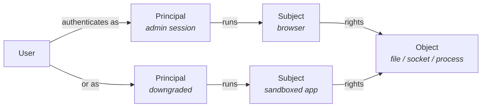
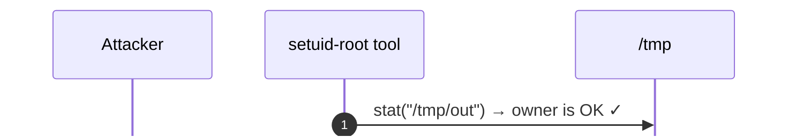
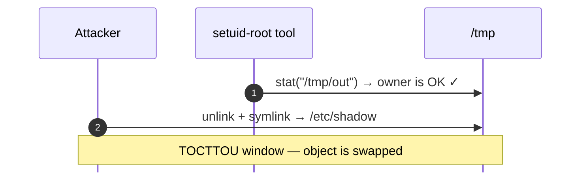
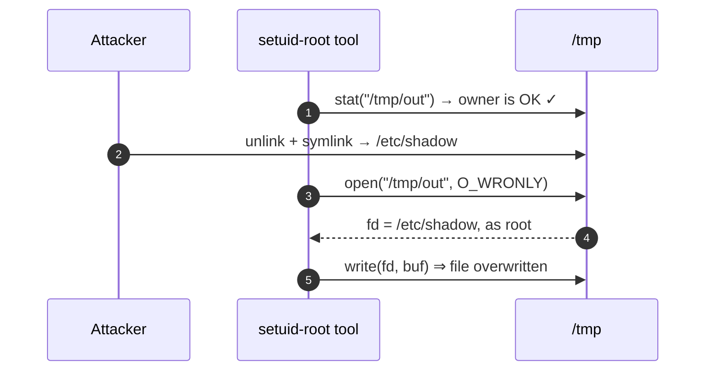
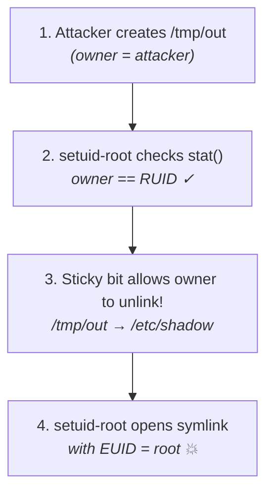
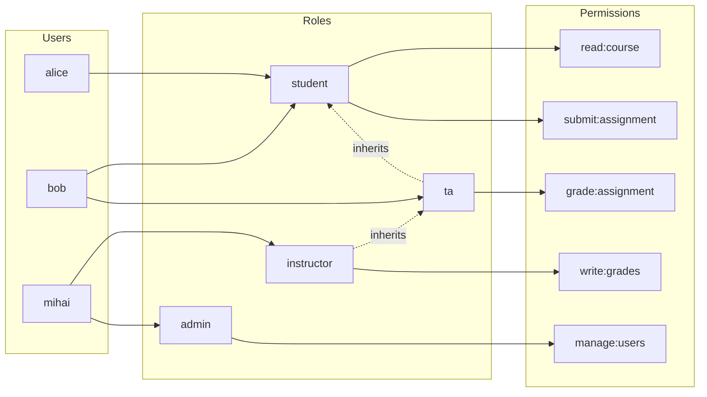
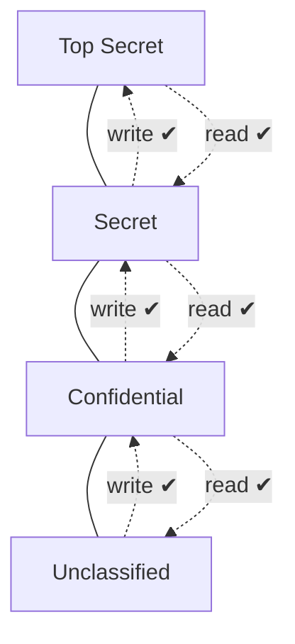
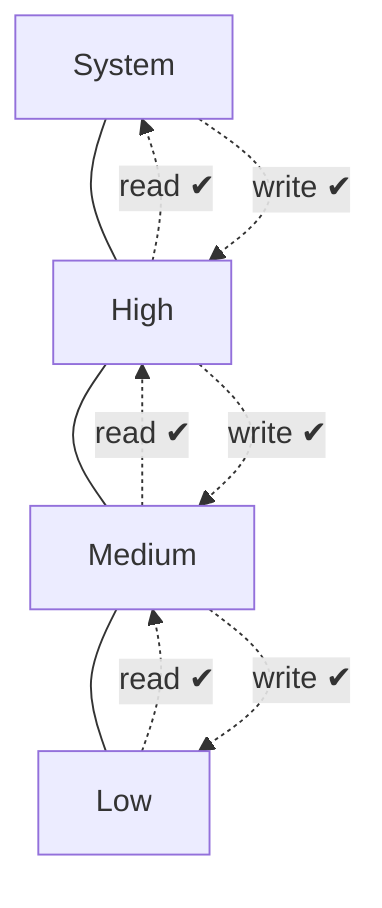
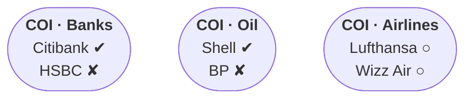
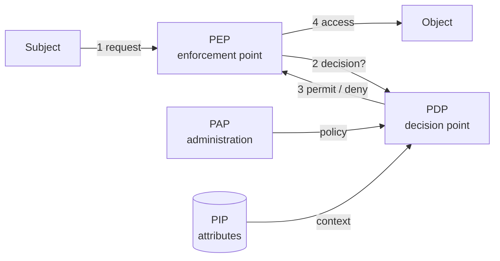

---
layout: cover
title: "Lecture 4: Authorization & Access Control"
subtitle: "Access control models, DAC vs MAC, RBAC, implementations and the human factor"
---

::default::

---
layout: section
---

# Access control

---
layout: two-cols
class: cols-55-45
---

# Examples of Access Control

<v-clicks>

- **Social Networks** — access to personal information
- **Web Browsers** — access restricted between web domains (same origin policy)
- **Operating Systems** — one user cannot arbitrarily access/kill another user's files/processes
- **CPU Memory Protection** — code in one region (e.g., Ring 3) cannot access data in a more privileged region (e.g., Ring 0)
- **Firewalls** — if a packet matches certain conditions, it is dropped

</v-clicks>

::right::

<div class="img-col" style="padding: 3em;">

</div>

---

# PEI Model [1]

Access control = **P**olicy – **E**nforcement – **I**mplementation:

- **Policy** — intent / goals, rules;
- **Enforcement** — access mediation layer;
- **Implementation** — technologies, protocols etc.

---

# Vocabulary

Basic abstractions:

- **Subject** — the entity requesting access; usually a **process** acting for a user
- **Object** — the resource being accessed: file, directory, socket, memory segment, another process
- **Right** / **permission** — a permitted operation: read, write, execute, `kill`

The same entity can be both:

- Objects are usually **passive**, but processes are objects too: `kill`, `suspend`
- A process is a *subject* when it reads a file, an *object* when you attach to it

<!--
Subject = active, object = resource, rights = how subject can use object.
The last point matters later: processes holding capabilities are objects too.
-->

---

# Users, principals and subjects

- **User** — a human identity
- **Principal** — an identity authenticated in a context; the **unit of authorization**
- **Subject** — a program executing **on behalf of** a principal

<div style="width: 95%; margin: 0.2em auto;">



</div>

- **1** user → **N** principals → **N** subjects: **accountability** and least privilege
- **Service accounts / API keys** — principals that authenticate without a password
- In practice **principal ≈ subject**; the split matters when one principal runs many processes

<!--
Ask: where would you draw the principal/subject line inside a container?
-->

---
layout: section
---

# Access control models, DAC

---

# Access control enforcement — overview

- **DAC** (Discretionary Access Control) — access rights can be **propagated** from one subject to another; possession of a right is sufficient to allow access
- **MAC** (Mandatory Access Control) — access based on **system-wide policies** (security labels), changeable only by the administrator
- **RBAC** (Role-Based Access Control) — more flexible, access based on **roles**
- **ReBAC** (Relationship-Based Access Control) — Google's model for collaboration on shared resources (e.g., GDocs)

---

# Access control enforcement — more

- **ABAC** (Attribute-Based Access Control) — **properties of a subject/object/action/context** are used when access decisions are made
- **UCON** (Usage Control) — generalization of access control to include:
  - authorization, **obligations**, **conditions** (e.g., quotas)
  - continuity and mutability of attributes

---

# Discretionary Access Control (DAC)

- **No precise definition**
- Basically, DAC allows access rights to be propagated **at the subject's discretion**
- Often has the notion of **owner** of an object
- Used in **UNIX, Windows**, etc.

<!--
Ask: is "discretion" a feature or a bug? We'll see both sides.
-->

---

# Formal rule representation

Let $S$ be the set of all subjects, $O$ the set of all objects, $P$ the set of all permissions:

- Access control = a set $A \subseteq S \times O \times P$
- Adding a permission → add a triplet to $A$
- Revoking → delete the triplet

---

# Matrix representation

- An **access control matrix** $(M_{s,o})$: rows = subjects, columns = objects
- Element $M_{s,o} \subseteq P$ = permissions subject $s$ has for object $o$

<br>

| Subjects | catalog.csv | cat-anonim.txt | /dev/kmem | /sbin/sudo | PID 1001 |
| -------- | ----------- | -------------- | --------- | ---------- | -------- |
| Root     | rw          | rwx            | -         | rwx        | kill     |
| mihai    | rw          | rw             | -         | rx         | kill     |
| student  | -           | r              | -         | rx         | -        |
| guest    | -           | -              | -         | -          | -        |

---

# Access Control Lists (ACL)

- An **ACL** is a set $\{A_o \mid o \in O\}$ — **one element for each object**
- Each element = the pairs $(s, p)$ of subjects $s$ with permission $p$ for that object

<div class="img-col" style="width: 70%; margin: 0 auto;">


</div>

---

# Classic POSIX Model

- **Objects:** files · **Permissions:** R, W, X + specials (SUID/SGID/sticky)
- **Subjects:** users, groups, others
- Stored as **bit masks** (written in base 8 — octal) on inodes
- Bit mask: `111|101|100` → octal **754**
- Modern OSes support **full Access Control Lists** (multiple subjects!)

```bash
➜ ls -l /usr/bin/sudo
-rwsr-xr-x 1 root admin 92K Jan 18 08:05 /usr/bin/sudo
```

---

# Capability lists

- Alternate implementation: each **user stores a list of his capabilities**, instead of objects storing ACLs
- Storage: give each subject **tokens** that grant access to the permissions they are entitled to

<div class="img-col" style="width: 70%; margin: 0 auto;">


</div>

<!--
Transpose of the matrix representation: rows are now users holding tokens.
-->

---

# Capability examples

- POSIX: ~~capabilities~~ are misnamed (better regarded as roles in RBAC)!
- **Posix API descriptors:**

```c
int fd = open("/etc/passwd", O_RDWR);
// fork() -> setuid/setgid() -> exec(), inherits fd
//    (the authorization 'token' => retains read access!)
```

<div class="" style="float: right; margin: 0 2em; padding: 0; width: 45%;">

*[Access tokens (https://learn.microsoft.com/en-us/windows/win32/secauthz/access-tokens)]*

</div>

- **Windows Access Tokens**

---

# ACL vs. Capabilities

- **ACLs** require **authentication** of subjects
- **Capabilities** do not require authentication, but require:
  - **unforgeability**
  - **control of propagation** (usually via cryptography)
- The **Confused Deputy Problem** [N. Hardy, 1988]
  - E.g.: Cross-Site Scripting/Forgery (XSS / CSRF), setuid privilege escalation (e.g., `sudo`)
- **Solution:** bundle resource access together with capability

---
layout: two-cols
class: cols-55-45
---

# DAC problems

<v-clicks>

- DAC philosophy: subjects can determine who has access to **their** objects
- But there's a difference between **trusting a person** and **trusting a program**
- Copies of a file are **not controlled**
- **Trojan Horse attack** [1970]
- Solution: use **MAC** ☺

</v-clicks>

::right::

<div v-click="4" style="margin-top: 2em;">

# Trojan Horse / buggy software

- When a subject (e.g., buggy software) is exploited, it executes **the attacker's code**, while using **the privileges of the user who started it**

  → **DAC-only systems cannot be trusted with classified information!**

</div>

<!--
The horse carries the attacker's payload with the victim's keys.
-->

---
layout: section
---

# MAC

---

# Mandatory Access Control (MAC)

- Access rights assigned based on **regulations by a central authority**
- Historically, closely associated with Multi-level Security (Biba / BLP)
- Implemented using a **'Reference Monitor'**
- Part of the **Trusted Computing Base (TCB)** [John Rushby, 1981]
  - Kernel < Hypervisor < Hardware
  - a vulnerability in here compromises the entire system!

---

# The reference monitor

The privileged **Reference Monitor** mediates every access request against a policy before
allowing an action. It must be:

- **Always invoked** - every access to every object goes through it
- **Tamper-proof** - untrusted code cannot modify or bypass it
- **Verifiable** - small enough to be analyzed and tested (small TCB)

Examples:

- Application-level: authorization middlewares (e.g., Casbin), browsers sandboxing
  JS...
- OS/Kernels: [Linux Security Modules](https://en.wikipedia.org/wiki/Linux_Security_Modules)
  (used by AppArmor & SELinux) + seccomp-bpf, Windows Security Reference Monitor
  (kernel's [SeAccessCheck](https://learn.microsoft.com/en-us/windows-hardware/drivers/ddi/wdm/nf-wdm-seaccesscheck))
- Hypervisors & Hardware (ARM TrustZone, IOMMUs etc.), Firewalls, authz in remote APIs etc.

---

# MAC implementations — Type Enforcement

- E.g.: **SELinux**
- Subjects → grouped in **domains** (labels)
- Objects → grouped in **types** (another/same kind of labels)
- **Domain-Domain + Domain-Type permissions**
- "Checked after DAC: even if DAC allows access (e.g., root), if a MAC rule fails → access denied!"

```text
# TE rule: allow passwd_t shadow_t : file {read, write …}
# ls -Z /etc/shadow
-rw-r----- root root  system_u:object_r:shadow_t  shadow
# ps -aZ
gigel:user_r:passwd_t  16532 pts/0 00:00:00 passwd
```

---
layout: two-cols
---

# TOCTTOU — a race through the check

- **TOCTTOU** = *Time Of Check To Time Of Use*: the object can **change between the decision and the use**
- The attacker swaps it in that window (symbolic/hard link / rename / re-create file)
  - _since the owner retains write access over the parent path_
- The privileged subject then acts on a **different object** -> breaks *complete mediation*

::right::

<div style="width: 95%; margin: 0 auto; margin-top: 5em; text-align: center;">

<v-switch>
<template #0>



</template>
<template #1>



</template>
<template #2>



</template>
</v-switch>

</div>

---
layout: two-cols
class: cols-55-45
---

# TOCTTOU Deep Dive: `/tmp` & the Sticky Bit

- **POSIX quirk:** `unlink()` (delete) and `rename()` modify the **directory**, not the file!
  - Write + execute (`wx`) on the parent folder is enough to delete *any* file inside it
- **The Sticky Bit (`t`, octal `1000`):** set on shared directories like `/tmp` (`1777`):
  - Only the **file owner**, **directory owner**, or **`root`** may delete/rename a file inside `/tmp`
- **So why does the `/tmp/out` attack work?**
  - The attacker creates `/tmp/out` *first* (`owner == attacker`)
  - The buggy `setuid-root` tool checks `stat("/tmp/out")` → sees `owner == RUID` ✓
  - Because the attacker owns `/tmp/out`, the Sticky Bit **allows** them to `unlink()` and replace it with a symlink!

::right::

<div style="margin-top: 2.5em;">

```bash
# Sticky bit 't' at the end (octal 1777)
➜ ls -ld /tmp
drwxrwxrwt 18 root root 4096 Jan 18 08:05 /tmp
```

<div style="width: 95%; margin: 1.5em auto; text-align: center;">



</div>
</div>

<!--
Ask students: If root owns /tmp/secret (0400) inside a normal 0777 folder without sticky bit, can an unprivileged user delete it? Yes! Because deletion is a directory operation.
-->

---
layout: two-cols
class: cols-52-48
---

# Mitigating TOCTTOU: Code & Kernel Fixes

- **1. Atomic file creation (`O_CREAT | O_EXCL`):**
  - Never pair `stat()` / `access()` with `open()`
  - `O_CREAT | O_EXCL` fails with `EEXIST` if the file or symlink already exists (or use `mkstemp()`)
- **2. Refuse symlinks (`O_NOFOLLOW`):**
  - Causes `open()` to fail with `ELOOP` if the target is a symbolic link
- **3. Check the capability (`fd`), not the path:**
  - `open()` first → validate with **`fstat(fd)`** on the descriptor
- **4. Linux Kernel protection (`fs.protected_symlinks = 1`):**
  - Blocks following symlinks inside world-writable sticky directories (`1777`) when `symlink_owner != follower_EUID` and `symlink_owner != dir_owner`

::right::

<div style="margin-top: 2em;">

```c
// ❌ VULNERABLE: check-then-use on a path string
struct stat st;
if (stat("/tmp/out", &st) == 0 && st.st_uid == getuid()) {
    // ⚡ Race window here!
    int fd = open("/tmp/out", O_WRONLY);
}

// ✅ SAFE 1: Atomic exclusive create (no race window)
int fd = open("/tmp/out",
              O_WRONLY | O_CREAT | O_EXCL | O_NOFOLLOW,
              0600);

// ✅ SAFE 2: Open first (with O_NOFOLLOW), then fstat(fd)
int fd = open("/tmp/out", O_WRONLY | O_NOFOLLOW);
if (fd >= 0 && fstat(fd, &st) == 0 && st.st_uid == getuid()) {
    write(fd, buf, len); // operates on the exact inode!
}
```

```bash
# Modern Linux VFS mitigation (enabled by default)
➜ sysctl fs.protected_symlinks
fs.protected_symlinks = 1
```

</div>

<!--
Point out how fstat(fd) ties back to our earlier slide on Capabilities: once you hold the file descriptor (points directly to the open file description / inode), renaming the path in /tmp cannot swap the underlying object!
-->
---
layout: section
---

# RBAC

---

# Role (group) based access control

- Real-world security policies are **dynamic**
- E.g., a user is promoted → their rights must change (deleted, added, etc.)
- **RBACs are more flexible: can simulate MAC & DAC!**

- A role brings together **users** and **permissions**:
- A user can be a member of **many roles**
- Each role can have **many users** as members
- Roles may be **hierarchical**

---

# RBAC reference model

<div style="width: 100%; text-align: center;">



</div>

- A role **inherits** its parents' permissions (**ta** → **student**)

---
layout: two-cols
class: cols-60-40
---

# NIST RBAC Family ($RBAC_0$ – $RBAC_3$)

- **$RBAC_0$ (Core / Flat RBAC)** — the baseline:
  - Many-to-many **User–Role** and **Role–Permission** assignments + **Sessions**
- **$RBAC_1$ (Hierarchical RBAC)** — adds **role inheritance**:
  - Partial order ($\ge$): senior roles inherit permissions of junior roles (e.g., `instructor ≥ ta ≥ student`)
- **$RBAC_2$ (Constrained RBAC)** — enforces **Separation of Duty (SoD)**:
  - **Static SoD:** mutually exclusive role assignment (cannot *hold* both `requester` & `approver`)
  - **Dynamic SoD:** mutually exclusive activation in the *same session* (e.g., a `ta` cannot grade a course where they are also an active `student`)
- **$RBAC_3$ (Consolidated)** — combines **$RBAC_1 + RBAC_2$**

::right::

<div style="width: 100%; margin-top: 3.5em; text-align: center;">

http://googleusercontent.com/immersive_entry_chip/0

---

# RBAC shortcomings

- Role granularity may lead to **role explosion**
- Role design and engineering is **difficult and expensive**
- Assignment of users/permissions to roles is **cumbersome**
- Adjustment based on local/global **situational factors** is difficult

---
layout: section
---

# Formal security models

---

# Formal models

## Multi-level security (MLS)

- The capability of a system to carry information with **different sensitivities**, e.g. *Top Secret*
- **Bell-LaPadula (BLP)** Model [1973]
- **Biba** Model

## Conflict of interest

- Chinese Wall

---

# Bell-LaPadula (BLP) Model

- **Confidentiality**-centric
- Modelled as **transitions through a set of states**, from an initial state
- **State** = current access set, access matrix, level function
- Each object has a **classification level**
- Each subject $s$ has a **security clearance**

---
layout: two-cols
class: cols-60-40
---

# BLP Model — security properties

A state is **secure** if:

- **A) Simple Security Property (SS):** no subject may **read** data at a **higher** level (no read up)
- **B) \* (Star)-Property (SP):** no subject may **write** data at a **lower** level (fear of Trojan Horse / information leaks — no write down)

> A system is secure **if and only if** every reachable state is secure.

::right::

<div class="img-col">



</div>


---

# BLP in practice

- FreeBSD `mac_mls` + SELinux MLS policy (used by gov. defence / NATO)
- Data diodes / one-way gateways (e.g., SCADA systems -- no write down)
- Separation kernels (avionics / automotive)
- VM compartmentalization (Qubes OS / sandboxes)

---

# BLP problems

- **No communication** (e.g., acknowledging) from High to Low
- Not all components can be enforced by BLP — e.g., **memory management** needs access to all levels
  - Called **'trusted subjects'** (part of TCB)
- **Covert channels** cannot be blocked by the star-property

---
layout: two-cols
class: cols-60-40
---

# Biba Model

The **Integrity**-oriented counterpart of BLP:

- Subjects (processes) and objects carry an **integrity level**; levels are **ordered**
- **NO read down; NO write up** — BLP **upside down**
- Same lattice, **opposite arrows**: read up, write down

::right::

<div class="img-col">



</div>

---

# Biba Model in practice

- Windows Integrity Control + Mark of the Web:
  * Internet Explorer/Edge Protected Mode, Office Protected View cannot execute;
  * Overwriting system-protected files is denied by lower processes!
- iOS kernel / macOS Gatekeeper: unsigned applications cannot execute!

<!--
Biba protects integrity (from untrusted low), BLP protects confidentiality (from snooping high).
-->

---

# Chinese Wall [1989, Brewer and Nash]

**Read rule** — $S$ can read $O$ only if:

- $O$ is in the **same company dataset** as some object previously read by $S$ (*within the wall*), **or**
- $O$ belongs to a **conflict-of-interest class** in which $S$ has read nothing (*in the open*)

**Write rule** — $S$ can write $O$ only if:

- $S$ can read $O$ by the simple security rule, **and**
- no object can be read that is in a **different company dataset** than the one being written

<div style="width: 95%; margin: 0 auto; margin-top: 1em; text-align: center;">

<v-switch>
<template #1>



</template>
<template #2>


</template>
</v-switch>

</div>

---
layout: section
---

# AuthZ Implementation

---

# Policy architectures

- **Policy Enforcement Point** - where the request is checked (kernel, gateway, app)
- **Policy Decision Point** - evaluates policy; centralized and testable
- **Policy Information Point** - database for attributes about the request (dynamic constraints etc.)
- **Policy Administration Point** - where policy is changed

<div style="width: 95%; margin: 0 auto; margin-top: 1em; text-align: center;">



</div>

--- 

# Linux/Unix Privileges

- Privilege elevation:
  - **su/sudo/gosu** etc.: special `SUID` + `SGID` permission bits 
- Privilege dropping:
  - **Unix:** `setuid()` / `setgid()` system calls
- Enforcing **principle of least privilege** (server scenario):
  - Only root can open ports < 1024
  - Web server (e.g., `apache2`) starts as **root**
  - Opens log files, sockets, etc. — then **drops root** (user → `www-data`)
  - *Modern alternative*: **Linux capabilities** (`CAP_NET_BIND_SERVICE`)

---

# Linux Sandboxing: Seccomp & Capabilities

- Least privilege is **layered**: capabilities + seccomp + namespaces + LSM
- Docker keeps ~14 of ~40 Linux capabilities; drop the rest:

```bash
docker run --cap-drop=ALL --cap-add=NET_BIND_SERVICE nginx
capsh --print    # capability sets of the current shell
getcap /usr/bin/ping
```

- **seccomp** filters syscalls; e.g., default-deny profile:

```json
{ "defaultAction": "SCMP_ACT_ERRNO",
  "syscalls": [{ "names": ["read", "write", "openat", "exit_group"],
                 "action": "SCMP_ACT_ALLOW" }] }
```

- Namespaces limit *what you can see*; seccomp limits *what you can call*

---

# Writing authorization code

Tons of conditionals?

```python
if is_admin or (can_read(obj.parent) and can_write(obj)): ...
```

**Solution:** use language features & authorization frameworks:

<div class="authz-code">

```python
@authorize.create(Article)
def create_article(name):
    # implementation here

@authorize.read
def read_article(article):
    # implementation here
```

</div>

<style>
.authz-code { --slidev-code-font-size: 15px; --slidev-code-line-height: 1.3; }
</style>

- Real options: **Casbin**, **Oso**, **OPA/Rego**, Spring Security, Django rules
- One tested decision point — not duplicated `if`s in every view

---

# Policy as code: OPA / Gatekeeper

- **OPA (Open Policy Agent)** - decisions as a separate service: the **PDP**
  (Policy Decision Point)
- Policy written in **Rego**; the app sends `input` and asks `allow`
- **Kubernetes Gatekeeper** = OPA + admission webhook: constraints as CRDs
- Policy is versioned, reviewed and tested like code

<div class="opa-code">

```text
package authz

default allow := false

allow if {
    input.method == "GET"
    input.user == input.owner
}
```

</div>

<style>
.opa-code { --slidev-code-font-size: 14px; --slidev-code-line-height: 1.3; }
</style>

- Decoupled policy → one place to audit; the **PEP** becomes a proxy, gateway or SDK

---

# Cloud IAM policies (AWS)

Identity-based policy = **who** may do **what** on **which resource**, under which **conditions**:

<div class="iam-code">

```json
{
  "Version": "2012-10-17",
  "Statement": [{
    "Effect": "Allow",
    "Action": ["s3:GetObject"],
    "Resource": "arn:aws:s3:::course-materials/04-acl/*",
    "Condition": {"Bool": {"aws:SecureTransport": "true"}}
  }]
}
```

</div>

<style>
.iam-code { --slidev-code-font-size: 15px; --slidev-code-line-height: 1.35; }
</style>

- **Explicit deny** always wins; no statement = implicit deny (fail-safe default)
- `"Resource": "*"` or `"Action": "*"` → red flag in a review
- Conditions bring **ABAC**: tags (team, project), MFA, source IP, encryption
- IAM is the **PDP**; the service endpoint is the **PEP**

---

# Kubernetes RBAC

<div class="k8s-code">

```yaml
apiVersion: rbac.authorization.k8s.io/v1
kind: Role
metadata: { name: slide-editor, namespace: lectures }
rules:
  - apiGroups: [""]
    resources: ["configmaps"]
    verbs: ["get", "list", "update"]
---
apiVersion: rbac.authorization.k8s.io/v1
kind: RoleBinding
metadata: { name: alice-edits-slides, namespace: lectures }
subjects: [{ kind: User, name: alice }]
roleRef: { kind: Role, name: slide-editor, apiGroup: rbac.authorization.k8s.io }
```

</div>

<style>
.k8s-code { --slidev-code-font-size: 13px; --slidev-code-line-height: 1.3; }
</style>

- **Role** = permissions; **RoleBinding** = who gets them (namespace-scoped)
- `ClusterRole` / `ClusterRoleBinding` for cluster-wide resources
- **ServiceAccounts** give pods an identity → tokens inside the container (**ambient authority**)
- `kubectl auth can-i get configmaps --as alice` — test the policy, not the UI

---

# OAuth 2.0 - delegated authorization

- OAuth is **authorization**, not authentication: it grants a client **access**, not identity
- **Roles:** resource owner · client · authorization server · resource server
- The client gets an **access token** with **scopes** - a delegated, time-limited capability
  - e.g., a task app may read your Google Calendar, but nothing else
  - Access tokens are usually **bearer** tokens: possession *is* the right
  (e.g., access fields inside the JWT)
- **Refresh tokens** without bothering the user
- Recall: **OIDC** = identity layer on top of OAuth2 for authentication (ID token, `/userinfo`)

---

# Broken access control

The **#1** web vulnerability class (OWASP A01:2021):

- **Insecure Direct Object Reference (IDOR) / Broken Object Level Authorization (BOLA)**
  * e.g., `GET /api/invoices/1001` -> change the ID to `1002` -> allowed? -> profit!
  - Checks often exist for the *function* but not for the *object*
- **Path Traversal**

	```python
	if request.file.startswith("/home/user/share/"): # ...
	# but, inb4...
	request = {"file": "/home/user/share/../../../etc/shadow"}
	```

- **Horizontal** escalation (another user's data) -> **vertical** escalation (admin function)
- Hiding a button is not authorization: re-check server-side, per request, per object!

---

# Design principles [Saltzer & Schroeder, 1975]

Checklist for reviewing an access-control design:

- **Least privilege** - only the rights needed, only as long as needed
- **Fail-safe defaults** - deny by default; access needs an explicit grant
  - one central `authorize(user, action, object)` decision
- **Complete mediation** - *every* access is checked, with no bypass
  - Use a good **middleware / framework** as app-level Reference Monitor!
- **Separation of privilege** - two independent conditions (MFA, dual control)
- **Economy of mechanism** - small, simple, reviewable designs
- **Least common mechanism** - avoid shared resources between subjects
- **Open design** - no security through obscurity
- **Psychological acceptability** - unusable security gets bypassed

---
layout: section
---

# The Human Factor

---

# Security and humans

- Security policies must be in place … **and must be followed**
- Regardless of how strong (and expensive) your secure deployment is:
  - Humans can still write their **passwords on post-it notes**
  - Humans can still **give their passwords** to anyone they trust
  - Humans can still open **tempting attachments** …

---

# Security fatigue

- **Alert fatigue** — hundreds of warnings train users to dismiss all of them
- **Habituation** — repeated false positives ("just click OK") destroy the signal
- **Consent-dialog blindness** — OAuth scopes and cookie banners become "accept all"
  - → users grant *more* access than the task needs; least privilege breaks down
- **Banner blindness** — security warnings compete with ads and get tuned out
- Design fixes: fewer prompts, **safe defaults**, just-in-time consent,
  concrete consequences ("this app can read all your mail")

<!--
Ask: how many browser extensions have you given "read all data on all sites"?
-->

---

# Social engineering


- **Non-technical intrusion** — tricking people to break security policies
- **Manipulation** — relies on false confidence:
  - Everyone trusts someone
  - Authority is usually trusted by default
  - Non-technical people don't want to admit their lack of expertise → they ask fewer questions
- **Most people are eager to help**
  - When the attacker poses as a fellow employee in need
- People are **not aware** of the value of the information they possess
- **Vanity, authority, eavesdropping** — they all work
- When successful, social engineering **bypasses ANY kind of security**

---

# Types of phishing

**By technology used:**

- **Smishing** (SMS)
- **Vishing** (Voice)
- **Email phishing**
- **Angler phishing** (via social networks)

**By target:**

- **Watering Hole** (people visiting a certain website)
- **Spear phishing** (a specific organization)
- **Whaling** (C-level of a specific organization)

---

# Policy friction and shadow IT

- **Friction** — if access is slow or hard, users route around it
  - personal Dropbox / WhatsApp for work files, shared logins, unapproved SaaS
- **Shadow IT** — accounts and data outside the IdP → no revocation, no audit
- **Privilege creep** — rights accumulate across role changes
- **Orphaned accounts** — leavers keep access (contractors, service accounts, API keys)
- Controls: **access reviews**, joiner-mover-leaver process, expiry/TTL, audit logs
- Authorization is only as good as the **identity lifecycle** behind it

<!--
Links back to Lecture 3: authentication without lifecycle management is theatre.
-->

---

# References

- [1] [PEI Framework](https://profsandhu.com/confrnc/misconf/collabcom09_pei_pre.pdf)
- [Cornell CS5430 — Non-Logical Access Control](https://www.cs.cornell.edu/courses/cs5430/2011sp/NL.accessControl.html)
- [CS526 — Access Control slides](https://cnitarot.github.io/courses/cs526_Spring_2015/s2014_526_ac.pdf)
- [Rutgers CS419 — Access Control notes](https://pk.org/rutgers/419/notes/access.html)
- [Saltzer & Schroeder — The Protection of Information in Computer Systems](https://web.mit.edu/Saltzer/www/publications/protection/)
- [OWASP Top 10 — A01: Broken Access Control](https://owasp.org/Top10/A01_2021-Broken_Access_Control/)
- [Kubernetes — RBAC Authorization](https://kubernetes.io/docs/reference/access-authn-authz/rbac/)
- [Open Policy Agent — Policy Language](https://www.openpolicyagent.org/docs/latest/policy-language/)

---
class: text-center
---

# Thank you

**Further reading:**
*Computer Security and the Internet: Tools and Jewels* — Paul C. van Oorschot (Springer, 2021)

[people.scs.carleton.ca/~paulv/toolsjewels.html](https://people.scs.carleton.ca/~paulv/toolsjewels.html)
