---
layout: cover
title: "Lecture 6: Malicious Software"
subtitle: "Malware internals, detection, analysis, and defense"
---

::default::

<!--
Welcome students. Lecture 6: malicious software. Based on ISC course material by M. Chiroiu & F. Stancu (2024).
-->

---
layout: two-cols
---

# Objectives

<v-clicks>

- Definition & classification
- Malware internals
- Malware detection & analysis
- Anti-malware & defense

</v-clicks>

::right::

<div class="img-col">

</div>

---
layout: section
---

# What is malware?

---
layout: two-cols
---

# What is malware?

- 'Little monsters eating your PC's resources'
- Software intentionally designed to cause damage to systems / information.
- Buggy software? **NOT** really malware :(
- CRWD: 'hold my beer'

::right::

# The grey zone

- **Potentially unwanted applications (PUA):**
- Adware & spyware
- Potentially unwanted software: Windows Recall

<!--
Emphasize the distinction: malware is intentional. A buggy or "hold my beer"
piece of software is not automatically malware — it's a (bad) software quality issue.
-->


<div class="img-col">
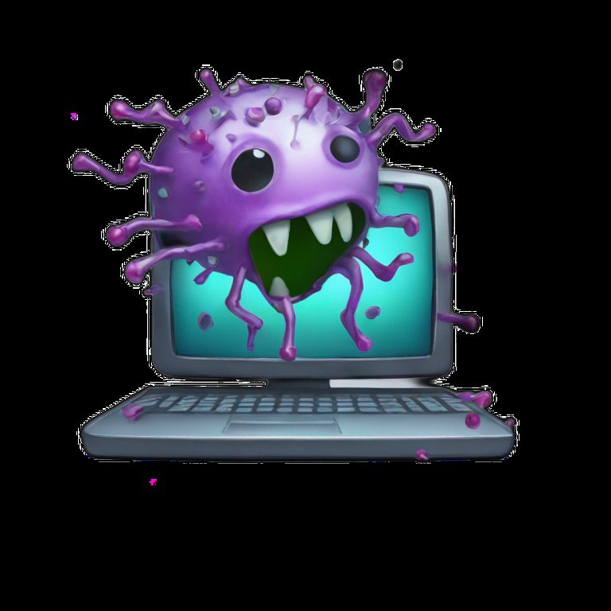
</div>

---

# Malware attributes

<v-clicks>

- Infection / propagation mechanism
- Purpose / functionality
- Affected properties: confidentiality / integrity / availability?
- Stealth & evasion ability
- Persistence
- Command-ability / automatic triggers
- Polymorphism (self-modifying code)

</v-clicks>

---
layout: two-cols
---

# Classification

**By primary distribution method:**

- Viruses
- Worms
- Trojan Horses
- Backdoors

**By function:**

- Rootkit, adware, RATs, ransomware, miners etc.

::right::

<div class="img-col">
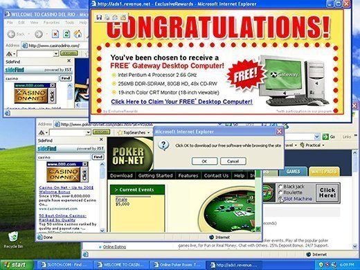
</div>

---
layout: section
---

# Types of malware

---
layout: two-cols
---

# Virus

- Requires explicit execution / open by user
- Infects & hides inside user's files
- Executable code modification / injection
- File format vectors (macros / scripting / local buffer overflows etc.)
- Spreading media: email attachments, removable drives (floppy / USB), network file sharing etc.

::right::

<div class="img-col">
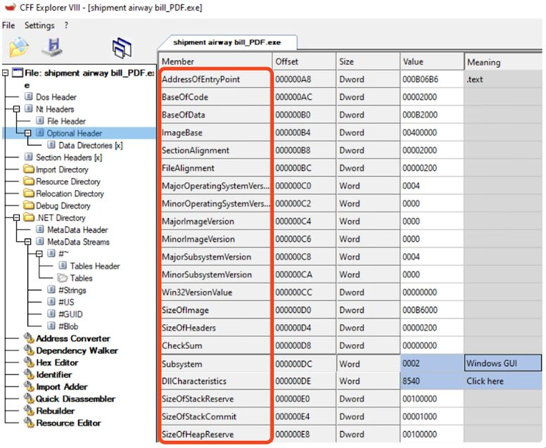
</div>

---

# Virus pseudocode (example)

```ts
// infected program entrypoint:
start_spreading_thread()
call original_program_entrypoint()

// resident thread:
for (file in scan_disks()):
    if !check_infection(file):
        infect(file)
```

---
layout: two-cols
---

# Worm

- Automatically spreads remotely via network / application vulnerabilities (mainly, Remote Code Execution)
- Distributed scanning for vulnerable devices:
  - early hit lists to bootstrap infection
  - local/global IPv4 address generation
  - address books for email spreading

::right::

<div class="img-col">
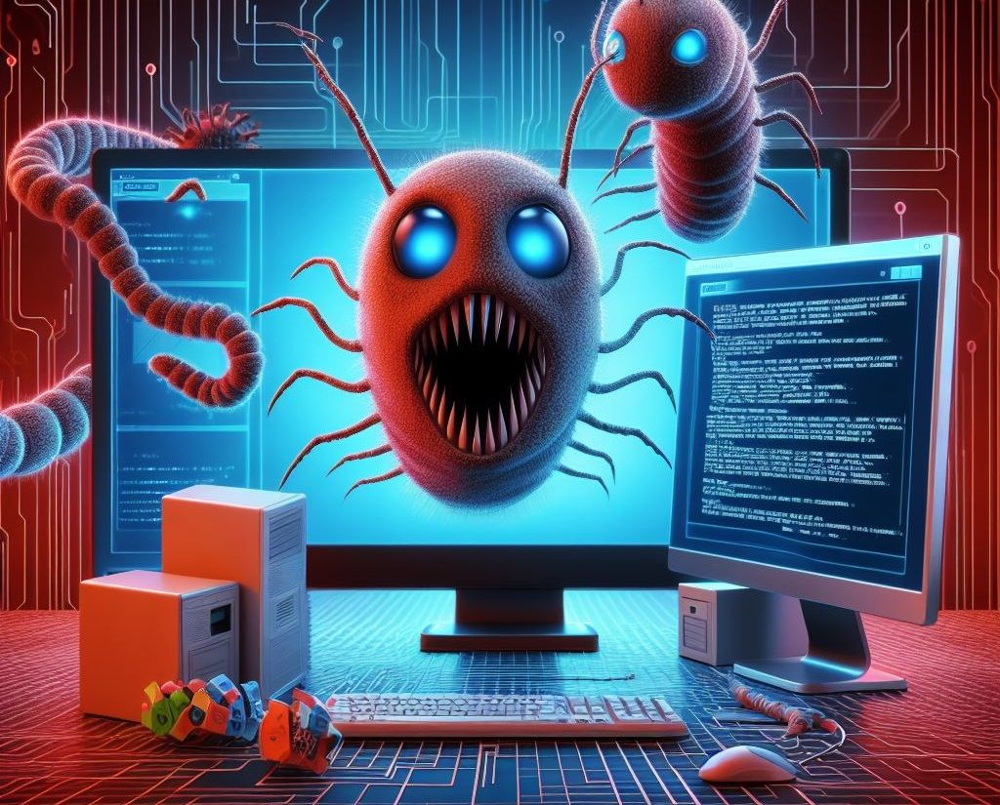
</div>

---
layout: two-cols
---

# Early popular viruses

- Creeper / Reaper (1971), RABBIT fork-bomb
- **Boot sector viruses** (Floppy period):
  - **Brain (1986)** — anti-piracy 'solution'
  - **Stoned (1987)** — fun / hacktivism: 'legalize marijuana'!
  - **Michelangelo (1991)** — destroyed MBR of HDDs, dormant until global effect
  - **CIH (1998)** — highly destructive, erased BIOS flash chips → hardware unusable!
  - **Simile (2001)** — metamorphic, rebuilds itself [2]
- Windows shortcut viruses

[Virus Encyclopedia](http://virus.wikidot.com/)

::right::

<div class="img-col">
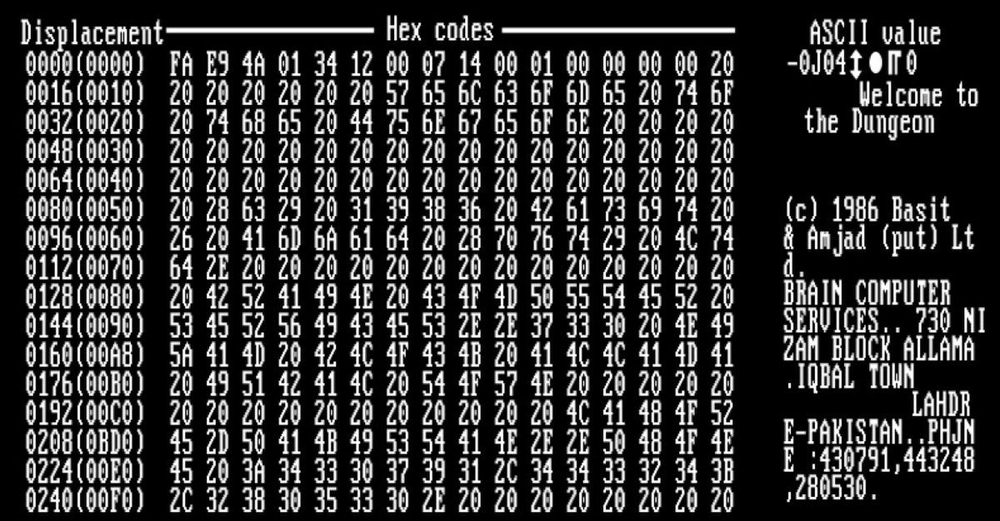
</div>

---

# Email-spreading worms

- Macro viruses: Concept, **Melissa (1999)**
- Attachments with macros: 'sexxxy.jpg' / 'naked wife'
- **ILOVEYOU (2000)** — love letter with .vbs attachment
- **Sobig (2003)**, **MyDoom (2004)**
- DDoS trigger → SCO Group & Microsoft
- Creators never caught, still active today (:
- **Storm Worm (2007)** — '230 dead as storm batters Europe', spread via clickbaiting
- **Koobface (2009–2013)** — infostealer spread via social apps
- Win32.Antiman.A (2005) ☠

---
layout: two-cols
---

# Popular worms (1)

- **Morris (1988)** — 1st wild worm
  - used sendmail vulnerability
- **Code Red (2001)** — MS IIS vulnerability
  - defaced websites, minor
- **Blaster / Lovesan (2003)**
  - DCOM RPC vulnerability stack overflow
- **SQL Slammer (2003)**
  - affected Bank of America ATMs
- **Daprosy (2009)** — autorun worm

<!--
Code Red famously defaced sites, e.g. "Welcome to http://www.worm.com! Hacked By Chinese!".
-->

::right::

<div class="img-col">
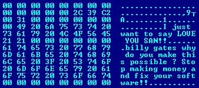
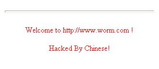
</div>

---

# Popular worms (2)

- **Conficker (2008)**
  - M$ / NetBIOS exploits (Win 2000 → 7)
  - downloaded updates from pseudorandom domains
- **Stuxnet (2010)**
  - Advanced Persistent Threat
  - Mainly attacked Iran's SCADA systems, destroyed nuclear centrifuges
  - 'most complicated and sophisticated malware at the time'
- **Mirai (2016)** — routers & IoT devices
- **Exploit kits:** Angler (2015), BlackHole (2010), Nuclear (2016)

<!--
Highlight Stuxnet as the canonical APT: state-sponsored, physical-world impact
(nuclear centrifuges) via SCADA compromise.
-->

---
layout: two-cols
---

# Trojan Horse

- User is tricked into opening it
- Targeted: does not propagate automatically
- May be hidden inside exe/docs (like viruses)
- May be installed as late payload by worms!
- Functions: remote access, info stealing (keylogger), botnet zombies, ransomware, backdoor etc.
- Script kiddies: trojan construction kits!

::right::

<div class="img-col">
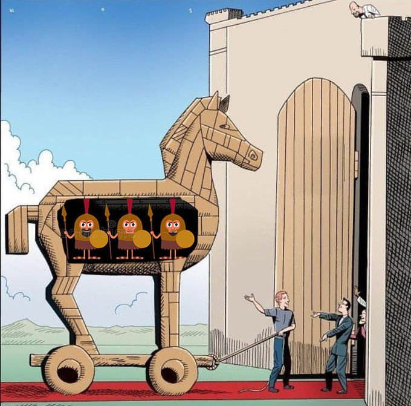
</div>

---

# RATs

**Remote Admin/Access Tool Trojan**

- May have ethical uses (e.g., remote desktop) — if owner consents!
- Usually installed by social engineering / physical device access
- E.g., spying on your lover(s) — please don't!

**Features:**

- Taking full control of the infected machine
- Full file system access (download / upload / execution)
- Online / offline key logging, live webcam / microphone
- Remote shutdown and reboot, disable user input etc.
- Commercial tools / open source projects for building yourself

---
layout: two-cols
---

# Historical / popular RATs

- **Antiques:** Back Orifice / Beast / Sub7 [3] / Houdini
- **'Grey' market:** NjRat, MoSucker, ProRAT, DarkHorse, Senna Spy, Pandora etc.
- **Open / leaked sources:**
  - [gh0st](https://github.com/sin5678/gh0st)
  - [ZeroAccess](https://github.com/hfiref0x/ZeroAccess)
  - [Poison Ivy Reload](https://github.com/killeven/Poison-Ivy-Reload)
  - [thorse](https://github.com/PushpenderIndia/thorse) (Python3 :D)
  - [SilverRAT](https://github.com/UpSetst/SilverRAT-FULL-Source-Code)

::right::

<div class="img-col">
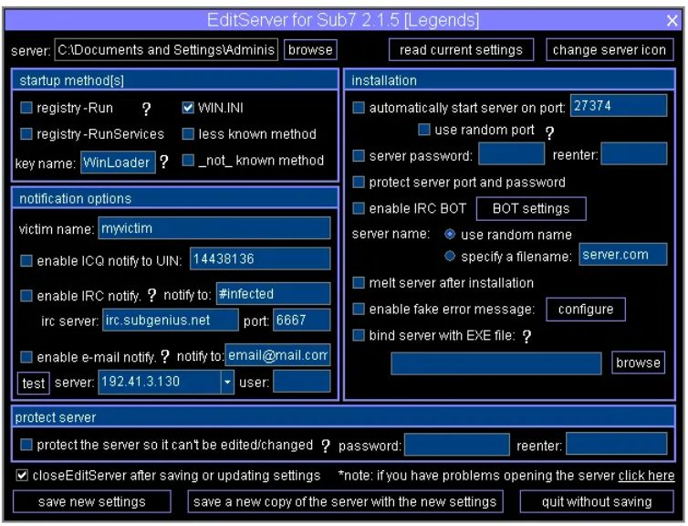
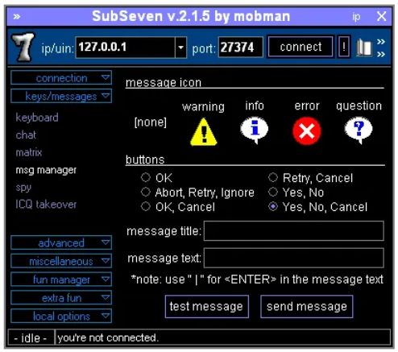
</div>

---

# Backdoors / Supply chain

- Highly targeted:
  - Installed at manufacturing / compile time ('supply chain attacks')
  - Inserted via vulnerabilities in a system
  - They just 'keep the door open' for future payload execution
- Examples:
  - libXZ compile-time auth. bypass for OpenSSH server
  - NIST Dual EC DRBG crypto RNG by NSA (speculated)
  - Master passwords in Cisco & Juniper routers/firewalls
  - Numerous NPM / Python packages, PC/Android/iOS apps (e.g., VLC) etc.

---
layout: section
---

# Rootkits

---

# Rootkits

- Actively prevent detection, offer privileged (root) access
- Concealment (userspace / kernel / hypervisor / firmware)
- Antivirus software manipulation
- Persistence (survive reboots)
- Stealth network communication / updates
- Usually embeds / combines with a RAT or backdoor
- Benign uses? there are some ;)

[awesome-linux-rootkits](https://github.com/milabs/awesome-linux-rootkits)

---
layout: two-cols
---

# Execution concealment

**User mode:**

- System file hiding (e.g., inside C:\Windows\System32)
- Library injection (e.g., explorer.exe plugin)
- Binary patching / detour hooks

**Kernel mode:**

- Kernel modules (run with SYSTEM privileges / modprobe)
- System call table patching

**Other:**

- Firmware-level (SMM rootkits)
- Code obfuscators / packers

::right::

<div class="img-col">
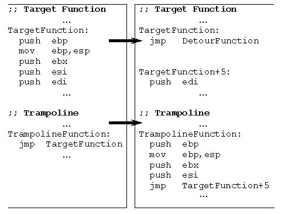
</div>

---
layout: two-cols
---

# Command & control / stealth comm.

**Botnet: command & control**

- Centralized → 'easy' to shutdown
  - except for generated DNS
- Peer-2-peer
- Encryption, D-H, asymmetric keys …

**Stealth communication + data exfiltration:**

- Hide in plain sight
- Transported using common protocols: HTTP, DNS, SNMP, ICMP, ARP
- Extreme Covert Channels: 1 bit at a time (:

::right::

<div class="img-col">
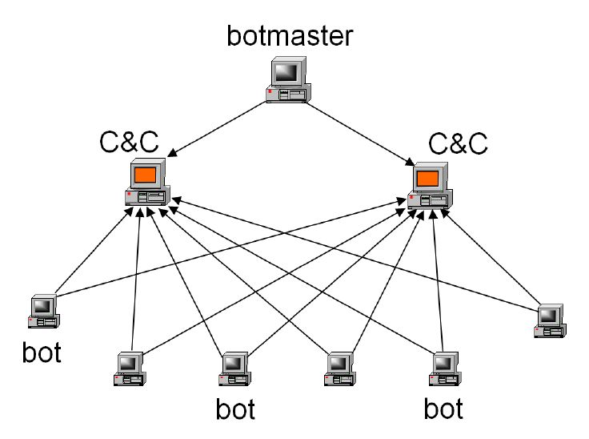
</div>

---
layout: two-cols
---

# Ransomware

- Usually worms, very destructive
- Delete / steal / encrypt user's documents
- Advanced techniques (asymmetric ciphers, timed triggers etc.)
- CryptoLocker (2013), WannaCry (2017), Petya
- Ransomware as a Service (e.g., REvil, Hive)

::right::

<div class="img-col">
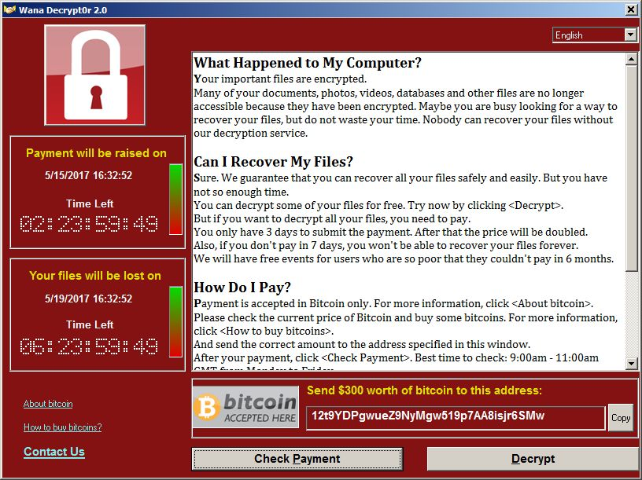
</div>

---
layout: section
---

# Detection & defense

---
layout: two-cols
---

# White-hat time! Malware defense?

**Endpoint protection:**

- Realtime protection (AVs) / malware scanning tools
- Cloud-based endpoint protection
- Periodic updates & backups !

::right::

**Network protection:**

- Firewalling (or the extreme: air gapping)
- Cloud-based threat intelligence
- Honeypots

<div class="img-col">
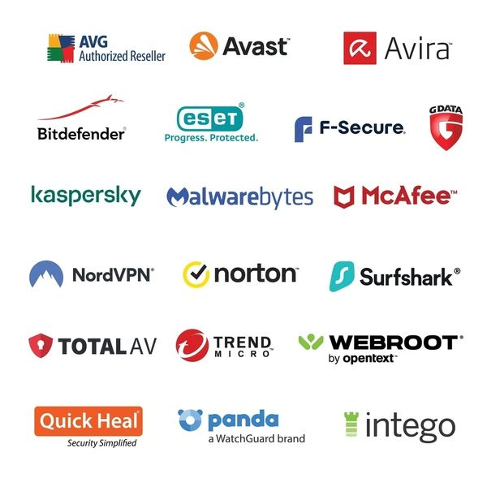
</div>

---

# Malware detection

- File/memory integrity checks
- Signature-based scans
  - vs new or self-modifying (polymorphic) malware?
  - advanced patterns (e.g., regular expressions)
- Behavioral heuristics (e.g., opened files, system calls)
- Machine learning (requires training phase + resource-intensive)
- Network traffic / anomaly detection
- Intrusion Detection / Prevention Systems

---

# Endpoint security tools

- **Historical:** Symantec Norton, McAfee, Kaspersky, ESET Nod32
  - 'Kaspersky deletes itself, installs UltraAV antivirus without warning'
- **Microsoft:** buys [RO] GeCAD (2003), Windows Defender (2005)
  - Actually, Defender was based on prev. acquired GIANT AntiSpyware
- **Softwin (1996) → Bitdefender (2001)**

**Cloud / open source:**

- **Cloud threat intelligence:** Crowdstrike, Sophos, Cisco AMP / Fortinet / Palo Alto / Check Point etc.
  - mostly for Windows (& Mac OS X, probably 🤑)
- **Open source:** ClamAV → Linux support!
- **Linux rootkit detectors:** chkrootkit, rkhunter, clamav, LMD

---

# Malware datasets & intelligence

- **EICAR Anti-Virus Test File** — simple test files (not malware)
- Many free malware databases:
  - VirusShare, Malware Bazaar, Canadian Institute of Cybersecurity, SOREL-20M, BODMAS, VirusSign etc.
- **Multi-scanning:** VirusTotal
- AV companies publish latest threats (responsible disclosure!)
  - for fame & profit
- Also share threat info with each other via partnerships
- Companies crowdsource unknown threats from cloud customers
- 'all for one and one for all'

---

# Malware analysis

- Quick response → **isolation!**
- Stealth rootkit? Put RAM into freezer :)
- **Sandboxing** — execute piece inside a virtual machine to study its behavior
  - must make environment undetectable!
  - sometimes: simulate entire network of devices to capture malware before production (honeypots)!
- **Reverse engineering tools** (+ skillz) [4] [5]
  - IDA Pro / Ghidra / Binary Ninja / gdb + pwndbg etc.
  - Sysinternals (MS) / frida / radare2 / ptrace / eBPF

<!--
Tie-in: malware analysis, reverse engineering, and sandboxes (also mentioned in defense)
are where detection meets deep understanding.
-->

---

# Bibliography

- [1] [Tools and Jewels, ch.7](https://people.scs.carleton.ca/~paulv/toolsjewels/TJrev1/ch7-rev1.pdf)
- [2] Win32/Simile — [Striking Similarities: Metamorphic Virus Code](https://docs.broadcom.com/doc/striking-similarities-metamorphic-virus-code-03-en)
- [3] [A Malware Retrospective: SubSeven](https://medium.com/phrozen/a-malware-retrospective-subseven-d86fed0c88bf)
- [4] [Malware Analysis Tools](https://www.stationx.net/malware-analysis-tools/)
- [5] [Reverse Engineering Reading List](https://github.com/onethawt/reverseengineering-reading-list)

---
layout: end
class: text-center
---

# Thank you

**Further reading:**
*Computer Security and the Internet: Tools and Jewels* — Paul C. van Oorschot (Springer, 2021)

[people.scs.carleton.ca/~paulv/toolsjewels.html](https://people.scs.carleton.ca/~paulv/toolsjewels.html)
