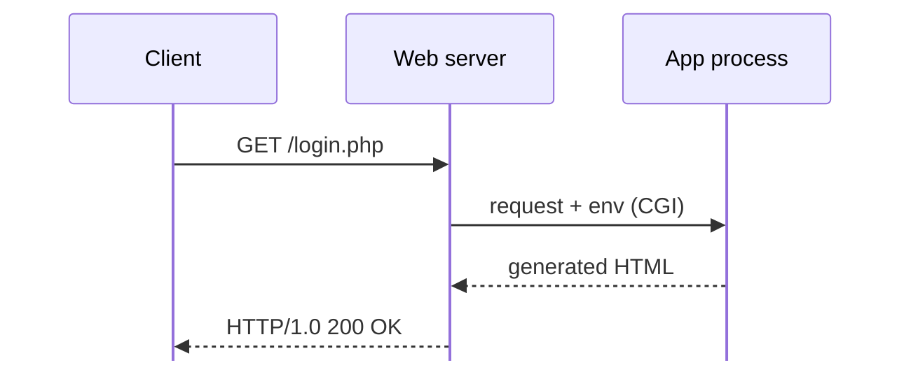
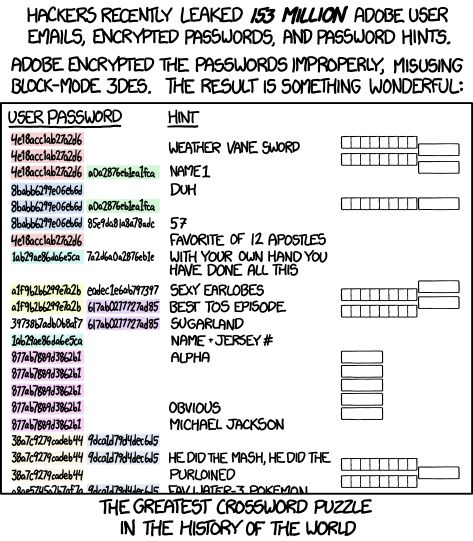
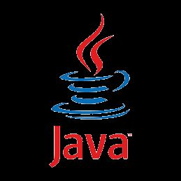

---
layout: cover
title: "Lecture 7: Web Security"
subtitle: "HTTP, sessions, injection, and the browser as an attack surface"
---

::default::

<!--
© 2024 by Mihai Chiroiu & Florin Stancu, CC BY-NC-SA 4.0. Based on the ISC course slides.
-->

---
layout: section
---

# HTTP, Cookies & Sessions

---
layout: two-cols
---

# HTTP Protocol

- **Stateless**, text-based request–response protocol [1]

**Client → Server:**

```http
GET /index.html HTTP/1.0
Header1: value1
Header2: value2

<optional body>
```

::right::

**Server → Client:**

```http
HTTP/1.0 200 OK
Header1: value1
Header2: value2

<html><head>...</head>
<body>...</body></html>
```

<style>
:deep(.col-left) { padding-right: 0.8em; }
:deep(.col-right) { padding-left: 0.8em; }
</style>

---

# HTTP Methods

- **GET** — fetch a resource, may have query strings:
  - URL: `http://domain.com/browse.php?list=users&name=john`
  - Request line: `GET /browse.php?list=users&name=john HTTP/1.0`
- **PUT / POST** — create or edit a resource (only POST is widely used)
- **DELETE** — delete resources (not used in practice)
- **HEAD** — like GET, but server responds with headers only
- **OPTIONS** — determine options for a resource
- **GET, HEAD and OPTIONS should be idempotent**

<!--
Note that query strings are visible in URLs, logs, and referrer headers — GET leaks data.
-->

---

# HTTP Methods & HTML Forms

- Links typically use a **GET** request for opening pages
- HTML forms can generate GET and POST requests:

```html
<form action="/login.php?user_type=regular" method="post">
  User: <input type="text" name="username">
  Password: <input type="password" name="pass">
</form>
```

```http
POST /login.php?user_type=regular HTTP/1.0
Content-Type: application/x-www-form-urlencoded
Content-Length: 30

username=<username>&pass=<user's password>
```

<!--
Even with POST, the user_type parameter stays in the URL; the body carries the fields.
-->

---

# Cookies

- Small piece of data that the **browser** stores and sends back to the **server** on future requests
- Can be used to remember user preferences, server sessions, etc.

**Response header example:**

```http
HTTP/1.0 200 OK
Set-Cookie: c1=val1; flags
Set-Cookie: c2=val2; flags
```

**Request example:**

```http
GET / HTTP/1.1
Cookie: cook1=val1;cook2=val2
```

---

# Cookie Security

**Cookies are insecure:**

- The user can freely **read & modify** them
- They can be **intercepted** unless HTTPS is used for transport

**Must add confidentiality and integrity guarantees:**

- Using cryptography: **encryption & HMAC** [2]
- **Server-side sessions**

**Privacy implications:**

- Cookies can be used to **track users** (e.g. by analytics & ad servers)

---

# Server Sessions

- Also known as **server-side cookies**
- Server generates a **random, unique session ID**:

```
4125a859778b1bf9b9b778a236f01e01
```

- Server uses a **database** to store secrets associated with a session ID
- Persisted as a **cookie** / passed using **GET / POST** parameters:
  - `Cookie: PHPSESSID=4125a85...`
  - `show.php?phpsessid=4125a85...`

<!--
Moving secrets server-side means the client only holds an opaque token.
-->

---

# HTTPS [3]

**HTTP over TLS** — confidentiality, integrity, and **server authentication** (X.509 / PKI).

- **TLS 1.3:** AEAD ciphers (AES-GCM, ChaCha20-Poly1305), ephemeral DH → **forward secrecy**
- **Broken legacy:** SSLv3, RC4, 3DES, CBC-mode — disable them
- **Web-visible effects:** `Secure` cookies, HSTS, no mixed content

**HTTPS does not fix:** application bugs (XSS, SQLi), phishing, malicious or compromised certificates.

**Certificates & PKI** → **Lecture 9**  
**TLS** details & attacks → **Lecture 10** [3] [4]  
Test a deployment: [ssllabs.com/ssltest](https://www.ssllabs.com/ssltest/)

---
layout: section
---

# Server-side Security & Injection

---
layout: two-cols
class: cols-55-45
---

# Server-side Processing

- Server generates **dynamic content**
- Scripting interfaces: **CGI** (legacy) / **FastCGI** / integrated modules [5]

**Sample layout — `/var/www`:**

```text
/var/www
|-- index.html
|-- login.php
|-- css/style.css
|-- images/logo.png
```

::right::



**Example requests:**

```http
GET /index.html HTTP/1.0
GET /images/logo.png HTTP/1.0
POST /login.php HTTP/1.0
```

<style>
:deep(.col-left) { padding-right: 0.8em; }
:deep(.col-right) { padding-left: 0.8em; }
</style>

---

# Server-side Processing — Example (PHP)

```php
<?php
    $name = $_GET["name"];
    $curDate = date("l");
?>
<p>Hello, <i><?=$name?></i>. The date is <b><?=$curDate?></b></p>
<?php echo $message; ?>
```

**Example (Python / Flask):**

```python
@app.route("/")
def index():
    cur_date = datetime.now().strftime("%d.%m.%Y")
    return f"Hello, {request.args.get('name')}<br /> Date is {cur_date}!"
```

<!--
Note how user input flows straight into the response — the seed of injection issues.
-->

---

# SQL Intro

**Querying:**

```php
$query = "SELECT * FROM employees WHERE name LIKE 'florin%'";
$result = mysql_query($conn, $query);
```

**Modification queries:**

```sql
INSERT INTO employees (name, emp_date, status) VALUES
    ('Florin S.', '2023-10-01 08:00', 'active');

UPDATE employees SET status='terminated' WHERE id=2;
```

---

# SQL Injection (1)

**Code:**

```php
$query = "SELECT * FROM users WHERE user = '" .
    $_POST["user"] . "' AND password='" .
    hash($_POST["password"]) . "'";
$result = mysql_query($conn, $query);
```

**What if user input is `admin' -- comment here`?**

```sql
SELECT * FROM users
WHERE user = 'admin' -- comment here
' AND password=''
^<- injected input ->^
```

<!--
The comment kills the password check entirely — login as admin without a password.
-->

---

# SQL Injection (2)

**This doesn't work very often:**

```sql
SELECT * FROM users
WHERE user=''; DROP DATABASE app -- commented'
^<- user-injected input ->^
```

- SQL servers' standard `query()` functions only execute **one single statement**!
- There are `multi_query()`-like functions, but they're **seldom used**!

---

# SQL Injection (3)

**Error Reporting Abuse:**

```sql
SELECT * FROM users WHERE user =
'asdf' OR 1/(select password from users) --'
```

**Boolean statements:**

```sql
SELECT * FROM users WHERE user='' OR user LIKE '%admin%'
```

**Time-based attacks:**

```sql
SELECT * FROM users WHERE user='' OR
IF(user LIKE '%adm%'), SLEEP(10), 'false')'
```

<!--
Boolean/time-based: exfiltrate data bit by bit without touching the normal code path.
-->

---

# Code Injection (File Upload)

- A site allows image submissions with **minimal verification**
- Upload a script disguised as an image: `image.gif.php`
- Request it — the server executes our code (if badly configured):

```http
GET /uploads/image_9876.gif.php
```

**Path traversal in the upload filename:**

```http
Content-Disposition: form-data;
  name="../../index.php"

<?php die('PWNED') ?>
```

- `../` escapes the uploads directory → overwrites `index.php`
- Both variants end in **Remote Code Execution**

<!--
Bad validation + a writable web root = full site takeover.
-->

---

# Preventing Injection

- **Do not trust tutorials / ChatGPT** [7]
- **Always sanitize user input!**
- Try not to use `exec()` / `eval()`
- For SQL, use **prepared statements**:

```php
$stmt = $mysqli->prepare("INSERT INTO table (name) VALUES (?)");
$stmt->bind_param("s", $id); // "s" for string
$stmt->execute();
```

---

# Application-Specific Vectors

**Broken authentication systems** [8]:

- Predictable / insecure session IDs
- Unencrypted passwords [9]

**Authorization vulnerabilities:**

- Improper access verification
  - Example: `/delete_user.php?id=5368`
- Direct object reference: `/admin/list_users.php`

**Vulnerable frameworks / plugins** (e.g. WordPress)

<!--
delete_user.php?id=5368: anyone who guesses/knows an ID can act on it.
-->

---

# Server Misconfiguration [9]

- Again: **do not trust tutorials & ChatGPT**
- **Nginx & PHP FastCGI** configuration vulnerability [10]
- **Exposed files** (e.g. password files, backups) / directory listings
- **Bad permissions**
- **Debugging enabled in production**
- **System software vulnerabilities:**
  - e.g. **ShellShock** (BASH vulnerability) [11]

---
layout: two-cols
---

# Pwned Websites

- [**Haveibeenpwned.com**](https://haveibeenpwned.com) — account breach checker
- **Yahoo!** (2012 SQLi; 2013–14 forged cookies) — **3 billion accounts**
- **LinkedIn** — hacked 2012, leaked 2016, sold on the Dark Web 2021
- **Adobe** (2013, 2019): broken encryption :|
- **Dropbox** (2012): SHA1 and salted passwords ;)

**2013 Adobe breach:** 153M accounts leaked. Block-mode 3DES was misused: the same password hint always produced the **same ciphertext** (e.g. every "OBVIOUS" → identical hash).

<!--
Identical hints produced identical ciphertexts — the "greatest crossword puzzle in the world."
-->

::right::

<div class="img-col">

</div>

---

# Pwned Websites (2)

- **Equifax** (2017): credit reporting agency
- **Starwood / Marriott** (2018, 500 million guests)
- **Twitter** (2018): user passwords were logged in plaintext
- **MyFitnessPal** (2018): user diet data, securely hashed passwords
- **Facebook** (2019): user data leaks (146 gigabytes)
- **Twitch** (2021): source code stolen ;)
- **Graff** (2021): jewellery — data on high-profile clients (Trump, Beckham, Oprah)
- **23andMe** (2023): USA DNA testing...

<!--
Even "correct" crypto didn't help: MyFitnessPal hashed fine but leaked health data.
-->

---
layout: section
---

# Client-side / Browser Security

---

# Client-side Security

- Client-side scripting (JavaScript)
- Isolated execution, resource policies
- AJAX

**Websites affecting client-side security:**

- **Cross-site scripting (XSS)**
- **Cross-site request forgery (CSRF)**
- **Tracking & advertisements**

**Browser vulnerabilities:**

- Legacy plugins: **ActiveX, Java, Flash**

---

# JavaScript

- The most popular **ECMAScript** implementation [12]
- Used for webpage scripting (dynamic content, animations)
- **Document Object Model**
- Can also be used for **server scripting** (NodeJS)
- **Sandboxed execution** (e.g. cannot: read user's files, run external programs)
- Modern web applications rendered entirely in JavaScript: **Angular, React, Polymer** etc.

---

# XSS Attack [15]

- **Cross-Site Scripting** / client-side code injection
- E.g.: a messaging board that allows HTML rich text:
  - Someone posts:
    - "I just wanted to say hello!"
    - `<script>pwnThisSucker();</script>`
- If the target website doesn't **filter this**, the code will execute on **any visitor's browser**
- Code can **steal data**, infect victims using a browser exploit, etc.

<!--
XSS = injection, but on the client side and inside trusted origins.
-->

---

# XSS Prevention

- **Escape HTML** before rendering
  - Convert `<` to `&lt;`, `>` to `&gt;`, quotes to `&quot;`, etc.
- Use a **template engine** that does this
- If rich text is required, use a **whitelist-based HTML processor** to sanitize:
  - Strip out dangerous tags like `script`, `embed`, `iframe`, etc.
  - **WARNING:** don't do this unless you know what you're doing!
- Use a **library designed to do this** (e.g. [htmlpurifier.org](http://htmlpurifier.org))

---

# AJAX [13]

- **Asynchronous JavaScript and XML**
- **XMLHttpRequest** — API for issuing background HTTP requests
- Used to build modern, responsive applications
- **XHR re-sends cookies for the requested domain!**

```js
var xhr = new XMLHttpRequest();
xhr.open('get', 'ajax.php');
xhr.onreadystatechange = function() { /*...*/ };
xhr.send(null);
```

---

# Same / Cross Origin Policies [14]

- **Same Origin** = Same **protocol** + **domain** + **port**
- Example: `http://domain.com` vs `https://www.domain.com` (different origins)
- Used to prevent **cross-domain data stealing**
- For example, a user enters `malicious.com`:
  - Malicious.com makes a request for `facebook.com`
  - The request **is** made, but the **response is discarded**
- **Does not prevent information leakage!**
- **CORS** — Cross-Origin Resource Sharing

---

# CORS

- **CORS — Cross-Origin Resource Sharing**
- The target server sends special response headers:

```
Access-Control-Allow-Origin: https://*example.com
```

- If the requester's domain matches this **ACL**, the browser accepts it
- Otherwise, the XHR receives an **error** and the response text is **discarded**

---

# CSRF [16]

- **Cross-Site Request Forgery**
- A malicious website **tricks the browser / user** into accessing a cross-origin URL
- Example (on `malicious.com`):

```html

```

- **Defenses:**
  - Don't execute **critical actions on GET requests!**
  - Use **CSRF tokens**
  - Check headers (**Referer**, **X-Requested-With**, etc.)

<!--
Cookies are re-sent automatically (see AJAX) — that's why the forged request "works."
-->

---

# Browser Privacy [17]

- Websites can **track the user across multiple domains!**
  - **Cookies**
  - **Invisible objects or scripts** that do remote requests
    (e.g. Google AdSense, Google Analytics, Facebook)
- **Browser fingerprinting** [19]
- Test yourselves using EFF's [**Panopticlick**](https://panopticlick.eff.org/) [18]
- Tracking servers can become **attack vectors!**
- Extensions that block such requests [20]

---
layout: two-cols
---

# Browser Vulnerabilities

- Browsers are **complex software**; bugs can let attackers **escape the sandbox**
- **Attack vectors:**
  - Malicious websites
  - Code injection on trusted sites (e.g. **XSS**)
  - Legacy plugins: **Flash, Java, ActiveX**
- **2015:** Adobe Flash alone had **96 vulnerabilities** [21]
- **2016:** Flash topped the **exploit kits**; IE second [22]
- **Exploit kits:** Angler, RIG, GrandSoft, etc.

::right::

<div class="img-col">



</div>

---
layout: two-cols
class: cols-50-50
---

# Browser Vulnerabilities (2)

**Pwn2Own** — the annual browser exploitation contest.

- **2016** [23]: 16 bugs across six targets
- **2018** [27]: 11 bugs; the Chrome exploit failed
- **2021:** Safari, Zoom Messenger, Chrome & Edge

**Trend:** browsers are getting harder; plugins and messengers are the weak spots.

::right::

| Target | 2016 | 2018 |
|--------|:----:|:----:|
| Safari | 2 | 5 |
| Internet Explorer / Edge | 4 | 4 |
| Firefox | 3 | 1 |
| Chrome | 1 | 1 (failed) |
| Adobe Reader | 3 | — |
| Adobe Flash | 3 | — |
| **Total** | **16** | **11** |

---

# Secure Browsers

If you want a secure browser:

- **Don't use Microsoft's Internet ExploDer!**
- **Block all plugins** by default
- **Always use the latest version** of a browser

**Modern browsers employ multi-process sandboxing:**

- One process per tab with no access to the user's system
- Coordinate with a main browser process
- **Chromium** uses **namespaces + seccomp** on Linux! [24]

---

# OWASP [25]

**OWASP Top 10 — 2021** [26]:

<v-clicks>

1. Broken Access Control
2. Cryptographic Failures
3. Injection (SQL, XSS, etc.)
4. Insecure Design
5. Security Misconfiguration
6. Vulnerable and Outdated Components
7. Identification and Authentication Failures
8. Software and Data Integrity Failures
9. Security Logging and Monitoring Failures
10. Server-Side Request Forgery

</v-clicks>

[owasp.org/www-project-top-ten](https://owasp.org/www-project-top-ten/)

---

# References (1)

- [1] HTTP: [tools.ietf.org/html/rfc2616](https://tools.ietf.org/html/rfc2616)
- [2] Murdoch, S.J. "Hardened stateless session cookies." Int'l Workshop on Security Protocols, Springer, 2008
- [3] TLS 1.2: [tools.ietf.org/html/rfc5246](https://tools.ietf.org/html/rfc5246) (2008)
- [4] TLS attacks: [cloudinsidr.com](https://www.cloudinsidr.com/content/known-attack-vectors-against-tls-implementation-vulnerabilities/)
- [5] CGI: [tools.ietf.org/html/rfc3875](https://tools.ietf.org/html/rfc3875)
- [6] Clarke-Salt, J. *SQL Injection Attacks and Defense*. Elsevier, 2009

---

# References (2)

- [7] Flawed Tutorials: [arxiv.org/pdf/1704.02786.pdf](https://arxiv.org/pdf/1704.02786.pdf)
- [8] Session Fixation: [acros.si](http://www.acros.si/papers/session_fixation.pdf)
- [9] [fishbowl.pastiche.org](https://fishbowl.pastiche.org/archives/docs/PasswordRecovery.pdf) · [PCMag](http://www.pcmag.com/article2/0,2817,11525,00.asp)
- [10] Common Nginx + PHP Misconfiguration: [bit.ly/1kAK8xu](http://bit.ly/1kAK8xu)
- [11] ShellShock: [securityfocus.com/bid/70103](http://www.securityfocus.com/bid/70103)
- [12] ECMA-262: [ecma-international.org](http://www.ecma-international.org/publications/standards/Ecma-262.htm)
- [13] XMLHttpRequest: [developer.mozilla.org](https://developer.mozilla.org/en-US/docs/Web/API/XMLHttpRequest)

---

# References (3)

- [14] Same-Origin Policy: [developer.mozilla.org](https://developer.mozilla.org/en-US/docs/Web/Security/Same-origin_policy)
- [15] [Happy 10th birthday, cross-site scripting](https://blogs.msdn.microsoft.com/dross/2009/12/15/happy-10th-birthday-cross-site-scripting/)
- [16] [nccgroup CSRF paper](https://www.nccgroup.trust/globalassets/our-research/us/whitepapers/csrf_paper.pdf)
- [17] [IEEE Xplore](http://ieeexplore.ieee.org/stamp/stamp.jsp?arnumber=6234427)
- [18] Panopticlick: [panopticlick.eff.org](https://panopticlick.eff.org/)
- [19] How unique is your browser?: [kabijo.de](https://kabijo.de/files/13/14/5641571611600.pdf)
- [20] [lifehacker.com](http://lifehacker.com/the-best-browser-extensions-that-protect-your-privacy-479408034)
- [21] [heimdalsecurity.com](https://heimdalsecurity.com/blog/adobe-flash-vulnerabilities-security-risks/)

---

# References (4)

- [22] [recordedfuture.com/top-vulnerabilities-2016](https://www.recordedfuture.com/top-vulnerabilities-2016/)
- [23] [Pwn2Own 2016](https://venturebeat.com/2016/03/18/pwn2own-2016-chrome-edge-and-safari-hacked-460k-awarded-in-total/)
- [24] [Chromium Linux sandboxing](https://chromium.googlesource.com/chromium/src/+/master/docs/linux_sandboxing.md)
- [25] [owasp.org](https://www.owasp.org/)
- [26] [OWASP Top 10](https://owasp.org/Top10/)
- [27] [Pwn2Own 2018 day two](https://www.thezdi.com/blog/2018/3/15/pwn2own-2018-day-two-results-and-master-of-pwn)

---
layout: end
class: text-center
---

# Thank you

**Further reading:**
OWASP Top 10 — [owasp.org/www-project-top-ten](https://owasp.org/www-project-top-ten/)

[ocw.cs.pub.ro/courses/isc](https://ocw.cs.pub.ro/courses/isc)
