---
layout: cover
title: "Lecture 9: Public Key Infrastructure"
subtitle: "Trust anchors, certificates, and how the web proves who it is"
---

::default::

<!--
Welcome students; today we look at how public keys are distributed and trusted at scale.
-->

---

# Contents

<v-clicks>

1. Public-key distribution problem
2. Certificates
3. Validation types
4. Case studies
5. TLS, SSH, PGP/GPG
6. OTR instant messaging services
7. Email security, DNS-based PKI etc.

</v-clicks>

---
layout: section
---

# The problem

---

# Public-key distribution problem

- Digital signatures (also: public-key encryption):
- Public key must be given to **all interested parties** …
- **How?** MitM may alter public keys → need **integrity** guarantees!
- Transfer it over a secure channel?
- Use one (or many) **common trusted parties**?
- **Public announcement** / YOLO TOFU

```
signature = Sign(message, privA)
valid = Verify(signature, pubA)
```

---

# Solutions

**● Public Key Infrastructure:**

- A central authority that manages trust
- Trust is **built-in** (installed together with the OS)
- Requires a mechanism for verifying trust by the central authority

**● Web of Trust (PGP):**

- Relies on **peer-to-peer** (decentralized) trust transfer
- Requires a mechanism for 'manual' key transfer
- Based on the **transitive** relationship of trust

---

# Public Key Infrastructure — the idea

- Store public keys in **public trusted repositories**
- Operated by trusted **authorities**!
- Must do: **PK owner verification** — costs / inconvenience?
- **Trusted channel** with authority, database integrity?
- **Digital signature** of each 'public key entry' with the authority's key!
- Multi-level hierarchies?
  - Don't put all eggs in the same basket!
  - Intermediate authorities signed by higher-level authorities
  - Turtles all the way down → **trust anchor**

---
layout: section
---

# Certificates

---
layout: two-cols
---

# Certificates

- Proof you **have/did** something of relevance
- Attributes:
  - Your identity
  - What does it prove
  - The issuing authority
  - Entitlements
  - Expiration date
  - ID / Registration number
  - Custom metadata etc.
- **Standard for certificates: X.509**

::right::

<div class="flex flex-col items-center" style="text-align: center; gap: 0.4em;">
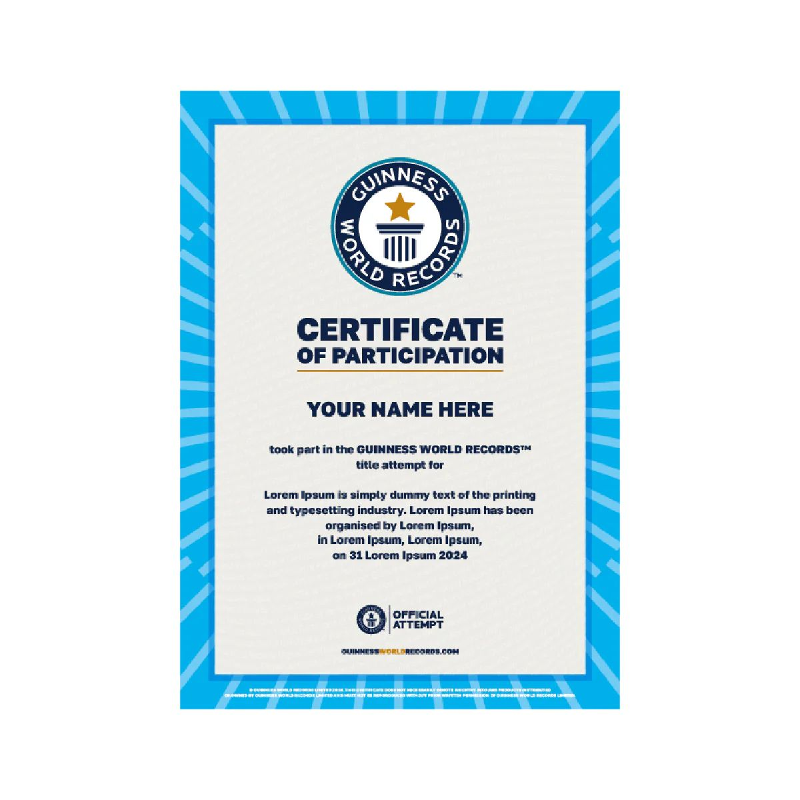
</div>
<style>
.slidev-layout.two-columns { grid-template-columns: 52% 48%; }
.slidev-layout.two-columns .col-right img { display: inline; max-width: 100%; }
</style>

---

# X.500 standards

- **X.500** — ITU specifications for Directory Services (e.g., LDAP)
- Identifying an entity: **DN** (Distinguished Name)
- DN fields:
  - C: Country
  - O: Organisation
  - OU: Organisational Unit
  - DC: Domain Component
  - etc!

```
dn: cn=John Doe, dc=example, dc=com
cn: John Doe
givenName: John
sn: Doe
telephoneNumber: +1 123 456 789
mail: john@example.com
```

---
layout: two-cols
---

# Certificate structure: X.509

- Standard for information fields:
  - Version (v3) / serial number
  - **Validity period**
  - Subject / Alt. Names
  - Issuer
  - **Key usages**
  - Signature algorithm
  - Key fingerprints + digital signatures
  - Extensions …

::right::

<div class="flex flex-col items-center" style="text-align: center; gap: 0.4em;">
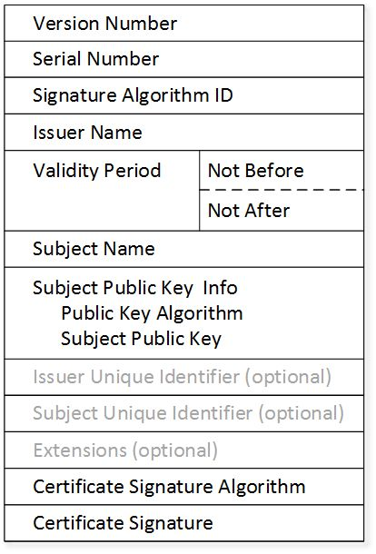
</div>
<style>
.slidev-layout.two-columns { grid-template-columns: 52% 48%; }
.slidev-layout.two-columns .col-right img { display: inline; max-width: 100%; }
</style>

---
layout: two-cols
---

# Encodings vs standards

- **X.509** standard, but many possible encodings!
- **ASN.1** — Abstract Syntax Notation One (X.690)
  - Basic/Canonical/Distinguished Encoding Rules
  - **DER** — "there is one and only one way to encode a message"
- File formats (most ASN.1-based):
  - **PEM** (GPG, SSH), p10/p8/p7 (PKCS #) etc.
- Other certificate standards:
  - SPKI
  - RFC 2440 (OpenPGP Message Format)
  - Card Verifiable Certificates — embedded devices

::right::

<div class="flex flex-col items-center" style="text-align: center; gap: 0.4em;">
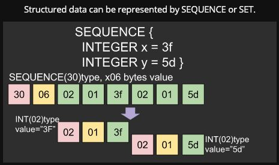
</div>
<style>
.slidev-layout.two-columns { grid-template-columns: 52% 48%; }
.slidev-layout.two-columns .col-right img { display: inline; max-width: 100%; }
</style>

---

# ASN.1/BER, practically

| Integer value | BER encoding   |
| ------------- | -------------- |
| 0             | `02 01 00`     |
| 127           | `02 01 7F`     |
| 128           | `02 02 00 80`  |
| 256           | `02 02 01 00`  |
| -128          | `02 01 80`     |
| -129          | `02 02 FF 7F`  |

<!--
Tag-length-value: 02 = INTEGER tag; length, then bytes.
-->

---

# Obtaining certificates

<v-clicks>

1. Applicant generates **PK + certificate signing request (CSR)**
   - Public key + identification (CN, OU etc.), purpose & other fields
   - **PKCS #10** standard 🙃
2. Submits CSR to **Certification Authority**
   - E.g., governmental office / mail / web / automated protocols
   - Must be done via a **trusted channel**!
3. CA **verifies** the identity, **signs** & emits the certificate
4. Gives the digital file back to the applicant (via untrusted channels)
5. Start using the certificate!
   - e.g., configure a TLS server

</v-clicks>

---
layout: two-cols
---

# Certificate Authorities

- Commercial / Non-Profit organisations implementing **rigorous validation standards**
- Must **secure** their data (signing private keys)
- Must maintain **public trust**
- Must **NOT** sign off fraudulent identities!
- Hierarchical approach:
  - Leaf CA → Intermediate CAs (may have restrictions, e.g., Extended Key Usage) → trusted by ultimate **Root CAs**
- Trust the gatekeepers?
  - **Mutual assurance:** popular OS & browser vendors!
  - + **Certificate Transparency**

::right::

<div class="flex flex-col items-center" style="text-align: center; gap: 0.4em;">
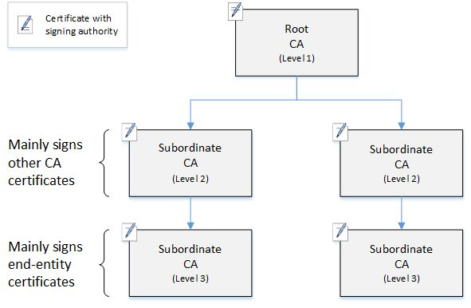
</div>
<style>
.slidev-layout.two-columns { grid-template-columns: 52% 48%; }
.slidev-layout.two-columns .col-right img { display: inline; max-width: 100%; }
</style>

---

# Self Certificate Authorities

<v-clicks>

1. Create a **private key** for the CA
2. Create the **certificate** of the CA
3. Add the CA certificate to the trusted root certificates:
   - `sudo cp CA.crt /usr/local/share/ca-certificates`
4. Create a certificate for the **webserver**
5. **Sign** the certificate
6. **Deploy** the certificate
7. ?? → Profit!

</v-clicks>

<!--
Home-lab classic: your own root of trust.
-->

---
layout: two-cols
---

# Certificate revocation

- Server is **compromised**, private key stolen
- Certificate valid until expiration date?
- CAs have another role: **revocation**
- CAs can **also** be revoked 😈
- **Certificate Revocation Lists (CRLs)**
- **Online Certificate Status Protocol (OCSP)**

::right::

<div class="flex flex-col items-center" style="text-align: center; gap: 0.4em;">
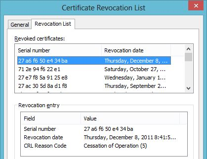
</div>
<style>
.slidev-layout.two-columns { grid-template-columns: 52% 48%; }
.slidev-layout.two-columns .col-right img { display: inline; max-width: 100%; }
</style>

---

# Certificate Revocation Lists (CRLs)

- CRL = an URL where revoked certificates are stored
- Can be accessed via **HTTPS, LDAP, FTP**
- CRLs must be **signed by the CA** too
- Someone (browsers) need to **verify** the list
- What happens if the list is **not available**? (DoS on the browser)
- Reasons to revoke, hold, or unlist a certificate (RFC 5280):
  - `unspecified (0)`
  - `keyCompromise (1)`
  - `cACompromise (2)`
  - `privilegeWithdrawn (9)`

---
layout: two-cols
---

# Online Certificate Status Protocol (OCSP)

- Protocol used to **replace the (simple, but heavy) CRLs**
- Requests are made **per certificate**, not the full list
- Client–Server protocol
- The server is specified **in the certificate** to be checked
- OCSP uses **ASN.1** format over HTTPS
- **OCSP stapling:**
  - Caching mechanism for the server to send the certificate status **directly** with the certificate

```text
CertID ::= SEQUENCE {
  hashAlgorithm    AlgorithmIdentifier,
  issuerNameHash   OCTET STRING,
  issuerKeyHash    OCTET STRING,
  serialNumber     CertificateSerialNumber
}
```

::right::

<div class="flex flex-col items-center" style="text-align: center; gap: 0.4em;">
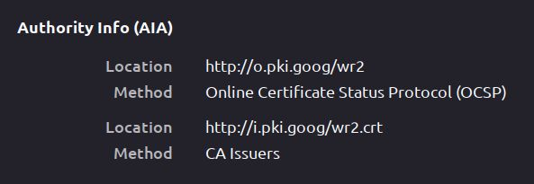
</div>
<style>
.slidev-layout.two-columns { grid-template-columns: 52% 48%; }
.slidev-layout.two-columns .col-right img { display: inline; max-width: 100%; }
</style>

---
layout: two-cols
---

# Certificate usage & validation

- **Server vs Client/User** (e.g., VPN authentication)
- **Key Usage** / constraints:
  - digital signatures, non-repudiation, certificate signature (for CAs), CRL signature, encryption etc.
- **Validation level:**
  - **Domain Validation**
  - **Organisation Level**
  - **Extended Validation**

::right::

<div class="flex flex-col items-center" style="text-align: center; gap: 0.4em;">
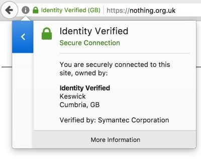
</div>
<style>
.slidev-layout.two-columns { grid-template-columns: 52% 48%; }
.slidev-layout.two-columns .col-right img { display: inline; max-width: 100%; }
</style>

---

# Certificate Authority types

- **Government CAs** (e.g., EU Digital Identity)
- **Commercial CAs**
  - GlobalSign, IdenTrust, Comodo, DigiCert, Verisign etc.
- OS/Browser Root CA lists: **> 100** trusted authorities!
- **Open-Source CAs:**
  - **Let's Encrypt: > 50% market share!**
  - Only Domain Validation — fully automated!
- New players? **Cross-Signing!**
  - Let's Encrypt was signed by IdenTrust for backwards compatibility!

---

# Let's Encrypt: ACME protocol

- **Automatic Certificate Management Environment** by ISRG
- Automate CSR generation & validation:
  - CA challenges client with a **random nonce**
  - Certificate client installs nonce on server (**HTTP**) or in **DNS**
  - CA queries server/DNS to check for that nonce
- Tools / libraries:
  - [certbot](https://letsencrypt.org/docs/client-options/)

---

# Compromised CAs

- **Supply chain attack:** attack CAs / steal private keys & forge certificates
- Or: **untrustworthy CAs** in browser databases (e.g., state controlled)
- Incidents:
  - **Thawte (2008)** — validation: register sslcertificates@live.com and obtain a rogue SSL certificate for Microsoft's live.com!
  - **DigiNotar (2011)** — hacked, MitM for Iranian users, bankrupt
  - **TurkTrust (2011)** — accidentally issues two intermediate CA certificates to subscribers
  - **MCS Holdings (2015, China)** — issued certificates for Google domains

---

# Certificate Transparency

- Who watches the watchers?
- CA compromised … how to detect **foul play**?
- Publish all issued certificates on an **append-only blockchain public log**!
- How?
  - CSR → **PreCertificate** → send to logs → **Signed Certificate Timestamp**
  - **SCT** — promise the certificate will be appended within a time window → send back to CA → finally obtain a valid certificate (with SCT embedded within)!
- **Browsers require proof of SCT:** Chrome / Safari

---
layout: section
---

# Beyond web certs

---

# Alt. public key validation approaches

- Problem: domain validation not applicable
- **Email** (on same domain, e.g. gmail.com)
- **Instant messaging** (user chat confidentiality)
- **Self-signed certificates**
- Out of band / manual **fingerprint validation**
- **Trust on First Use (TOFU)**
- **Decentralized / Web of Trust!**

---
layout: two-cols
---

# TOFU

- **Trust on First Use** / Leap of Faith
- SSH: *do you accept this key?*
- Key remains cached (`~/.ssh/known_hosts`)
- Compare **fingerprints**

::right::

<div class="flex flex-col items-center" style="text-align: center; gap: 0.4em;">
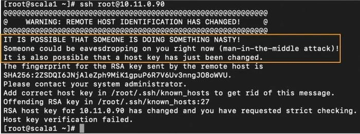
</div>
<style>
.slidev-layout.two-columns { grid-template-columns: 52% 48%; }
.slidev-layout.two-columns .col-right img { display: inline; max-width: 100%; }
</style>

---
layout: two-cols
---

# Off-The-Record messaging

- Chat applications → **untrusted server**
- E.g., Zucc / NSA / Russian gov.
- **TOFU + fingerprint checking**
- **QR codes FTW!**
- Who does this?
- Example applications:
  - XMPP (Jabber)
  - Signal / WhatsApp etc.

::right::

<div class="flex flex-col items-center" style="text-align: center; gap: 0.4em;">
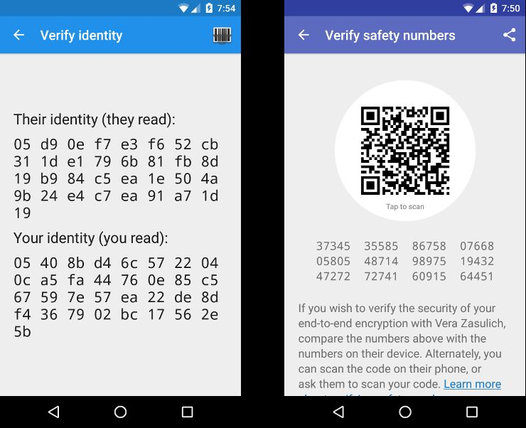
</div>
<style>
.slidev-layout.two-columns { grid-template-columns: 52% 48%; }
.slidev-layout.two-columns .col-right img { display: inline; max-width: 100%; }
</style>

---
layout: two-cols
---

# GPG/PGP — Web of Trust model

- Decentralized, ad-hoc management of keys
- Does **not** use X.509 → lightweight certificates
- **Friends endorse** a person
- Key signing parties / conferences etc.
- Initial anchors? Trusted **key servers** ;)
- **Trust scoring:**
  - Must be signed by **fully-trusted** or at least **3 marginally trusted** keys
  - Trust doesn't propagate when path length **> 5**

::right::

<div class="flex flex-col items-center" style="text-align: center; gap: 0.4em;">
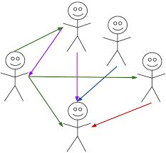
</div>
<style>
.slidev-layout.two-columns { grid-template-columns: 52% 48%; }
.slidev-layout.two-columns .col-right img { display: inline; max-width: 100%; }
</style>

---

# Secure email

- Client → Mail Server: **STARTTLS / IMAPS / SMTPS**
- P2P / End-to-end encryption?
  - **PGP/GPG**, **S/MIME** (Secure/Multipurpose Internet Mail Extensions)
- Public key usually sent as attachment (TOFU?)
- Problems: key provisioning, webmail …
- Outlook, Gmail, and Apple Mail support **S/MIME**
- Thunderbird has extensions for S/MIME & GPG
- Browser-based mail: extensions (WebPG)
- Provider-based encryption: **ProtonMail**

---
layout: two-cols
---

# Email server authentication

- Prevent **mail spoofing** & spam
- **DKIM & SPF:** both use DNS records
- **DomainKeys Identified Mail:**
  - Public-key signature of emails originating from the server
- **Sender Policy Framework:**
  - IP addresses allowed to send using the SMTP server
  - E.g., allow marketing services (e.g., sendgrid / mailgun) to send mails using the company's domains

::right::

<div class="flex flex-col items-center" style="text-align: center; gap: 0.4em;">
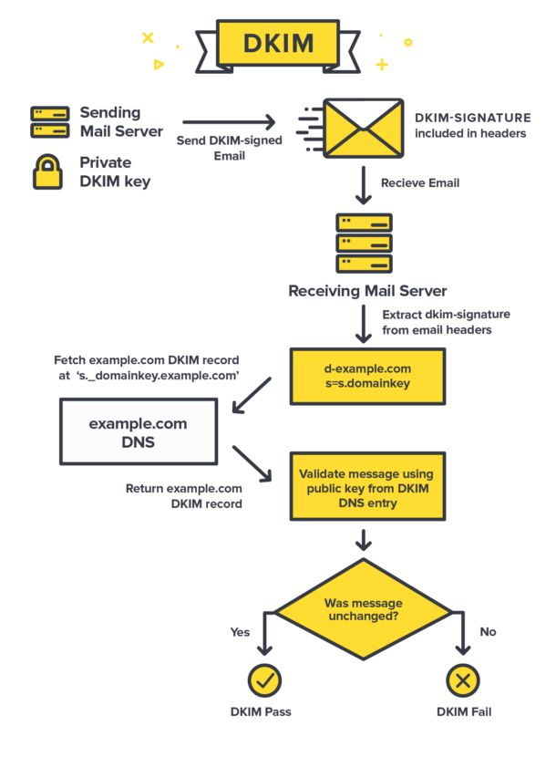
</div>
<style>
.slidev-layout.two-columns { grid-template-columns: 52% 48%; }
.slidev-layout.two-columns .col-right img { display: inline; max-width: 100%; }
</style>

---
layout: two-cols
---

# DNSSEC

- DNS cache easily **poisoned**!
- Domain Name System **Security Extensions**:
  - Domain has priv/pub key (**DNSKEY** record) and signs all records
  - Parent zone authenticates your public key (and so on, recursively)
  - Root DNS zones' keys are trusted by resolvers (similar to Root CAs in browsers)
  - Actually, the recursive resolve process is a bit more complicated than this (

::right::

<div class="flex flex-col items-center" style="text-align: center; gap: 0.4em;">
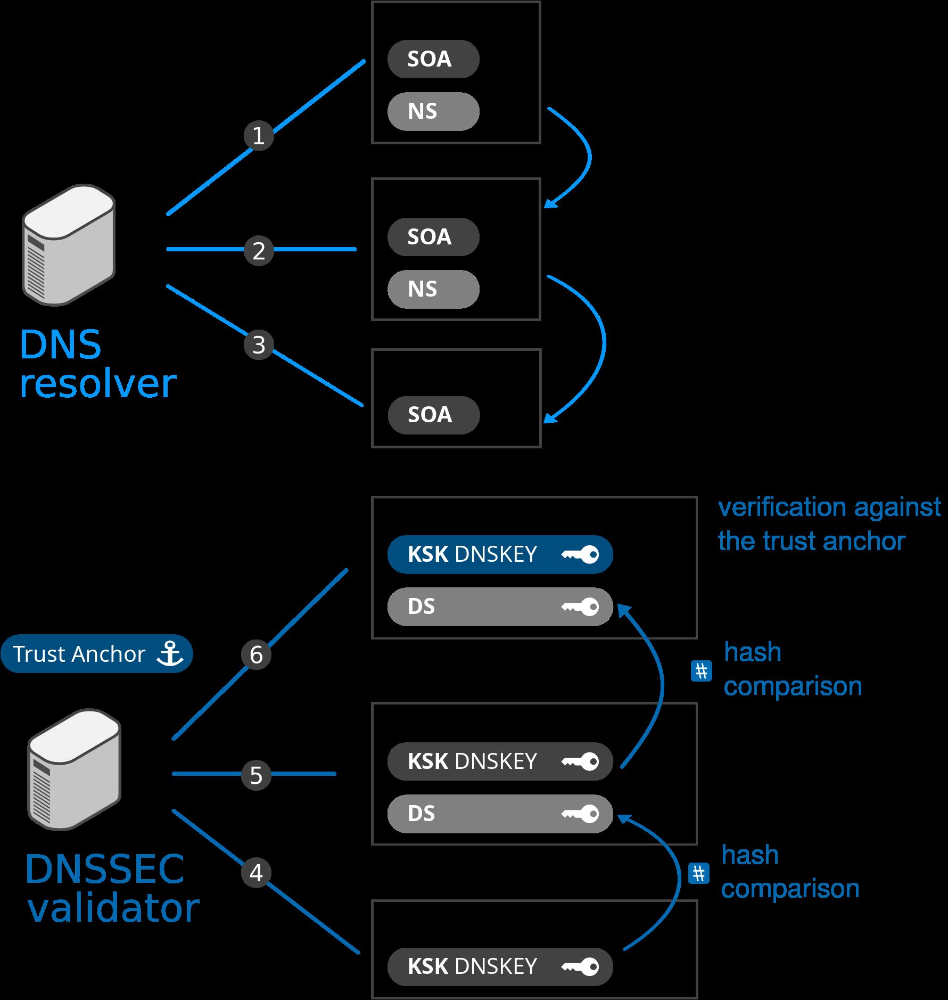
</div>
<style>
.slidev-layout.two-columns { grid-template-columns: 52% 48%; }
.slidev-layout.two-columns .col-right img { display: inline; max-width: 100%; }
</style>

---
layout: end
class: text-center
---

# Thank you

**Further reading:**
*Computer Security and the Internet: Tools and Jewels* — Paul C. van Oorschot (Springer, 2021)

[people.scs.carleton.ca/~paulv/toolsjewels.html](https://people.scs.carleton.ca/~paulv/toolsjewels.html)
