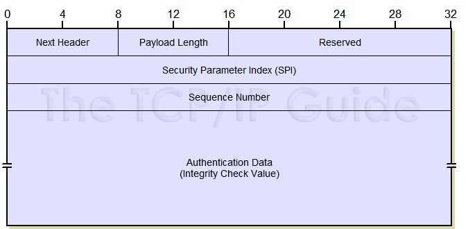
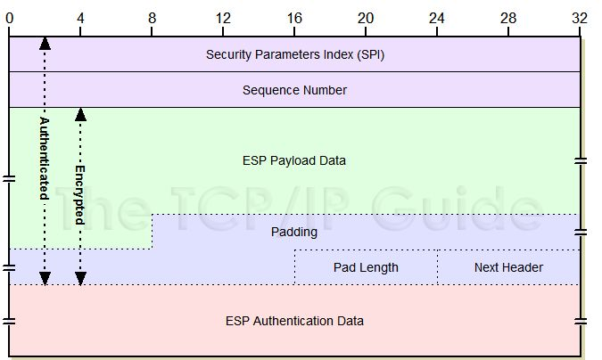
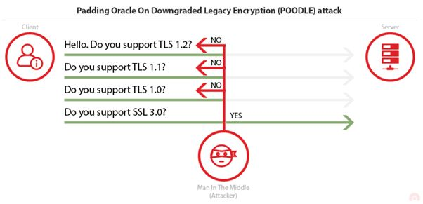
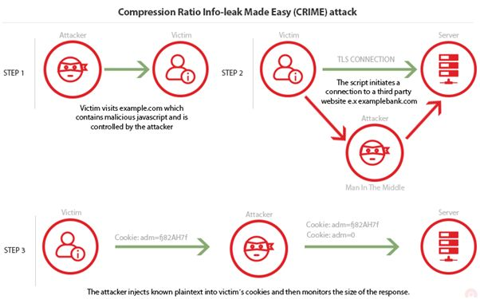
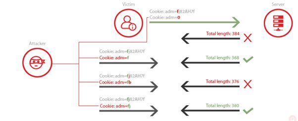
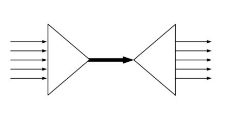
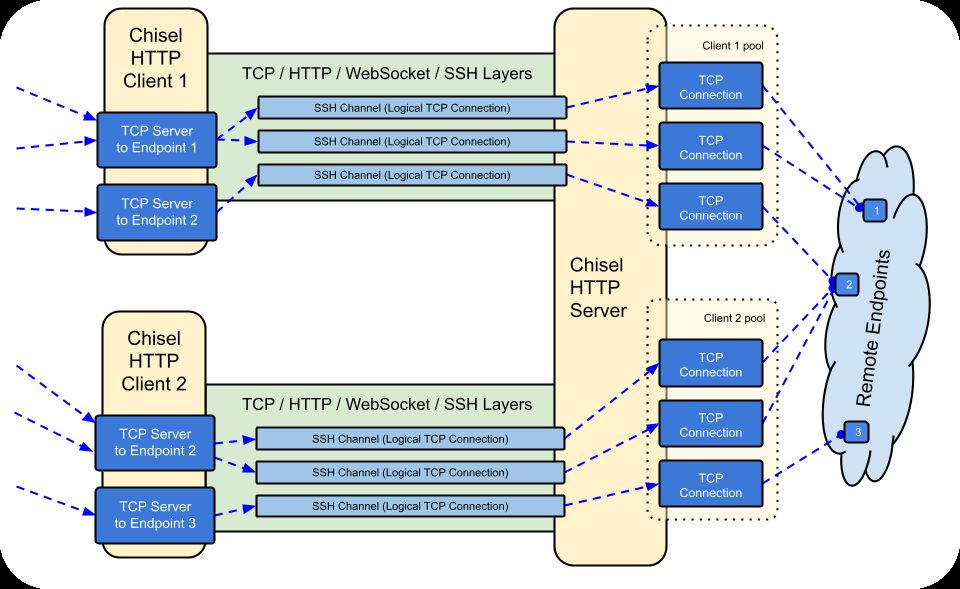
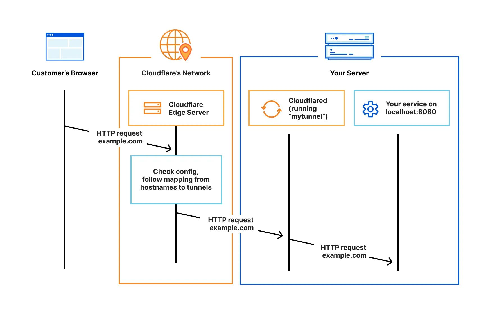

---
layout: cover
title: "Lecture 10: Remote Network Security, Tunnels"
subtitle: "IPSec, TLS/SSH, OpenVPN, WireGuard"
---

::default::

<!--
Welcome students; today: how to securely connect to remote networks.
-->

---

# Content

- IPSec
- TLS / SSH
- OpenVPN / WireGuard

---

# VPN topologies

**● Remote-access VPNs:**

- Remote users requiring access to a private network
- The VPN parameters are **dynamically negotiated**
- The tunnel can be established **only when required** (on-demand)

**● Site-to-site VPNs:**

- **Persistent** + remote connectivity between two (or more) networks
- Usually configured between two network devices (routers/firewalls)
- Each end of the tunnel acts as a **gateway** for its networks

::right::

# OSI layer encapsulation

- **L2** — L2TP
- **L3** — IPSec
- **L6-7** — TLS, SSH, OpenVPN, WireGuard etc.

---
layout: section
---

# IP Security (IPSec)

---

# IPSec RFCs

- IPSec is an **IETF standard**
- Collection of open standards that describe how to secure IP packets
- **RFC 4301** — Generic architecture
  - Defines **Security Associations (SAs)**, placeholders for **AH** and **ESP**
- **RFC 4302** — IP **AH** definition
- **RFC 4303** — IP **ESP** definition
- **RFC 7296** — Internet Key Exchange Protocol Version 2 (**IKEv2**)
- **RFC 4305 & RFC 4835** — Cryptographic algorithms

---

# IPSec architecture

- Relies on existing algorithms to provide:
  - Data **confidentiality & integrity**
  - **Authentication**
  - Secure **key exchange** (freshness, forward secrecy)
- Can be used **peer-2-peer** (transport) or **gateway-2-gateway** (tunnel)
- Zero Trust Networks

---

# IPSec — cryptographic blocks

- Algorithms that provide **confidentiality** (encryption):
  - Examples: DES, 3DES, AES, SEAL
- Algorithms that ensure **integrity**:
  - Examples: HMAC (MD5/SHA)
- …or both: **AES-GCM**, **ChaCha20-Poly1305** etc.
- Algorithms that define the **authentication** method:
  - Examples: pre-shared keys (PSK) or digitally signed using RSA
- The mechanism to securely communicate a **shared key**:
  - Several DH (Diffie-Hellman) groups / **ECDH**

---

# IPsec SA

- A **security association (SA)** is a set of policy and key(s) used to protect information
- Different SAs for **inbound** and **outbound** traffic
- A security association is uniquely identified by a tuple:
  - a **Security Parameter Index (SPI)**
  - an **IP Destination Address**
  - a security protocol (**AH** or **ESP**) identifier
- The tuple is stored in the **Security association database (SAD)**

---

# Packet processing — outbound

- When a packet **leaves** the node we have to decide if IPSec should be applied
- **Security Policy Database (SPD)** — set of rules defining what traffic should be processed by IPSec
- A Security Policy identifies the traffic using a **selector** (e.g. ACL), defines an **action** (e.g. protect with AH) and creates an **SPI** to link it

```
Application -> SPD -> Match Policy -> Locate/Create SA -> Apply IPsec -> Transmit
```

---

# Packet processing — inbound

- **SPI** = 32-bit value used to uniquely identify each SA
- SPIs are assigned to each SA during the IKE phase
- When a packet **arrives** we look in the header (AH or ESP) for the SPI and process the packet using the keys in the **SAD**
- !!! After decryption the packet is checked against the **SPD** to see if the policy is applied (e.g. ACL)

```
Receive Packet -> Check SPI in SAD -> Decrypt/Authenticate -> check SPD -> Forward/Drop
```

---
layout: two-cols
---

# IPSec AH

- **RFC 4302** — IP Authentication Header
- IP protocol field **51**
- Provides **IP header and data integrity and authentication**
- Some fields are **not** protected because they need to be changed in traffic (e.g. TOS, flags, frag offset, TTL, header checksum)
- Uses a **Message Authentication Code** for integrity
- **Not working with NAT/PAT**

::right::

<div class="flex flex-col items-center" style="text-align: center; gap: 0.4em;">

</div>
<style>
.slidev-layout.two-columns { grid-template-columns: 52% 48%; }
.slidev-layout.two-columns .col-right img { display: inline; max-width: 100%; }
</style>

---
layout: two-cols
---

# IPSec ESP

- **RFC 4303** — IP Encapsulating Security Payload
- IP protocol field **51**
- Provides **Data Confidentiality, Integrity, Authenticity or none**

::right::

<div class="flex flex-col items-center" style="text-align: center; gap: 0.4em;">

</div>
<style>
.slidev-layout.two-columns { grid-template-columns: 52% 48%; }
.slidev-layout.two-columns .col-right img { display: inline; max-width: 100%; }
</style>

---

# IPSec Tunnel vs Transport

- **Transport** mode is usually used between **2 hosts**
- **Tunnel** mode is usually the 'to go' solution between **gateways**

---

# IPSec mode storage

- **SPD** stores what mode to apply (transport vs tunnel)
- **SAD** stores how to apply the mode (crypto blocks to be used)

| Selector | Action | Mode | Protocol | Tunnel Endpoints |
| -------- | ------ | ---- | -------- | ---------------- |
| Src: 192.168.1.0/24 | PROTECT/ALLOW/DISCARD | Tunnel | ESP | Local: 1.168.1.1 |
| Dst: 10.0.0.0/24 | | | | Remote: 203.0.113.1 |

| SPI | Mode | Protocol | Encryption | Integrity | Local Endpoint | Remote Endpoint |
| --- | ---- | -------- | ---------- | --------- | -------------- | --------------- |
| 1232143242 | Tunnel | ESP | AES-256 + Key | MAC-SHA2-256 + Key | 1.168.1.1 | 203.0.113.1 |

---

# Internet Key Exchange v2 (IKEv2)

- Someone needs to provide keys to IPSec — **ISAKMP**
- Pre-shared keys, IKE, Kerberized Internet Key Exchange (**KINK**)
- **IKE:** negotiate, establish and manage SAs (
  - SA = peer IP + enc/auth parameters & keys!
  - Allows choosing of crypto blocks to be used (usually first round)
  - Provides keys to be used
  - Based on **ephemeral Diffie-Hellman** algorithms
- **Authenticate peers:**
  - Via **pre-shared keys (PSK)**, **digital certificates (RSA)** or **EAP**

---

# IKEv2 — two phases

- **Phase 1** = IKE SA (control channel)
  - **IKE\_SA\_INIT**
  - 2 modes of operation: **main** / **aggressive** mode
- **Phase 2** (over IKE\_SA) = IPSec SA → data channels
  - **IKE\_AUTH / IPSEC\_CHILD\_SA**
  - **Quick mode**
- Subsequent exchanges (using IKE\_SA):
  - **CREATE\_CHILD\_SA**
  - **INFORMATIONAL** for SA management (delete, update, etc.)

---

# IKEv2 — the conversation

<v-clicks>

- Hi, what crypto blocks can we use? *(IKE\_SA\_INIT)*
- What about this crypto blocks? *(IKE\_SA\_INIT)*
- Here are my DH A params *(IKE\_SA\_INIT)*
- Cool, here are mine DH B *(IKE\_SA\_INIT)*
- Here is a proof that I am Alice — {Alice} K' *(IKE\_AUTH)*
- Here is a proof that I am Bob — {Bob} K' *(IKE\_AUTH)*
- Here is what traffic I want to encrypt and how *(IPSEC\_CHILD\_SA)*
- Cool, let's generate a new key to encrypt that traffic *(IPSEC\_CHILD\_SA)*

</v-clicks>

---

# The NAT problem

- **AH** hashes the IP header and the TCP header and expects them to remain unaltered
- **NAT(PAT)** overwrites the layer 3 and 4 addresses and port numbers
- How do you solve this?
- Solution: **NAT-T** (NAT-Traversal or NAT-Transparency)
  - In IKE Phase 1, an **unencrypted but hashed** message is sent
  - At destination, if the hashes do not match, there is a **NAT router in between**
- NAT-T **encapsulates everything (including ESP) in an UDP header**
- There is also a **TCP variant** available when connection state tracking is required
  - E.g., if an IPS/IDS device is present

---

# L2F, PPTP, L2TP

- **Why Layer 2?**
  - To be in the same network / broadcast domain ofc (e.g., TVs / printers / sound systems / IoT devices)!
- **Cisco L2F + Microsoft PPTP** — encapsulate PPP packets
  - Proprietary, auth & encryption easily broken
- **L2TP** — no encryption, use with **IPsec**
  - Only PPP data frames!
- **L2TPv3** — able to encapsulate Ethernet etc.

---
layout: section
---

# TLS

---

# L7 secure tunnel: SSL / TLS

- Secure Socket Layer / Transport Layer Security
- Developed by **Netscape**, now an IETF RFC (**TLS Jan '99**)
- Used by most L7 protocols (HTTPS, SMTPS, IMAPS, databases etc.) — but **not SSH**!
- Protocol for using one or two public/private keys (optionals):
  - to authenticate a server to a client
  - and by requiring a client key to authenticate the client to the server
- Establish a **shared symmetric key** (the session key)
- Provides **authentication, message integrity and confidentiality**
- Target of numerous attacks [10] [11]

---

# TLS architecture

- Used to protect communication in a **client-server** scenario
- Layers of TLS:
  - **Record layer** — encrypts and hashes data
  - **Handshake layer** — chooses crypto blocks and authenticates peers
  - **Alert layer** — protocol management

---

# TLS handshake — the conversation

<v-clicks>

- Hi, what crypto blocks can we use? *(ClientHello)*
- What about this crypto blocks? *(ServerHello)*
- Let's create a key for encryption using DH *(Server Key Exchange)*
- Btw here is my certificate *(ServerCertificate)*
- OK, if you want I can also authenticate using a certificate *(Client Auth)*
- All good, let's encrypt *(Server & Client)*

</v-clicks>

---

# TLS Record layer

- Used to **fragment** data if required
- **Compression is now deprecated** due to the **CRIME** attack
- Uses negotiated algorithms to encrypt and hash data

---
layout: two-cols
---

# TLS downgrade attack

- **TLS 1.3** introduces a **downgrade sentinel value** (configurable by the client) that tells the server it should select TLS 1.3
- The sentinel value has to be protected using hashes

[acunetix.com — TLS vulnerabilities (final part)](https://www.acunetix.com/blog/articles/tls-vulnerabilities-attacks-final-part/)

::right::

<div class="flex flex-col items-center" style="text-align: center; gap: 0.4em;">

</div>
<style>
.slidev-layout.two-columns { grid-template-columns: 52% 48%; }
.slidev-layout.two-columns .col-right img { display: inline; max-width: 100%; }
</style>

---
layout: two-cols
---

# TLS CRIME attack

- **Compression Ratio Info-leak Made Easy**
- Compression algorithm replaces repeated byte sequences with a pointer to the first instance of that sequence (so the attacker adds **one character at a time**)

[acunetix.com](https://www.acunetix.com/blog/articles/tls-vulnerabilities-attacks-final-part/)

::right::

<div class="flex flex-col items-center" style="text-align: center; gap: 0.4em;">


</div>
<style>
.slidev-layout.two-columns { grid-template-columns: 52% 48%; }
.slidev-layout.two-columns .col-right img { display: inline; max-width: 100%; }
</style>

---
layout: section
---

# SSH

---
layout: two-cols
---

# SSH architecture

- Used for **secure remote access** + **SFTP** + ??
- Protocols:
  - **RFC 4251** — SSH Protocol Architecture
  - **RFC 4253** — SSH Transport Layer Protocol — **NOT TLS, has its own protocol!**
  - **RFC 4252** — SSH Authentication Protocol
  - **RFC 4254** — SSH Connection Protocol
    - Channel Multiplexing
    - Port forwarding, **SOCKS proxy**

::right::

<div class="flex flex-col items-center" style="text-align: center; gap: 0.4em;">

</div>
<style>
.slidev-layout.two-columns { grid-template-columns: 52% 48%; }
.slidev-layout.two-columns .col-right img { display: inline; max-width: 100%; }
</style>

---

# SSH — the conversation

<v-clicks>

- Hi, who are you? — to get the banner *(Transport Layer)*
- What about this crypto blocks? *(Transport Layer)*
- Here is my public key *(Transport Layer)*
- All good, let's use DH to create a key and a session ID *(Transport Layer)*
- Oh, btw I want to authenticate, how can I do that? *(User Authentication Protocol)*
- I can do passwords, keys, etc. *(User Authentication Protocol)*
- OK, let's do keys, here is my proof

</v-clicks>

---

# SSH — Connection Protocol

<v-clicks>

- Now that we have a secure channel, let's open a shell
- Done
- Execute this command
- Here is the result
- Cool, let's open a new channel
- Done
- Perfect, let's use this channel for **port forwarding**

</v-clicks>

---
layout: two-cols
---

# Chisel

**TCP/UDP tunnel, transported over HTTP, secured via SSH** :)

[ssh.com — SSH tunneling example](https://www.ssh.com/academy/ssh/tunneling-example)

::right::

<div class="flex flex-col items-center" style="text-align: center; gap: 0.4em;">

</div>
<style>
.slidev-layout.two-columns { grid-template-columns: 52% 48%; }
.slidev-layout.two-columns .col-right img { display: inline; max-width: 100%; }
</style>

---
layout: section
---

# Modern VPNs

---

# OpenVPN

- Easy to set up!
- Encapsulated at **L7**, uses **TLS** for encryption (OpenSSL)
- Authentication: pre-shared keys / user & password / certificates
- Server/admin generates embedded **.ovpn file** containing client key + certificate, client imports it!
- Mobile OS support (iOS + Android apps)
- May tunnel **L3 packets** or **L2 frames** (bridge tap)!

---

# WireGuard

- **NOISE** protocol framework
- Modern & fast cryptographic algorithms:
  - **Curve25519** for key exchange
  - **ChaCha20** for symmetric encryption (Daniel J. Bernstein)
  - **Poly1305** for message authentication codes (Bernstein++)
- Somewhat easy to setup for Linux enthusiasts :D
- Very popular, mobile (Android & iOS) support!
- Unfortunately, 'dinosaurs' (Cisco / Forti / PaloAlto) don't support it yet (maybe never …)
- Encapsulation protocol over **UDP**, **L3 tunneling** only :(

---

# Cloud-based tunnel services

- **Commercial VPNs** (NordVPN, ProtonVPN, ExpressVPN etc.)
  - privacy / bypassing geo-blocking
- **Cloud interconnection** for business networks
  - Connect servers in hybrid clouds
  - Google Cloud VPN, AWS VPN, Cloudflare Tunnel etc.
- **Ingress tunnels** (i.e., port forwarding)
  - Bypass NAT restrictions / hide IP / add firewall
  - Reverse SSH, Cloudflare Tunnel, ngrok, Pinggy.io etc.

---
layout: two-cols
---

# Example: Cloudflare

[Cloudflare One — connect networks](https://developers.cloudflare.com/cloudflare-one/connections/connect-networks/)

::right::

<div class="flex flex-col items-center" style="text-align: center; gap: 0.4em;">

</div>
<style>
.slidev-layout.two-columns { grid-template-columns: 52% 48%; }
.slidev-layout.two-columns .col-right img { display: inline; max-width: 100%; }
</style>

---
layout: end
class: text-center
---

# Thank you

**Further reading:**
*Computer Security and the Internet: Tools and Jewels* — Paul C. van Oorschot (Springer, 2021)

[people.scs.carleton.ca/~paulv/toolsjewels.html](https://people.scs.carleton.ca/~paulv/toolsjewels.html)
